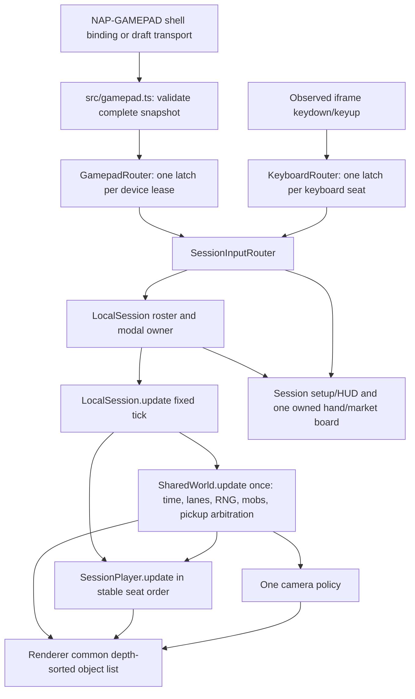

# Phase 2: Shared Local Session - Research

**Researched:** 2026-10-14
**Domain:** deterministic local shared-world simulation, shell-mediated controller input, and compact napplet session UI
**Confidence:** MEDIUM

<user_constraints>
## User Constraints (from CONTEXT.md)

### Locked Decisions

- Preserve solo's one-action start and current game aesthetic. No forced lobby
  for a single player. Local setup appears through explicit selection or a
  deliberate second-controller input, in either Arcade or Stroll.
- User requires game-like interfaces: large readable typography/controls,
  voxel character previews, tinted/obscured paused background, no website feel,
  no scrollbars. Small frames use multiple views rather than shrinking controls.
- Reuse bundled Lilita One and current wood/paper/green/gold materials; preserve
  the existing 240x240 minimum notice, theme integration and reduced motion.
- Four player seats are the working default; configuration is validated and
  representation should not depend on exactly four hard-coded elements.
- Every seat has a different character, a persistent number/name/marker and a
  separate device identity. Never rely on color alone.
- Defaults must support two players on one keyboard plus controllers. Include
  a real binding editor with visible current binding, capture, conflict/error,
  cancel and reset states. Native iframe keyboard input is allowed; no private
  shell rebinding protocol or native controller polling.
- Input should have independent latches and safe focus/context reset; the join
  press must not also trigger a hop, start, purchase or character action.
- Controller disconnect is delegated to the mode. Browser focus/visibility or
  too-small-frame remains a global safety pause.
- Existing market and persistent hand are reused with an explicit owner. Plan
  the affordance now, implement co-op inventory/market ownership in phase 3.
- Mode result/podium designs must eventually expose per-character outcomes,
  including equal team podium for co-op and true ties for Race, not invented
  competition. Full result behavior belongs to modes/phases 3–6.

### the agent's Discretion

No additional discretion section appears in `02-CONTEXT.md`.

### Deferred Ideas (OUT OF SCOPE)

Mode mechanics and results arrive in subsequent phases using this foundation.
</user_constraints>

<phase_requirements>
## Phase Requirements

| ID | Description | Research Support |
|----|-------------|------------------|
| ARCH-03 | Separate one shared advancing world from independent player state. | `SharedWorld` / `SessionPlayer` split and single fixed-tick order below. |
| INPUT-01 | Observe all exposed standard controllers and open Local Play from a second active controller. | Full-snapshot transport plus per-device router and consumed-join policy. |
| INPUT-02 | Give every local player stable seat/device identity and a unique character. | Roster leases, character reservation, and explicit ambiguous-reclaim handling. |
| INPUT-03 | Provide two shared-keyboard defaults and a working remap/reset editor. | App-owned keyboard router, SDK-registration suspension, storage-backed profile policy. |
| INPUT-04 | Keep simultaneous input, held repeats, focus loss, index reuse, and teardown safe. | Per-device latches, identity epochs, context seeding, and test matrix. |
| INPUT-05 | Let modes own controller loss/reconnect outcomes. | Session emits lifecycle events; it never chooses pause/ghost/skip/elimination. |
| INPUT-06 | Mix controllers and keyboard; retain fallback without native polling. | Existing draft adapter remains transport-only; keyboard/pointer work with no gamepad domain. |
| UI-01 | Provide game-styled setup, ready/join feedback, and controller/keyboard help. | One modal/session router, approved `02-UI-SPEC.md` responsive boards. |
| UI-02 | Render distinct identifiable characters and reserved per-player HUD state. | Common renderer object list, nameplates, 2×2/session HUD model, no fake future mechanics. |
</phase_requirements>

## Project Constraints (from AGENTS.md)

- Read `docs/context-map.md` and relevant boundary/design/package documents before product work. [VERIFIED: AGENTS.md]
- Keep napplet code on the iframe side: no shell implementation, signer/relay/cookie/service-worker/host-DOM access, direct network APIs, browser durable storage, or `@napplet/shim` import. [VERIFIED: AGENTS.md]
- Use SDK storage for durable state; use OUTBOX for normal Nostr work; only optional injected domains may be feature-detected. [VERIFIED: AGENTS.md]
- Preserve a compact, full-frame napplet with no masthead/footer, current responsive tiers, whole-surface runtime theming, and the 240×240 safety notice. [VERIFIED: AGENTS.md]
- Verify the four baseline commands before completion: `pnpm type-check`, `pnpm build`, `pnpm test:guidance`, and `pnpm test:conformance`; browser evidence must cover injected-domain behavior and optional-domain fallback. [VERIFIED: AGENTS.md]

## Summary

Build Phase 2 around a `LocalSession` that owns exactly one `SharedWorld` and an ordered roster of independent `SessionPlayer` records. The world owns rows, actor phases, world time, world RNG, retention, pickup claims, one mob director, and one camera target. A player owns movement interpolation, health/recovery, character power state, device lease, character identity, per-player statistics, and later inventory. This is the smallest split that preserves the existing `Game` facade for solo while preventing multiple calls to a shared mutable world's update. [VERIFIED: `.planning/codebase/ARCHITECTURE.md`; VERIFIED: codebase graph]

Treat Phase 1's planned `Game.definition` / `Game.rules` and trailing options API as provisional until its implementation summaries exist. Phase 2 must consume the resolved immutable definition once at session creation and must not reconstruct rule values, branch on a definition ID, or change released `arcade`/`stroll` seed identities. [VERIFIED: `01-02-PLAN.md`; VERIFIED: `01-03-PLAN.md]

The existing gamepad module already validates complete shell snapshots but intentionally selects one lowest-index pad. Keep that module as the NAP-GAMEPAD transport boundary; place a multi-device router above it. The official proposal remains a draft, so preserve the adapter and its fallback rather than introducing a package or a private wire protocol. [VERIFIED: `src/gamepad.ts`; CITED: https://github.com/napplet/naps/pull/108]

**Primary recommendation:** Introduce `LocalSession`, `SharedWorld`, `SessionPlayer`, `GamepadRouter`, and `KeyboardRouter`; retain `Game` as a one-player compatibility wrapper over those seams until solo-facing consumers are migrated safely.

## Architectural Responsibility Map

| Capability | Primary Tier | Secondary Tier | Rationale |
|------------|-------------|----------------|-----------|
| Fixed-step world time, lanes, actors, RNG, mobs, pickup claims | API / Backend (local deterministic model) | Browser / Client | Pure TypeScript model owns authority; the client only drives ticks and draws it. [VERIFIED: `src/game.ts`; VERIFIED: `src/main.ts] |
| Player movement, health, power, statistics, seat state | API / Backend (local deterministic model) | Browser / Client | Player state needs independent deterministic updates using shared actor samples. [VERIFIED: `.planning/codebase/ARCHITECTURE.md] |
| Gamepad snapshots and focus gating | Frontend Server (napplet shell boundary) | Browser / Client | Shell mediates the device stream; the napplet interprets delivered snapshots only. [CITED: https://github.com/napplet/naps/pull/108] |
| Split keyboard capture and binding editor | Browser / Client | Frontend Server (keys domain) | The iframe owns observed native key events and stored profile mappings; SDK keys actions remain optional global commands. [VERIFIED: installed `@napplet/sdk` 0.29.0 declarations] |
| Roster/setup, modal focus, hand/market owner | Browser / Client | API / Backend (local model) | UI renders model-owned seat/device state and routes actions through one modal owner. [VERIFIED: `src/main.ts`; VERIFIED: `src/market-ui.ts`; VERIFIED: `src/run-hand.ts] |
| Canvas scene, nameplates, camera, HUD | Browser / Client | API / Backend (local model) | One renderer consumes a world view and ordered player render models. [VERIFIED: `src/render.ts] |

## Standard Stack

### Core

| Library | Version | Purpose | Why Standard |
|---------|---------|---------|--------------|
| TypeScript | 5.9.3 | Deterministic model, input router, DOM UI | Existing project language and configured compiler. [VERIFIED: `package.json`] |
| `@napplet/sdk` | 0.29.0 | Optional storage, keys, theme, and existing runtime access | Existing SDK; its declarations export `keys.register` but no gamepad helper. [VERIFIED: installed `@napplet/sdk` 0.29.0 declarations] |
| Existing `src/gamepad.ts` bridge | project-local | Validated NAP-GAMEPAD-draft transport | Authorized bridge already handles the injected binding and exact draft messages. [VERIFIED: `docs/gamepad.md`; CITED: https://github.com/napplet/naps/pull/108] |
| DOM, Canvas 2D, CSS | browser built-ins | Setup/UI/HUD/world rendering | Existing framework-light architecture and approved Phase 2 UI contract. [VERIFIED: `02-UI-SPEC.md`; VERIFIED: `src/render.ts] |

### Supporting

| Library | Version | Purpose | When to Use |
|---------|---------|---------|-------------|
| Node test runner | Node 26.7.0 | Model/router tests | Deterministic session, keyboard, and controller-state tests. [VERIFIED: local environment; VERIFIED: `package.json`] |
| Playwright | 1.61.0 | Opaque-iframe input and responsive visual evidence | Built artifact only, with `--mute-audio`. [VERIFIED: local environment; VERIFIED: existing tests] |

### Alternatives Considered

| Instead of | Could Use | Tradeoff |
|------------|-----------|----------|
| One shared world plus player records | A `Game` instance per controller | Rejected: each `Game.update()` advances shared lanes, time, mobs, and pickups again. [VERIFIED: `.planning/codebase/ARCHITECTURE.md] |
| App-owned split keyboard while session is active | Re-registering altered `defaultKey` values in SDK keys | Rejected: `defaultKey` is only a shell suggestion; no set-binding/rebind API exists. [VERIFIED: installed `@napplet/sdk` 0.29.0 declarations; VERIFIED: `.planning/research/INPUT-UI.md] |
| Existing shell snapshot adapter | Native `navigator.getGamepads()` polling | Rejected by napplet boundary and draft isolation model. [VERIFIED: AGENTS.md; CITED: https://github.com/napplet/naps/pull/108] |

**Installation:** None. Phase 2 adds no dependency and must leave `pnpm-lock.yaml` unchanged. [VERIFIED: `02-UI-SPEC.md`; VERIFIED: `package.json`]

## Package Legitimacy Audit

Not applicable: Phase 2 installs no external package. [VERIFIED: `02-UI-SPEC.md]

## Architecture Patterns

### System Architecture Diagram



### Recommended Project Structure

```text
src/
├── session.ts              # LocalSession, roster, lifecycle event contracts
├── shared-world.ts         # SharedWorld and once-per-tick world operations
├── session-player.ts       # Independent movement/health/power/stat state
├── session-input.ts        # Modal owner and device-to-seat dispatch policy
├── gamepad.ts              # Transport/parser only; no device-selection policy
├── keyboard-input.ts       # App-owned split keyboard and capture state
├── session-ui.ts           # Setup, binding editor, roster/HUD DOM controller
├── render.ts               # Solo wrapper plus common session object submission
└── main.ts                 # Mode switch, one frame loop, global safety pause
```

### Pattern 1: Preserve the solo facade while extracting shared world state

**What:** Make `Game` a compatibility facade containing one `SharedWorld` and one `SessionPlayer`, or introduce a small adapter with the existing public fields/getters delegated to those objects. Existing construction, `Game.fromSeed`, constants, callbacks, and `Renderer.draw(game, character, dt)` stay valid. [VERIFIED: `01-02-PLAN.md`; VERIFIED: `src/game.ts`; VERIFIED: `src/render.ts]

**When to use:** First extraction task, before wiring a second player or any new UI.

**Required update order:**

1. `LocalSession` gates state and captures one `previousWorldTime` and each player's previous ground sample.
2. `SharedWorld` advances its run-level real-time policy, rebases lane speeds, advances world time once, updates retention/row generation from a deterministic session progress policy, and advances the wave/fog policy once.
3. Every active player decrements personal real-time clocks, completes rescue/hop movement, resolves vehicle/river/trail/wave hazards against the same world time window, and records candidate pickup contact.
4. `SharedWorld.resolvePickups()` awards each pickup once, using collision time then distance then stable seat order as a deterministic tie-breaker.
5. `SharedWorld` updates the mob population once and applies resolved impacts to the targeted/struck player records in stable seat order.
6. Lifecycle events are delivered after state changes; renderer/HUD observe only the completed tick. [VERIFIED: `.planning/codebase/ARCHITECTURE.md`; VERIFIED: `src/game.ts]

```ts
// Proposed Phase 2 seam; names are prescriptive, exact Phase 1 rule fields are provisional.
// Source basis: src/game.ts update ordering and Phase 1 plans.
class LocalSession {
  constructor(readonly world: SharedWorld, readonly players: SessionPlayer[]) {}
  update(realDt: number): void {
    const frame = this.world.beginTick(realDt, this.players);
    const claims = this.players
      .filter(player => player.participates)
      .map(player => player.update(frame));
    this.world.resolvePickups(claims, this.players);
    this.world.updateMobsOnce(frame, this.players);
    this.emitLifecycleAfterTick();
  }
}
```

### Pattern 2: Full snapshots below a per-device router

**What:** Change the existing adapter's consumer from one `GamepadInput` selection policy to `onSnapshot(state, now)`. `GamepadRouter` keeps a device lease and `DeviceInput` latch/repeat/context state for every standard connected pad, routes only fresh actions, and seeds current held values on every context, focus, reconnect, or identity change. [VERIFIED: `src/gamepad.ts`; CITED: https://github.com/napplet/naps/pull/108]

**When to use:** All Local Play setup and live-session controller input. The transport remains responsible for parsing bounds, parent-source validation, subscribe/unsubscribe, and no-domain fallback only. [VERIFIED: `src/gamepad.ts]

**Device lease rules:**

- Use a session lease keyed by current `index` plus sanitized `id`; the seat ID remains stable while the lease is live. [VERIFIED: `GamepadSnapshot` fields in `src/gamepad.ts`]
- A missing prior index emits one `device-disconnected` event and clears that device's latches; it does not pause the world. [VERIFIED: `02-CONTEXT.md]
- A new device at a former index with a different `id` emits disconnect before `device-seen`; it must never inherit the former seat. [VERIFIED: `GamepadSnapshot` fields in `src/gamepad.ts]
- A same-index/same-id return may be offered as a reclaim and must be seeded, so an already-held button is never fresh. Identical physical controllers cannot be distinguished beyond the draft snapshot fields; keep the slot in reclaim state when policy needs certainty. [CITED: https://github.com/napplet/naps/pull/108]
- Only deliberate fresh button/stick activity on an unassigned device can request join; consume it before the device receives modal or player dispatch. [VERIFIED: `02-CONTEXT.md]

### Pattern 3: App-owned shared keyboard with explicit shell-shortcut arbitration

**What:** Treat split keyboard control as a local iframe input profile, not a shell remap. Persist profile mappings through `storage`; capture real `keydown`/`keyup` events on the napplet document in capture phase; track pressed keys and per-seat repeat timers independently; clear latches on blur, visibility loss, resize safety pause, capture entry/exit, modal change, and session teardown. [VERIFIED: AGENTS.md; VERIFIED: `src/main.ts`; VERIFIED: `02-UI-SPEC.md]

**The mandatory overlap policy:** Current boot code registers Arrow keys and WASD movement plus Q call with the optional shell keys domain. While a split-keyboard session is active, close/unregister exactly those gameplay and call registrations via their existing `keys.register()` handles before accepting keyboard seats. The installed SDK confirms `close()` removes both the action listener and `unregisterAction()` registration. Keep global menu registrations (`Enter`, `P`, `M`, `Escape`) only if they do not overlap an active profile; reserve those keys from capture. Re-register the normal solo movement/call actions only after all local latches are cleared when the session ends. [VERIFIED: `src/main.ts`; VERIFIED: installed `@napplet/sdk` 0.29.0 implementation]

**Availability policy:** Do not mark Keyboard A/B ready merely because defaults or saved mappings exist. After the gameplay registrations are closed, require an observed supported native key event in the iframe for each activated profile. If a shell still withholds the event, keep that profile unavailable, explain that keyboard forwarding is unavailable in this shell, and leave pointer/controller entry usable. This is the only honest response because the SDK exposes no rebind/set-binding/key-up API and native event delivery cannot be assumed. [VERIFIED: installed `@napplet/sdk` 0.29.0 declarations; VERIFIED: `.planning/research/INPUT-UI.md]

**Dispatch policy:** In a text/select control, let native editing win except the explicit binding-capture control. In capture mode, consume the first supported non-reserved key, validate conflict before writing storage, clear every latch, and suppress its gameplay/menu effect. During live input, consume only a key uniquely bound to an active keyboard seat; unbound keys retain normal browser behavior. [VERIFIED: `02-UI-SPEC.md]

### Pattern 4: One modal owner, one market/hand tree

**What:** Add a `modalOwnerSeatId` to the session UI router. It determines whose roster details/character selection/binding page is displayed and names the active owner in every market/hand toolbar. It is not a second game camera or a duplicate menu DOM. When it changes, close the hand/market detail, clear selection/draft/target references, seed every input latch, and focus the new owner heading. [VERIFIED: `02-UI-SPEC.md`; VERIFIED: `src/market-ui.ts`; VERIFIED: `src/run-hand.ts]

**Phase boundary:** Phase 2 displays `Viewing Pn · Character` and reserves an owner selector contract, but retains the current one-run market/hand behavior. Phase 3 replaces that run accessor with mode-authorized per-player inventory/wallet access; Phase 2 must not manufacture a co-op wallet, purchase, item, or revival state. [VERIFIED: `02-CONTEXT.md; VERIFIED: `02-UI-SPEC.md]

### Pattern 5: Common render list and one camera

**What:** Keep `Renderer.draw(game, character, dt)` as a solo wrapper and add a session entry point accepting `WorldRenderView`, `readonly PlayerRenderModel[]`, and one `CameraPolicy` target. Submit terrain, actors, rewards, mobs, player voxel models, and player nameplates into the common depth-sorted list. Draw nameplates as clipped screen overlays after their actor's depth pass, hiding them only when the actor is offscreen. [VERIFIED: `src/render.ts`; VERIFIED: `02-UI-SPEC.md]

**Camera:** Camera policy is world-owned and chooses the furthest active player's interpolated progress with stable seat tie-break; it smooths once per frame. Do not render/calculate a camera per player. Future Race can substitute its rule-defined camera/fog policy without changing the renderer's player list. [ASSUMED]

### Explicit shared-effect, mob, and pickup policies

| Concern | Phase 2 policy | Why |
|---------|----------------|-----|
| Live lane/card effects | Shared lanes read only the resolved immutable world definition; Phase 2 does not let any seat purchase/apply a card that mutates lane speed, spacing, terrain, or world effect. | Last-player-wins mutation would make one course nondeterministic. [VERIFIED: `.planning/codebase/ARCHITECTURE.md] |
| Mobs | One `MobDirector` advances once. Its target selection is an explicit session policy: nearest eligible active player, ties by seat ID; each swept mob collision is evaluated against all eligible players in stable seat order. | Current director targets a single `Game`, so copying it per player would multiply spawns and RNG. [VERIFIED: `src/mobs.ts`; ASSUMED] |
| Coins/pickups | The world owns unclaimed pickup state and resolves all same-tick claims exactly once by collision time, distance, then seat ID. The recipient is the resolved player record. | Current lane coin state is shared mutable state, and later consumables need deterministic contest resolution. [VERIFIED: `src/game.ts`; VERIFIED: REQUIREMENTS.md] |
| Camera/retention | World progress/retention uses the maximum active player progress, tie by seat ID; all players draw in that world. | A per-player retention map would generate/prune one course differently for each player. [ASSUMED] |
| Market/hand | One displayed board has `modalOwnerSeatId`; actual authorized inventory ownership remains Phase 3. | Avoids duplicated DOM and false multiplayer economy. [VERIFIED: `02-CONTEXT.md; VERIFIED: `02-UI-SPEC.md] |

### Roster entry policy by mode phase

| Situation | Phase 2 foundation behavior | Later consumer |
|-----------|-----------------------------|----------------|
| Solo Arcade/Stroll | Explicit `Local Play` remains optional; a second controller's fresh activity opens setup and is consumed. | No forced lobby. [VERIFIED: `02-CONTEXT.md] |
| Survive Together | Expose `quickJoin(device)` that selects the lowest free seat and first unlocked unused character, then asks the mode whether a safe live spawn is allowed. | Phase 3 owns actual drop-in/spawn/inventory continuity. [VERIFIED: REQUIREMENTS.md; ASSUMED] |
| Relay | Setup builds ordered seats; after start, `allowJoin` is false and only matching-seat reclaim reaches the mode. | Phase 4 owns handoff/dropout semantics. [VERIFIED: REQUIREMENTS.md] |
| Race | Setup builds a locked roster; after start, fresh devices cannot join and only explicit reclaim is forwarded. | Phase 5 owns results, fog, and dropout policy. [VERIFIED: REQUIREMENTS.md] |

### Anti-Patterns to Avoid

- **Multiple full `Game.update()` calls:** Never call it once per player over shared lanes; it advances world time, actor positions, lane rebasing, mobs, and pickup state multiple times. [VERIFIED: `.planning/codebase/ARCHITECTURE.md]
- **One controller selected by lowest index:** Replace only the selection policy, not the validated transport, or the second controller can never join. [VERIFIED: `src/gamepad.ts]
- **Native-keyboard optimism:** Do not call profile defaults “working” until the iframe receives an actual key event after colliding shell actions are closed. [VERIFIED: installed `@napplet/sdk` 0.29.0 declarations]
- **Hidden duplicate dispatch:** Do not retain shell directional/call registrations while routing the same physical keys locally. [VERIFIED: `src/main.ts`; VERIFIED: installed `@napplet/sdk` 0.29.0 implementation]
- **Mode decisions in device transport:** The transport reports snapshots; session/mode code decides disconnect, rejoin, and join policy. [VERIFIED: `02-CONTEXT.md]
- **Four literal UI branches:** Render capacity-derived seat cards/chips/pages and use stable generated IDs. [VERIFIED: `02-CONTEXT.md]

## Don't Hand-Roll

| Problem | Don't Build | Use Instead | Why |
|---------|-------------|-------------|-----|
| Shell controller discovery/focus/permission | Native browser Gamepad API or a custom postMessage contract | Existing authorized NAP-GAMEPAD adapter | Preserves shell focus isolation, snapshot validation, and exact draft transport. [VERIFIED: AGENTS.md; CITED: https://github.com/napplet/naps/pull/108] |
| Durable keyboard profiles | `localStorage` / `sessionStorage` | Optional SDK storage with unavailable-state fallback | Required sandbox boundary and existing persistence pattern. [VERIFIED: AGENTS.md; VERIFIED: `src/main.ts] |
| Key rebinding in host shell | Invented NAP messages or a fake `setBinding` method | App-owned native-event mapping, or displayed actual shell binding for global actions | Installed SDK has registration only, not a rebind API. [VERIFIED: installed `@napplet/sdk` 0.29.0 declarations] |
| Player model/camera renderer | Separate canvas per player | Existing renderer with common depth-sorted render submissions | Shared terrain must be drawn and clocked once. [VERIFIED: `src/render.ts`; VERIFIED: `.planning/codebase/ARCHITECTURE.md] |
| Roster/mode lifecycle framework | A generic ECS/state-machine dependency | Typed local session/lifecycle interfaces | Existing project has no framework dependency and needs a narrow deterministic seam. [VERIFIED: `package.json`; VERIFIED: `02-UI-SPEC.md] |

## Runtime State Inventory

| Category | Items Found | Action Required |
|----------|-------------|-----------------|
| Stored data | The only production durable key found is `puddlehop.progress.v1`; it stores solo progress/preferences, not a session roster or bindings. [VERIFIED: `src/main.ts`] | Add versioned session-keyboard profile storage only after validation; keep host solo traveler preference separate. This is a code edit plus new data shape, not a migration of existing records. |
| Live service config | None found: this napplet has no backend/service configuration for sessions or gamepads. [VERIFIED: `AGENTS.md`; VERIFIED: repository search] | None. |
| OS-registered state | None found: no launchd/systemd/Task Scheduler/PM2 registration is present in tracked files. [VERIFIED: repository search] | None. |
| Secrets/env vars | No session/gamepad secret or environment key exists; current `import.meta.env.DEV` is build-mode only. [VERIFIED: `src/main.ts`; VERIFIED: repository search] | None. |
| Build artifacts | Ignored `dist/` and `artifacts/` exist locally and are regenerated by build/browser evidence. [VERIFIED: `.gitignore`; VERIFIED: local filesystem] | Rebuild; do not hand-edit or commit generated artifacts. |

## Common Pitfalls

### Pitfall 1: World tick multiplies with seats
**What goes wrong:** Cars, logs, trains, wave, world time, generation, and mobs run N times per fixed frame.
**Why it happens:** Existing `Game.update()` combines world and one player.
**How to avoid:** Make `SharedWorld` the sole owner of mutable shared state and assert its tick counter increments once for two simultaneous moves.
**Warning signs:** Two seats make actors travel twice as fast, pickup candidates disappear, or mob RNG diverges. [VERIFIED: `src/game.ts`; VERIFIED: `.planning/codebase/ARCHITECTURE.md]

### Pitfall 2: Device index reuse inherits held state
**What goes wrong:** A replacement device moves or confirms immediately, or silently takes a disconnected player's seat.
**Why it happens:** Index is a slot, not a durable device identity, and current input only tracks one selected pad.
**How to avoid:** Lease by index plus id, emit old disconnect first, clear/reseed latches, and require a fresh deliberate action for a new lease.
**Warning signs:** A pressed A button joins/hops after reconnect or Pn changes controller without UI state. [VERIFIED: `src/gamepad.ts`; CITED: https://github.com/napplet/naps/pull/108]

### Pitfall 3: Shell and native keyboard dispatch twice
**What goes wrong:** One W/Arrow/Q input becomes both an SDK action and a local-seat action.
**Why it happens:** `main.ts` currently registers the same defaults with `keys.register`, while a native listener would see the key only in some shells.
**How to avoid:** Close directional/call action handles before local profile activation; route a key through exactly one active router; restore registrations after latches clear.
**Warning signs:** One press hops two tiles, a capture action moves a player, or keyboard works in fixture but not target shell. [VERIFIED: `src/main.ts`; VERIFIED: installed `@napplet/sdk` 0.29.0 implementation]

### Pitfall 4: Global frame safety is confused with controller loss
**What goes wrong:** One controller disconnect pauses everyone, or blur/hidden state leaves held controls active.
**Why it happens:** Current `onConnection(false)` calls `suspendPlay()`.
**How to avoid:** Keep blur/visibility/undersize as global pause/latch-clear; translate per-device connection transitions to lifecycle events only.
**Warning signs:** All seats pause when P2 unplugs, or hidden-frame resume produces a hop. [VERIFIED: `src/main.ts`; VERIFIED: `02-CONTEXT.md]

### Pitfall 5: Profile hydration mutates session characters
**What goes wrong:** Async solo progress hydration calls `readyPreview()` and overwrites a seat's selected traveler.
**Why it happens:** Current preview applies `progress.selected` directly to the `Game` character.
**How to avoid:** Session character reservations are session-owned and never read/write host profile selection; hydrate only the solo preview outside an active session.
**Warning signs:** A guest changes character after storage resolves. [VERIFIED: `src/main.ts`; VERIFIED: `.planning/research/INPUT-UI.md]

## Code Examples

### Device router boundary

```ts
// Source basis: src/gamepad.ts complete snapshots; exact names are Phase 2 design.
function receiveSnapshot(state: GamepadState, now: number): void {
  for (const pad of standardPads(state)) router.upsert(pad, now);
  router.disconnectAbsent(state.pads, now);
  if (!state.focused) router.seedAll();
}
```

### Keyboard/session transition

```ts
// Source basis: @napplet/sdk keys.register close() implementation.
async function activateSharedKeyboard(): Promise<void> {
  closeSoloGameplayAndCallBindings(); // unregisters Arrow/WASD/Q actions
  keyboardRouter.attach(document);
  keyboardRouter.clearLatches();
  // Mark a profile ready only after an observed supported iframe key event.
}
```

### Renderer compatibility wrapper

```ts
// Source basis: Renderer.draw(game, character, dt) in src/render.ts.
draw(game: Game, character: string, dt: number): void {
  this.drawSession(asSoloWorldView(game), [asSoloPlayerView(game, character)], dt);
}
```

## State of the Art

| Old Approach | Current Approach | When Changed | Impact |
|--------------|------------------|--------------|--------|
| One lowest-index selected controller and one action sink | Full shell snapshot transport plus a Phase 2 per-device policy router | Phase 2 | Supports local seats without changing the shell contract. [VERIFIED: `src/gamepad.ts`; CITED: https://github.com/napplet/naps/pull/108] |
| `Game` combines world and player | Shared world plus independently updated player records behind a solo facade | Phase 2 | Prevents duplicate world advancement while retaining compatibility. [VERIFIED: `.planning/codebase/ARCHITECTURE.md] |

**Deprecated/outdated:** `docs/gamepad.md` says the installed SDK is 0.24.4; the installed package is 0.29.0 and still has no gamepad export. Update the documentation as part of the Phase 2 adapter work. [VERIFIED: `docs/gamepad.md`; VERIFIED: installed `@napplet/sdk` 0.29.0 declarations]

## Assumptions Log

| # | Claim | Section | Risk if Wrong |
|---|-------|---------|---------------|
| A1 | Furthest active-player progress, tied by seat ID, is the appropriate default world retention/camera policy. | Architecture Patterns / effect policy | Future mode may require an alternate policy sooner than anticipated. |
| A2 | A shared mob can deterministically target nearest eligible player and evaluate impacts against all eligible players. | Explicit policies | Phase 3 may need a different cooperative target/aggression contract. |
| A3 | Phase 3 quick join should choose lowest open seat and first unlocked unused character before asking the mode for safe spawn. | Roster entry policy | Product may prefer an explicit selection even for live co-op. |

## Open Questions

1. **What exact Phase 1 type and construction signature shipped?**
   - What we know: plans promise immutable `Game.definition` / `Game.rules`, presets, a trailing options object, and preserved positional construction.
   - What's unclear: exact exported names/field nesting until `01-02-SUMMARY.md` and `01-03-SUMMARY.md` exist.
   - Recommendation: begin Phase 2 with a contract-read task against the completed summaries and source; change only the adapter names, never duplicate/normalize rule configuration.
2. **How should the first shared-world mode settle a player death before Survive Together exists?**
   - What we know: Phase 2 owns foundation/UI while survival/death/revival behavior belongs to Phase 3.
   - What's unclear: whether the Phase 2 demo session allows only setup/controlled movement or needs a temporary mode lifecycle.
   - Recommendation: make session emit `player-death` and display reserved state; let Phase 3 install the actual co-op lifecycle instead of inventing a universal game-over rule.
3. **Will the target shell forward native iframe keyboard events after movement/call registrations are closed?**
   - What we know: local SDK types support register/unregister, not rebinding; no native-event delivery guarantee exists.
   - What's unclear: target-shell behavior.
   - Recommendation: add the required built-fixture case and retain an explicit unavailable keyboard profile state; do not claim unsupported shell remapping.

## Environment Availability

| Dependency | Required By | Available | Version | Fallback |
|------------|-------------|-----------|---------|----------|
| Node.js | model/router tests | ✓ | 26.7.0 | — [VERIFIED: local environment] |
| pnpm | build/type checks | ✓ | 10.8.0 | — [VERIFIED: local environment] |
| Playwright Chromium | opaque iframe/layout evidence | ✓ | Playwright 1.61.0 | Node-only model tests while browser evidence is unavailable. [VERIFIED: local environment] |
| SDK storage/keys | profile persistence and optional shortcuts | package present; runtime optional | `@napplet/sdk` 0.29.0 | In-memory session profile and on-screen/pointer controls when domain absent. [VERIFIED: `package.json`; VERIFIED: installed declarations] |
| NAP-GAMEPAD shell support | controller sessions | optional/draft | no SDK export | Keyboard/pointer remain usable; fixtures test both supported draft paths. [VERIFIED: `src/gamepad.ts`; CITED: https://github.com/napplet/naps/pull/108] |

**Missing dependencies with no fallback:** None for planning/implementation.

**Missing dependencies with fallback:** A real shell that exposes NAP-GAMEPAD; use the existing opaque-iframe draft fixture and report physical-controller validation separately. [VERIFIED: `docs/gamepad.md]

## Validation Architecture

### Test Framework

| Property | Value |
|----------|-------|
| Framework | Node built-in test runner plus Playwright 1.61.0 [VERIFIED: `package.json`; VERIFIED: local environment] |
| Config file | none — direct scripts in `package.json` [VERIFIED: `package.json`] |
| Quick run command | `node --test tests/local-session.test.mjs tests/session-input.test.mjs tests/gamepad.test.mjs` |
| Full suite command | `pnpm type-check && pnpm build && pnpm test:guidance && pnpm test:conformance` |

### Phase Requirements → Test Map

| Req ID | Behavior | Test Type | Automated Command | File Exists? |
|--------|----------|-----------|-------------------|-------------|
| ARCH-03 | Two players move independently while one world clock/actor timeline/RNG/pickup record advances once. | model/integration | `node --test tests/local-session.test.mjs` | ❌ Wave 0 |
| INPUT-01 | Second fresh standard-pad action opens setup and is consumed; idle pads do nothing. | unit/runtime | `node --test tests/session-input.test.mjs && pnpm build && node tests/local-session-runtime.mjs` | ❌ Wave 0 |
| INPUT-02 | Seat/device lease, character reservation, capacity, and reclaim ambiguity. | unit | `node --test tests/session-input.test.mjs` | ❌ Wave 0 |
| INPUT-03 | Keyboard A/B defaults, native-event probe, capture/conflict/cancel/reset, storage error. | unit/runtime | `node --test tests/keyboard-input.test.mjs && pnpm build && node tests/local-session-runtime.mjs` | ❌ Wave 0 |
| INPUT-04 | Simultaneous movement, held repeats, blur/context reset, malformed snapshots, index reuse, teardown. | unit/runtime | `node --test tests/session-input.test.mjs tests/keyboard-input.test.mjs tests/gamepad.test.mjs` | ❌ Wave 0 |
| INPUT-05 | Disconnect/reclaim emits lifecycle records without a global device-loss pause. | model/runtime | `node --test tests/local-session.test.mjs && pnpm build && node tests/local-session-runtime.mjs` | ❌ Wave 0 |
| INPUT-06 | No gamepad domain leaves keyboard/pointer path functional and emits no probe. | runtime | `pnpm build && node tests/local-session-runtime.mjs` | ❌ Wave 0 |
| UI-01 | Setup/binding board has focus-safe page changes and no action leakage. | layout/runtime | `pnpm build && node tests/local-session-layout.mjs` | ❌ Wave 0 |
| UI-02 | Common render list draws two models/nameplates once per world; HUD contracts survive frame tiers. | render/layout | `node --test tests/session-render.test.mjs && pnpm build && node tests/local-session-layout.mjs` | ❌ Wave 0 |

### Mandatory scenario detail

- Test one fixed frame with two controller directions: both player positions change, `world.time`, row generation, mob tick, and actor sample each advance exactly once. [VERIFIED: ARCH-03 requirement]
- Test focus/visibility, modal ownership changes, capture start/end, malformed snapshots, disconnect/reconnect, and controller index reuse with held buttons; each must seed/release latches and produce no movement/confirm leak. [VERIFIED: INPUT-04 requirement]
- Test native keyboard routing in a fixture that suppresses Arrow/WASD/Q while their shell actions are registered, then delivers them after `close()` unregisters gameplay bindings; assert exactly one local dispatch and that global menu actions remain shell-owned. [VERIFIED: `src/main.ts`; VERIFIED: installed `@napplet/sdk` 0.29.0 implementation]
- Run all browser tests with Chromium `--mute-audio`; do not run the existing unmuted gamepad browser script until Phase 2 adds its mute flag. [VERIFIED: `.planning/research/INPUT-UI.md`; VERIFIED: `tests/gamepad-runtime.mjs]
- Record screenshots at 200×160, 240×240, 320×560, 900×600, 1000×280, and 2400×1200 in both themes for setup, capture/conflict, four ready seats, live HUD, and disconnected seat. [VERIFIED: `02-UI-SPEC.md]

### Sampling Rate

- **Per task commit:** `node --test tests/local-session.test.mjs tests/session-input.test.mjs tests/keyboard-input.test.mjs`
- **Per wave merge:** `pnpm type-check && pnpm build && pnpm test:gamepad`
- **Phase gate:** `pnpm type-check && pnpm build && pnpm test:guidance && pnpm test:conformance`, plus focused built-artifact runtime/layout commands and continuing `pnpm test:solo-parity`.

### Wave 0 Gaps

- [ ] `tests/local-session.test.mjs` — shared world/player split, one tick, once-only effects/pickups/mobs.
- [ ] `tests/session-input.test.mjs` — controller leases, join consumption, lifecycle and modal routing.
- [ ] `tests/keyboard-input.test.mjs` — native profile latches, conflict/capture/reset, shell overlap policy.
- [ ] `tests/session-render.test.mjs` — common object list, player models/nameplates, single camera.
- [ ] `tests/local-session-runtime.mjs` — muted opaque-iframe snapshot/native-keyboard/no-gamepad flows.
- [ ] `tests/local-session-layout.mjs` — required frame/theme/target/no-scroll visual matrix.

## Security Domain

### Applicable ASVS Categories

| ASVS Category | Applies | Standard Control |
|---------------|---------|-----------------|
| V2 Authentication | no | No user authentication is introduced. [VERIFIED: phase scope] |
| V3 Session Management | yes | Local in-memory session IDs and device leases; clear all input state on teardown. [ASSUMED] |
| V4 Access Control | yes | Shell remains the authority for focus/device access; mode handler authorizes roster transition. [CITED: https://github.com/napplet/naps/pull/108] |
| V5 Input Validation | yes | Reuse bounded snapshot parser; validate key profiles, character uniqueness, capacity, and all mode lifecycle inputs. [VERIFIED: `src/gamepad.ts`; VERIFIED: `02-UI-SPEC.md] |
| V6 Cryptography | no | No cryptography or secret material is introduced. [VERIFIED: phase scope] |

### Known Threat Patterns for this stack

| Pattern | STRIDE | Standard Mitigation |
|---------|--------|---------------------|
| Malformed/spoofed controller payload retains stuck input | Tampering / DoS | Preserve bounded parser, parent-source check, full-snapshot replacement, and clear latches on rejection. [VERIFIED: `src/gamepad.ts] |
| Device-index reuse impersonates a prior seat | Spoofing | Lease by index/id, disconnect before replacement, explicit reclaim state for ambiguity. [ASSUMED] |
| Captured key drives a game action | Tampering | Capture-phase consumption, reserved globals, validation before persistence, and global latch reset. [VERIFIED: `02-UI-SPEC.md] |
| Session profile leaks outside napplet scope | Information Disclosure | Use SDK storage only; no browser storage or network. [VERIFIED: AGENTS.md] |
| Multiple controllers mutate menu/market state | Elevation of Privilege | One modal owner and a central router; device actions are reseeded when ownership/context changes. [VERIFIED: `02-UI-SPEC.md] |

## Sources

### Primary (HIGH confidence)

- Project source and graph: `src/game.ts`, `src/gamepad.ts`, `src/main.ts`, `src/render.ts`, `src/mobs.ts`, `src/market-ui.ts`, and `src/run-hand.ts` — current seams and call boundaries. [VERIFIED: codebase graph and source]
- `02-CONTEXT.md`, `02-UI-SPEC.md`, `REQUIREMENTS.md`, `USER-REQUEST.md`, `ARCHITECTURE.md`, `INPUT-UI.md`, and `SOLO-PARITY.md` — locked phase scope and compatibility constraints. [VERIFIED: planning documents]
- Installed `@napplet/sdk` 0.29.0 declarations/implementation — no gamepad export; `keys.register()` close behavior. [VERIFIED: installed package]

### Secondary (MEDIUM confidence)

- [NAP-GAMEPAD PR #108](https://github.com/napplet/naps/pull/108) — current Draft status, shell-mediated complete snapshot/focus behavior, draft subscribe transport, and remapping scope. [CITED: https://github.com/napplet/naps/pull/108]

### Tertiary (LOW confidence)

- None beyond assumptions explicitly logged above.

## Metadata

**Confidence breakdown:**
- Standard stack: HIGH - existing packages and source were inspected directly.
- Architecture: MEDIUM - world/player split follows verified constraints; some Phase 1 names and future mode policies remain provisional.
- Pitfalls: HIGH - derived from current one-player update/input code and locked UI/input constraints.

**Research date:** 2026-10-14
**Valid until:** 2026-10-21, because the NAP-GAMEPAD proposal and Phase 1 API are both active work.
