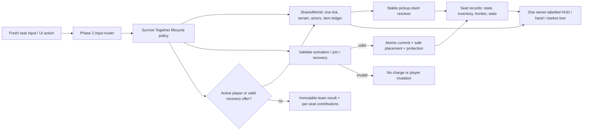

# Phase 3: Survive Together & Consumables - Research

**Researched:** 2026-10-14  
**Domain:** deterministic local co-op lifecycle, player-owned economy, and world pickups  
**Confidence:** MEDIUM

<user_constraints>
## User Constraints (from CONTEXT.md)

### Locked Decisions

- A shared session advances terrain, actors, clocks, and pickup claims once per tick. Each player owns movement, health, inventory, powers, and statistics.
- Each roster slot has a unique character. A new join consumes its triggering input and cannot also move, confirm a purchase, or activate an item.
- Survive Together allows live drop-in and dropout on either base ruleset. Existing players, course, clocks, scores, seed, and purchases cannot reset.
- Controller loss is a mode-owned event. A disconnected ghost cannot collide, take damage, advance progress, or claim items. It retains its slot and inventory.
- Reclaim and deliberate departure are distinct from death and new-player join.
- The existing automatic character hazard power remains separate from the new personal revival charge. Each player holds at most one personal revival; recharge requires 250 new tiles and cannot be farmed by backtracking or rejoin.
- Revival is a consumable that restores another eligible player. Its world probability is 1:2500. Flare restores dead teammates and brings everybody to the user's safe position. Its world probability is 1:1250.
- Consumables form their own item class with validated eligibility, targeting, charges, activation, deterministic world drops, and market purchases.
- World consumables use baseline collection gravity, including fractional positions after log hops. Coin magnet cards and powers must not increase it.
- Seeded drop generation must not perturb released terrain or coin RNG streams; its schema/version identity must make repeated generation reproducible.
- Contested pickups resolve exactly once deterministically. Failed or invalid item activation spends nothing and does not partially mutate players.
- Returns use safe placement and temporary protection; no return inside a hazard or immediate death loop. Preserve current player identity and statistics.
- Keep the prior user-authorized death economy: death spills that player's coins and cosmetics and clears their run inventory. Reviving does not restore lost purchases; teammates' inventories are untouched. A disconnect is not a death.
- Show the inventory/market owner clearly and keep one persistent hand/menu tree. Selling works without leaving the current menu, as in the existing solo UI.
- A team run ends when no active player or pending valid recovery remains. A disconnected ghost or unused charge without a pending offer cannot hold it open.
- Co-op results report a shared outcome and per-character contributions. Use a team podium rather than inventing competitive first/last places.

### the agent's Discretion

The approved policy uses each player's monotonic earned personal frontier for revival recharge, a bounded eight-active-second manual self-revive offer, and safe return no farther ahead than the living group. Backtracking, reclaim/rejoin, deliberate departure/new join, and recovery relocation grant no progress. The chosen defaults are four active seats, two active simulation seconds of return protection, one held Revival plus one held Flare, and market prices 24/36 respectively; tests cover every boundary transition.

### Deferred Ideas (OUT OF SCOPE)

None stated in CONTEXT.md.
</user_constraints>

<phase_requirements>
## Phase Requirements

| ID | Description | Research Support |
|----|-------------|------------------|
| COOP-01 | Shared Arcade/Flow world with independent player state. | One world-owned tick, seat-owned records, and a no-stacking shared-effect resolver. |
| COOP-02 | Safe live joining without reset. | Join admission validates a fresh input, unique character, and a safe spawn transaction. |
| COOP-03 | One 250-tile personal revival that cannot be farmed. | Per-seat monotonic frontier and expiring self-revive offer. |
| COOP-04 | Revive dead teammates safely and terminate correctly. | Atomic activation plans, safe return placement, protection, and recovery-aware terminal state. |
| COOP-05 | Disconnect/rejoin continuity distinct from death. | Ghost/reclaim/departure state machine. |
| ITEM-01 | Separate extensible consumable class. | Small discriminated catalog and owned-charge record, separate from cards/cosmetics. |
| ITEM-02 | Exact Revival/Flare world odds and effects. | Exclusive 2,500-bucket sampler and validated target policies. |
| ITEM-03 | World and market acquisition. | Shared pickup ledger plus per-owner market adapter. |
| ITEM-04 | Baseline gravity on fractional river positions. | Reuse baseline pull physics with a fixed gravity, never `coinRadius`. |
| ITEM-05 | Seeded bounded drops and once-only contests. | Versioned pure item stream and stable claim ordering. |
| UI-03 | Clearly owned market, inventory, and hand. | One owner-labelled tree; switch clears stale selection/target state. |
</phase_requirements>

## Summary

Implement Phase 3 on the Phase 2 shared-world seam: the world owns simulation and common effects; the composed Survive handler/session installs and owns one world-bound pickup capability/ledger only after adoption commits; a seat owns its own health, progress frontier, `RunInventory`, consumables, revival charge, lifecycle status, and contribution statistics. Ordinary Arcade/Flow without that capability allocates/serializes/renders and executes no item state or work. Keep the capability definition-driven so later modes may opt in without a Game mode-ID branch. Do not copy `Game` per player or add a second ticking RNG. The exact class and method names are provisional until the Phase 1 parity and Phase 2 session summaries land; reconcile names at the first implementation task. [VERIFIED: `src/game.ts`; VERIFIED: `02-RESEARCH.md`; ASSUMED: final Phase 1/2 exported names]

Use a separate, versioned, pure item-drop stream keyed by the captured course seed and pickup anchor. Its 2,500 buckets make Revival bucket `0`, Flare buckets `1` and `2`, and no item every other bucket. That is mutually exclusive, gives 1/2500 and 2/2500 (=1/1250) rates, and cannot consume terrain, coin, market, or mob randomness. [VERIFIED: `docs/seeds.md`; VERIFIED: `src/game.ts`; VERIFIED: REQUIREMENTS.md]

**Primary recommendation:** Add a compact session-owned consumables module and per-seat item/recovery state; use one transactional validation-and-commit path for joins, pickup claims, personal revival, Revival, and Flare.

## Architectural Responsibility Map

| Capability | Primary Tier | Secondary Tier | Rationale |
|------------|-------------|----------------|-----------|
| Session tick, pickup ledger, common actor effects | API / Backend (in-process simulation) | Browser / Client | The deterministic local simulation must advance once, independent of seat count. [VERIFIED: `02-RESEARCH.md`; VERIFIED: `src/game.ts`] |
| Seat health, inventory, revival frontier, lifecycle, stats | API / Backend (in-process simulation) | Browser / Client | This mutable state belongs to an identified player and is consumed by rules before rendering. [VERIFIED: CONTEXT.md] |
| Item activation and safe returns | API / Backend (in-process simulation) | Browser / Client | Validation must precede all mutations so input/UI cannot spend a charge partially. [VERIFIED: CONTEXT.md] |
| Pickup/HUD/market/hand presentation | Browser / Client | API / Backend (in-process simulation) | The UI renders authoritative state and selects its owner; it must not resolve claims or targets. [VERIFIED: `02-UI-SPEC.md`] |
| Durable keyboard bindings and normal napplet capability access | Frontend Server (runtime shell) | Browser / Client | The iframe uses SDK storage and the injected shell boundary, not browser storage or direct network. [VERIFIED: AGENTS.md; VERIFIED: `docs/boundaries.md`] |

## Project Constraints (from AGENTS.md)

- Keep the napplet framework-light and entirely on the napplet side of the shell boundary; do not add shell implementation code. [VERIFIED: AGENTS.md]
- Do not access signer keys, relay pools, cookies, service workers, host DOM, `localStorage`, `sessionStorage`, direct `fetch`, `WebSocket`, or `EventSource`. Use `@napplet/sdk` storage helpers and `resource.bytes()` only where appropriate. [VERIFIED: AGENTS.md; VERIFIED: `docs/boundaries.md`]
- Do not import `@napplet/shim`; use SDK helpers and only optional injected-domain checks. Do not invent NAP names, numbers, or wire envelopes. [VERIFIED: AGENTS.md; VERIFIED: `docs/package-surfaces.md`]
- Preserve the compact any-size applet contract, full-surface runtime themes, four frame tiers, and no title/tagline/footer. [VERIFIED: AGENTS.md; VERIFIED: `docs/design-patterns.md`]
- Keep standard Nostr access OUTBOX-first; this phase needs neither a new NAP nor direct network access. [VERIFIED: AGENTS.md]
- Before phase completion run `pnpm type-check`, `pnpm build`, `pnpm test:guidance`, and `pnpm test:conformance`; runtime browser evidence is muted and also covers optional-domain absence. [VERIFIED: AGENTS.md]

## Standard Stack

### Core

| Library / module | Version | Purpose | Why Standard |
|------------------|---------|---------|--------------|
| Project TypeScript simulation (`SharedWorld`/seat seam from Phase 2) | provisional | Single deterministic world and seat-owned state | It preserves the project’s existing seeded engine and avoids multiplying world time. [VERIFIED: `02-RESEARCH.md`; ASSUMED: final public API] |
| Existing `RunInventory` and market catalog | project source | Per-player wallet, cards, powers, cosmetics, market and clearing on actual death | It already validates purchases and clears run assets synchronously on death. [VERIFIED: `src/market/run.ts`] |
| Existing pull/contact geometry | project source | Baseline gravity for world consumables | `DEFAULT_COIN_GRAVITY`, fractional ground positions, platform support, and visible pull already solve river-log reachability. [VERIFIED: `src/market/run.ts`; VERIFIED: `src/game.ts`; VERIFIED: `src/coin-pull.ts`] |

### Supporting

| Module | Purpose | When to Use |
|--------|---------|-------------|
| `src/levels/*` seed schemas | Preserve released terrain and coin generation | Read lanes only; add a separate item-drop schema/stream rather than editing released schemas. [VERIFIED: `docs/seeds.md`] |
| `src/market/types.ts` | Existing discriminated item definitions and modifiers | Extend deliberately only for a consumable market adapter; do not turn consumables into cards/cosmetics. [VERIFIED: `src/market/types.ts`] |
| Phase 2 owner router / one hand tree | One owner-labelled market and inventory UI | Switch owner without duplicating DOM and clear stale target/draft/focus state. [VERIFIED: `02-UI-SPEC.md`; VERIFIED: `02-RESEARCH.md`] |

### Alternatives Considered

| Instead of | Could Use | Tradeoff |
|------------|-----------|----------|
| Pure keyed item stream | Draw drops from terrain/coin/market RNG | Shared draw order would change released courses or make generation-order-dependent items. [VERIFIED: `docs/seeds.md`; VERIFIED: `src/game.ts`] |
| One activation transaction | Per-item UI mutations | A target leaving or becoming invalid between checks can consume a charge or create partial restores. [VERIFIED: CONTEXT.md] |
| Descriptor-owned shared-effect aggregation | Sequentially apply each seat’s `RunInventory.effects` | Sequential passes stack/overwrite common lane and timing properties and make ownership/order visible in world behavior. [VERIFIED: `src/market/run.ts`; VERIFIED: `02-RESEARCH.md`] |

**Installation:** None. Phase 3 needs no external package. [VERIFIED: `package.json`]

## Architecture Patterns

### System Architecture Diagram



### Recommended Project Structure

```text
src/
├── session/                 # Phase 2 shared-world and seat APIs (reconcile names first)
├── consumables.ts           # definitions, charges, eligibility, activation plans
├── consumable-drops.ts      # versioned pure sampler and pickup identity
├── recovery.ts               # personal-revive offer, safe placement, protection
├── survive-together.ts       # lifecycle: join, ghost/reclaim, leave, terminal result
└── market/                  # thin catalog/UI adapters; no second market tree
```

### Pattern 1: Small separate consumable model

Use an item definition and an owned charge record distinct from the existing card/cosmetic unions. A market listing can reference a consumable definition, but it must not make it a card, cosmetic, automatic character power, or a permanent `RunModifiers` component. [VERIFIED: `src/market/types.ts`; VERIFIED: CONTEXT.md]

```ts
type ConsumableId = 'revival' | 'flare';
type ConsumableDefinition = Readonly<{
  id: ConsumableId;
  modeIds: readonly ['survive-together'];
  maxCharges: number;
  target: 'dead-teammate' | 'dead-teammates-at-user-safe-position';
}>;
type HeldConsumable = { id: ConsumableId; charges: number };
```

### Pattern 2: Exact independent sampler

For each eligible pickup anchor, compute a pure item-only roll keyed by the literal schema identity `item-drop-schema-1`, course seed, anchor key, and item-local retry. Map its validated bucket with inclusive lower/exclusive upper boundaries: `0 <= bucket < 1` is Revival; `1 <= bucket < 3` is Flare; `3 <= bucket < 2500` is none. The rejection step, if the hash source needs it to produce an unbiased 0–2499 bucket, uses only the same item stream. The final exported function name is chosen only after the Phase 1/2 API preflight. [ASSUMED: hash implementation and rejection detail; VERIFIED: locked odds and RNG isolation in CONTEXT.md]

```ts
function sampleDrop(bucket: number): ConsumableId | null {
  if (!Number.isInteger(bucket) || bucket < 0 || bucket >= 2500) throw new RangeError('item roll');
  if (bucket < 1) return 'revival';       // [0, 1): 1 / 2500
  if (bucket < 3) return 'flare';         // [1, 3): 2 / 2500 = 1 / 1250
  return null;                            // [3, 2500)
}
```

The world pickup ID should include `item-drop-schema-1`, course seed, row/anchor, and definition ID. Generate it from the read-only captured lane plus the pure item stream; never call the terrain generator RNG, `coinDenominationForRow`, `RunInventory.random`, or mob RNG. Keep coin state independent so an item does not remove or reroll a released coin. [VERIFIED: `src/game.ts`; VERIFIED: `docs/seeds.md`; ASSUMED: final key encoding]

### Pattern 3: Stable one-claim pickup ledger

The handler-installed, session-owned world capability owns each unclaimed `WorldConsumablePickup` record and advances it once with the shared world. If the capability is absent, no ledger/state/render node exists and no item sampler/update/pull/claim/prune path runs. With it installed, gather all eligible active-player contacts for a fixed tick, then choose the minimum tuple `(contactFraction, distanceSquared, seatId)`, mark the pickup claimed, and credit exactly that seat. Ghosts, dead seats, and departed seats are not candidates. [VERIFIED: CONTEXT.md; VERIFIED: `02-RESEARCH.md`; ASSUMED: exact final handler-extension API and contact-fraction API]

Use the current pull/contact rules with a fixed `DEFAULT_COIN_GRAVITY` value, `groundX/groundY`, `platformSurface`, and platform-safe river contact. Do not pass the owner’s `effects.coinRadius`; magnets and powers may still affect coins according to existing solo rules, but never consumable capture range. [VERIFIED: `src/game.ts`; VERIFIED: `src/market/run.ts`; VERIFIED: `src/coin-pull.ts`]

### Pattern 4: Validate, plan, commit

Activation returns either a rejection or a complete immutable plan. Validate actor lifecycle, mode, ownership, charge, target existence, safe return cells, and protection before changing any player or charge. Commit in a fixed seat order only after the whole plan is valid; otherwise leave every record unchanged. [VERIFIED: CONTEXT.md]

```ts
const plan = planConsumableUse(world, ownerSeatId, consumableId, targetSeatId);
if (!plan.ok) return plan;                 // no charge spent
commitConsumablePlan(world, plan.value);   // one state transition
```

Revival requires another eligible dead teammate. Flare requires at least one eligible dead teammate and validates placements for every affected player before it moves anyone to the user’s safe area. Both give the returned player temporary protection and keep their character/statistics; neither recreates the dead player’s cleared wallet, cards, powers, or cosmetics. [VERIFIED: CONTEXT.md]

### Pattern 5: Separate personal revival from character powers

Keep automatic character hazard powers in the existing character-power path. Store personal revival separately from contribution stats. The minimal run-local provenance owns `{ grantId, charged, personalHighWater, nextFrontier, aliases }`; a pending offer remains on the current death-generation record and cannot cross departure/new join. Reclaim and same-participant deliberate leave/new-join retain provenance even though the latter uses new-join UI. Resolve a stable participant ID before device/character aliases when Phase 2 supplies one. Without stronger identity, a known device or reacquired character conservatively reuses the provenance. A demonstrably different participant gets a new provenance and never inherits the archived charge. Advance high-water only when that participant reaches a new forward value, so leaving, changing seats/devices/characters, backtracking, and recovery relocation cannot reset a spent charge or partial progress. A charge is earned when the personal monotonic frontier reaches `nextFrontier`, then the next threshold moves by 250. [VERIFIED: `src/game.ts`; VERIFIED: CONTEXT.md; ASSUMED: exact final identity/progress field names]

On an actual death, perform the existing spill-and-clear first. If that player has a charge, create one short, manual, expiring self-revive offer; using it spends the charge and restores the empty player safely. An innate power that prevents `end()` is not a death and therefore creates neither spill nor personal offer. [VERIFIED: `src/game.ts`; VERIFIED: CONTEXT.md; ASSUMED: offer duration]

### Pattern 6: Explicit lifecycle and terminal recovery

Use `active`, `ghost`, `dead`, `departed`, and `recovery-pending` as mode states, rather than treating controller loss as death. A ghost retains seat and inventory but is excluded from collision, damage, movement, progress, and claims. Only a fresh explicit reclaim action binds a replacement controller back to that seat; a join allocates a new free seat and unique character and consumes its triggering input. [VERIFIED: CONTEXT.md; VERIFIED: `02-UI-SPEC.md]

An explicit departure is neither death nor reclaim: preserve immutable contribution statistics, release the running seat/character, and do not emit a death spill or transfer/refund its inventory. The archive is not reclaimable; later participation uses new-join state. The run-local recovery provenance remains able to recognize the same participant/character/device evidence so deliberate leave cannot manufacture another initial personal charge. [VERIFIED: approved Phase 3 policy]

The team remains alive only while an active seat exists or an eligible dead seat has an unexpired pending recovery offer. A ghost, a dead player with merely a stored charge but no offered recovery, or a late input after result finalization cannot keep the run open. On expiry, make one immutable shared result with per-character contribution snapshots. [VERIFIED: CONTEXT.md]

### Pattern 7: One common-world effect resolver

Existing `RunModifiers` mix seat-local benefits with properties that mutate common lanes, actors, spawning, and clocks. Do not apply each player’s `effects` sequentially. Add descriptor metadata identifying `local` versus `shared-world` properties and a defined beneficial direction; keep the existing solo path exactly `RunInventory.effects`. [VERIFIED: `src/market/types.ts`; VERIFIED: `src/market/run.ts`; VERIFIED: `02-RESEARCH.md]

For Survive Together, resolve every shared-world property once from eligible active seats in stable seat-ID order, using descriptor-defined non-stacking “best benefit” selection. Record the winning seat only for UI/diagnostics; ties choose the lower seat ID. Rebase common actor effects once, and make generation-affecting properties explicit instead of allowing a hidden seat pass during `ensureRows`. [ASSUMED: benefit-direction metadata and eligible-contributor policy]

Each mode must state its policy: solo retains its current single-owner behavior; Relay evaluates only the active runner’s permitted shared contribution at a handoff; Race defaults to common baseline/no card stacking unless an explicit Race rule allows a contextual shared effect. This protects Relay continuity and competitive fairness without creating a new generic effect system. [ASSUMED: phase-4/5 policy defaults]

### Anti-Patterns to Avoid

- **Per-seat world tick:** calling the old update path for every player advances actors, clocks, rows, mobs, and pickups multiple times. [VERIFIED: `src/game.ts`; VERIFIED: `02-RESEARCH.md]
- **Magnet inheritance for consumables:** forwarding `effects.coinRadius` makes item odds/geometry depend on cards and defeats the baseline-gravity requirement. [VERIFIED: `src/game.ts`; VERIFIED: CONTEXT.md]
- **Bucket overlap:** testing two independent drop predicates can create both items at one anchor; use one ordered 2,500-bucket classification. [VERIFIED: CONTEXT.md]
- **Mutation while validating:** decrementing charge before checking targets/safe cells violates invalid-use semantics. [VERIFIED: CONTEXT.md]
- **Sequential shared modifiers:** repeatedly applying lane/effect transforms lets seat order change traffic, river, and world timing. [VERIFIED: `src/market/run.ts`; ASSUMED: Phase 2 resolver shape]

## Don't Hand-Roll

| Problem | Don't Build | Use Instead | Why |
|---------|-------------|-------------|-----|
| Fractional river pickup pull | A second interpolation/physics system | Existing pull/contact/platform helpers with fixed baseline gravity | Existing code already carries pickups and players across log-offset positions. [VERIFIED: `src/game.ts`; VERIFIED: `src/coin-pull.ts`] |
| Death spill and reset | A parallel co-op wallet reset | Existing player inventory `clear()` and death-spill construction, invoked for that seat only | Existing behavior already clears wallet/cards/powers/cosmetics before callbacks. [VERIFIED: `src/game.ts`; VERIFIED: `src/market/run.ts`] |
| Market/hand visual tree | One market/hand DOM subtree per player | Phase 2 owner router and one persistent tree | Duplicate trees create stale focus, draft, and ownership bugs. [VERIFIED: `02-UI-SPEC.md`] |
| Shared-world modifier pass | Generic ECS/effect scripting | Small descriptor-driven resolver at the mode boundary | The project already has validated `RunModifiers`; this phase needs a policy boundary, not a new framework. [VERIFIED: `src/market/types.ts`] |

## Common Pitfalls

### Pitfall 1: Drop generation changes a released course
**What goes wrong:** A random draw during lane generation shifts terrain/coin output, or row-retention order changes drops.  
**How to avoid:** Use a pure versioned keyed item stream only inside the installed mode capability; assert ordinary Arcade/Flow has no ledger or item work and that terrain/coin/state/next-output golden snapshots remain byte-for-byte unchanged. [VERIFIED: `docs/seeds.md`; VERIFIED: `src/game.ts`]

### Pitfall 2: Personal revival is confused with innate power
**What goes wrong:** A 100-tile character power becomes a 250-tile revive, or power prevention triggers a death spill.  
**How to avoid:** Separate fields/transitions and test prevented hazard, actual death, charged offer, rejoin, and backtracking independently. [VERIFIED: `src/game.ts`; VERIFIED: CONTEXT.md]

### Pitfall 3: All-dead run never closes
**What goes wrong:** A disconnected ghost or unprompted charge leaves the simulation indefinitely recoverable.  
**How to avoid:** Count only active seats and unexpired valid offers, then freeze results before accepting late input. [VERIFIED: CONTEXT.md]

### Pitfall 4: Return cell is geometrically empty but immediately lethal
**What goes wrong:** A revived player lands on water, a moving hazard, wave/fog boundary, mob, or unsafe overlap.  
**How to avoid:** Compute candidates against the current world time, lane support/hazards and mode boundary, cap forward placement at the living group, then grant protection. [VERIFIED: `src/game.ts`; ASSUMED: final shared-world safe-placement API]

### Pitfall 5: Owner switch leaks an action
**What goes wrong:** A market/hand target from P1 buys or revives for P2 after switching UI owner.  
**How to avoid:** Clear selected card, pack draft, consumable target and input latches before rerendering the next owner’s one tree. [VERIFIED: `02-UI-SPEC.md`]

## Code Examples

### Shared common-effect resolver shape

```ts
// Reconcile types with the completed Phase 1/2 summaries before coding.
function resolveSurviveWorldEffects(seats: readonly Seat[]): SharedWorldEffects {
  const contributors = seats.filter(seat => seat.state === 'active').sort(bySeatId);
  return resolveNonStackingWorldEffects(contributors.map(seat => ({
    seatId: seat.id,
    effects: seat.inventory.effects,
  })));
}
```

This is deliberately a mode boundary: no player loop may call a world-effect mutation pass. [ASSUMED: final helper names; VERIFIED: `src/market/run.ts`; VERIFIED: `02-RESEARCH.md]

### Safe recovery transaction

```ts
const plan = planRecovery({ world, userSeatId, item: 'flare' });
if (!plan.ok) return plan;                 // no inventory/charge/state changes
applyRecoveryPlan(plan.value);             // targets, safe cells, protection, charge
```

The plan must include every Flare target and every safe placement before commit. [VERIFIED: CONTEXT.md]

## State of the Art

| Old Approach | Current Approach | Impact |
|--------------|------------------|--------|
| One `Game` owns both world and one player | Phase 2 plans a shared world plus seat records behind compatibility wrappers | Phase 3 can add co-op policy without multiplying simulation. [VERIFIED: `02-RESEARCH.md`] |
| One coin type/pull governed by player effects | Coin pull supports visible fractional movement; Phase 3 adds item pull pinned to baseline gravity | Consumables remain reachable on log-shifted grids without magnet amplification. [VERIFIED: `src/game.ts`; VERIFIED: `src/market/run.ts`] |

## Assumptions Log

| # | Claim | Section | Risk if Wrong |
|---|-------|---------|---------------|
| A1 | Final Phase 1/2 exported names are intentionally unknown until those phases ship. Phase 3 must read all summaries, reconcile live exports, and halt before product edits on an incompatible seam. | Summary / project structure | Prevents plans from presenting provisional names as shipped APIs. |
| A2 | Personal revival uses one eight-active-second offer; pause freezes active time, and only an unexpired valid offer may delay all-dead settlement. | Personal revival | Chosen and covered by exact expiry/decline/pause/terminal tests. |
| A3 | Explicit departure archives contribution statistics without death spill/refund/transfer; the archive is not reclaimable, later entry is a new join, and retained run-local recovery provenance prevents charge or partial-progress reset without transferring it to a demonstrably different participant. | Lifecycle | Chosen and covered across participant/character/device aliases and seat reassignment. |
| A4 | Active-seat shared-world aggregation is descriptor-owned, best-benefit, non-stacking, with lower-seat tie-breaking; owner-local properties remain private. | Shared-effect resolver | Chosen with an exhaustive descriptor-key test against the actual final modifier type. |
| A5 | The item stream can use a pure keyed hash plus rejection to produce a 2,500 bucket. | Exact sampler | Hash implementation needs reproducibility tests and a pinned schema. |

## Resolved Questions

1. **[RESOLVED] Which exact Phase 1/2 types and events ship?**
   - What we know: Phase 2 specifies lifecycle events, one tick, claims, owner routing, and `quickJoin` as a seam. [VERIFIED: `02-RESEARCH.md`]
   - Resolution: exported names remain provisional until Phase 1/2 complete. Every Phase 3 implementation plan begins with a blocking summary/live-export reconciliation and must halt before production edits on mismatch. It composes the APIs that actually shipped and does not duplicate Phase 2 state or invent compatibility NAP APIs.
2. **[RESOLVED] Voluntary departure inventory disposition and later return.**
   - What we know: actual death clears and spills; ghost retains inventory; departure is distinct. [VERIFIED: CONTEXT.md]
   - Resolution: deliberate departure archives immutable contribution statistics, releases the live seat/character, and creates neither death spill nor refund/transfer. Its inventory is not reclaimable. Later participation is a new join. A minimal run-local provenance retains immutable grant ID, charge state, personal high-water/next threshold, and observed aliases. Stable participant identity wins; without one, known device or reacquired character conservatively matches. This prevents reset across seat/device/character changes while a demonstrably different participant gets independent provenance and never receives the archived charge.
3. **[RESOLVED] Shared-world modifier directions.**
   - What we know: current modifiers include actor, lane, spawn, pickup and player-facing values. [VERIFIED: `src/market/types.ts`]
   - Resolution: build one exhaustive descriptor table against the actual final `RunModifiers` keys. Owner-local properties include card slots, shield, damage/recovery/regen, coin radius/multiplier, and owner coin awards. For shared-world fields, lower is beneficial for traffic/river/wave/mob speeds; higher is beneficial for traffic spacing, platform length, train period/warning, wave trail, mob windup/recovery/spawn delay, coin chance, scenery clearance, and the generation component of any split-use river coin modifier. Select one best active-seat contribution per descriptor, tie by lower seat, and never stack. A split-use modifier gets separate shared-generation and owner-award projections; one active player deep-equals existing solo effects.
4. **[RESOLVED] Concrete working defaults.**
   - Resolution: capacity is four active seats; personal offers last eight active-play seconds; return protection lasts two active simulation seconds; each player may hold one Revival and one Flare; Revival costs 24 and Flare costs 36. Safe placement is deterministic and at/below the living frontier, with own-last-safe fallback for all-dead personal recovery. These remain named validated rules rather than magic UI constants.

## Environment Availability

| Dependency | Required By | Available | Version | Fallback |
|------------|-------------|-----------|---------|----------|
| Node.js | model tests/build | ✓ | v26.7.0 | — |
| pnpm | scripts/build | ✓ | 10.8.0 | — |
| Vite | production build | ✓ | 6.4.3 | project dev dependency |
| Playwright | muted browser/runtime/layout evidence | ✓ | 1.61.0 | — |
| napplet-conformance | conformance gate | ✓ | project script | — |

## Validation Architecture

### Test Framework

| Property | Value |
|----------|-------|
| Framework | Node built-in test runner plus Playwright-backed built-artifact fixtures [VERIFIED: `package.json`] |
| Config file | none; scripts live in `package.json` [VERIFIED: `package.json`] |
| Quick run command | `node --test tests/survive-together.test.mjs tests/consumables.test.mjs` |
| Full suite command | `pnpm type-check && pnpm build && pnpm test:guidance && pnpm test:conformance` |

### Phase Requirements → Test Map

| Req ID | Behavior | Test Type | Automated Command | File Exists? |
|--------|----------|-----------|-------------------|-------------|
| COOP-01 | One world tick with independent active seats and non-stacking world effects | model/integration | `node --test tests/survive-together.test.mjs` | ❌ Wave 0 |
| COOP-02/05 | Join input consumption; ghost/reclaim/departure safe lifecycle | model/runtime | `node --test tests/survive-together.test.mjs && pnpm build && node tests/survive-together-runtime.mjs` | ❌ Wave 0 |
| COOP-03/04 | Monotonic 250 frontier, offer expiry, safe self/team recovery | model | `node --test tests/survive-together.test.mjs` | ❌ Wave 0 |
| ITEM-01/03 | Charges, eligibility, owner-routed market and sell persistence | model/layout | `node --test tests/consumables.test.mjs && pnpm build && node tests/survive-together-layout.mjs` | ❌ Wave 0 |
| ITEM-02/05 | Exact buckets, item-stream isolation, contested claims | unit/model | `node --test tests/consumable-drops.test.mjs tests/consumables.test.mjs` | ❌ Wave 0 |
| ITEM-04 | Baseline pull across fractional log-hop offsets and no magnet boost | unit/model | `node --test tests/consumables.test.mjs tests/log-coin-gravity.test.mjs` | ❌ Wave 0 |
| UI-03 | Owner label, owner switch reset, one persistent hand/market tree | built layout | `pnpm build && node tests/survive-together-layout.mjs` | ❌ Wave 0 |

### Mandatory scenario detail

- Run sampler boundary tests for buckets `-1`, `0`, `1`, `2`, `3`, and `2499`; assert exclusive result and the specified odds classification. [VERIFIED: CONTEXT.md]
- For identical course seeds, compare released terrain/coin snapshot output before/after item sampling; exercise rows out of order to prove no shared RNG consumption. [VERIFIED: `docs/seeds.md`; VERIFIED: CONTEXT.md]
- Put two active players in one pickup radius in the same fixed tick; assert exactly one deterministic winner. Repeat with a ghost/dead candidate. [VERIFIED: CONTEXT.md]
- Ride a log to a fractional coordinate, collect an item at baseline gravity, then equip/activate coin-magnet effects and assert item capture trace is unchanged. [VERIFIED: `src/game.ts`; VERIFIED: CONTEXT.md]
- Kill only P1 after purchases: P1 spills/clears; P2 wallet/cards/cosmetics/items remain equal; P1 revival returns empty. [VERIFIED: `src/game.ts`; VERIFIED: `src/market/run.ts`; VERIFIED: CONTEXT.md]
- Exercise all-dead offer expiry, ghost-only roster, invalid target/no safe placement, and late activation after result snapshot; each must leave state valid and immutable. [VERIFIED: CONTEXT.md]
- Use muted Chromium proof at compact and wide frames in both themes; inspect owner label, target picker, ghost/reclaim state, recovery, and no-scrollbars. [VERIFIED: AGENTS.md; VERIFIED: `02-UI-SPEC.md]

### Sampling Rate

- **Per task commit:** focused model tests plus `pnpm type-check`.
- **Per wave merge:** focused model tests, `pnpm test:solo-parity`, `pnpm build`, and affected existing market/seed/magnet tests. [VERIFIED: `package.json`]
- **Phase gate:** full suite command, `pnpm test:solo-parity`, and muted built-artifact runtime/layout evidence.

### Wave 0 Gaps

- [ ] `tests/consumable-drops.test.mjs` — bucket boundaries, version key, schema/RNG isolation.
- [ ] `tests/consumables.test.mjs` — charges, target validation, pull, claim, transaction, safe recovery.
- [ ] `tests/survive-together.test.mjs` — joins, ghosts/reclaims/leaves, personal revival, team end, common effects.
- [ ] `tests/survive-together-runtime.mjs` — muted opaque-iframe join/reclaim/use flow.
- [ ] `tests/survive-together-layout.mjs` — owner routing and compact/wide dark/light proof.

## Security Domain

### Applicable ASVS Categories

| ASVS Category | Applies | Standard Control |
|---------------|---------|-----------------|
| V2 Authentication | no | Local seats are not identities; retain shell-owned identity boundary. [VERIFIED: PROJECT.md] |
| V3 Session Management | yes | Validate explicit seat lifecycle transitions and reject stale/reused controller actions. [VERIFIED: `02-RESEARCH.md`] |
| V4 Access Control | yes | A consumable action must prove active owner, mode eligibility, and target eligibility before commit. [VERIFIED: CONTEXT.md] |
| V5 Input Validation | yes | Validate finite IDs, bucket bounds, seat/target state, charges, safe placement, and no partial mutation. [VERIFIED: CONTEXT.md] |
| V6 Cryptography | no | No cryptographic operation is introduced. [VERIFIED: phase scope] |

### Known Threat Patterns for this stack

| Pattern | STRIDE | Standard Mitigation |
|---------|--------|---------------------|
| Stale/disconnected device action revives or buys for an owner | Spoofing / tampering | Fresh reclaim/join action, seat ownership check, lifecycle generation/token, and latch clear. [VERIFIED: `02-RESEARCH.md`; ASSUMED: token representation] |
| Invalid target spends an item | Tampering | Pure validation plan then one atomic commit. [VERIFIED: CONTEXT.md] |
| Sequential seat modifiers alter a common world unpredictably | Tampering | One deterministic mode-owned resolver and no per-seat world pass. [VERIFIED: `src/market/run.ts`; ASSUMED: resolver API] |
| Browser storage/network bypass for session state | Information disclosure | SDK/sandbox boundaries only; no direct browser persistence or network. [VERIFIED: AGENTS.md] |

## Sources

### Primary (HIGH confidence)

- Project source and graph: `src/game.ts`, `src/market/run.ts`, `src/market/types.ts`, `src/coin-pull.ts`, `src/coin-denominations.ts`, and `src/levels/*` — concrete update, collection, market, death, and seed seams. [VERIFIED: codebase-memory graph and source]
- `03-CONTEXT.md`, `REQUIREMENTS.md`, `USER-REQUEST.md`, `PROJECT.md`, `ROADMAP.md`, `MODE-DESIGN.md`, and Phase 2 research/context/UI contract — locked behavior and integration contract. [VERIFIED: planning documents]
- `AGENTS.md`, `docs/boundaries.md`, `docs/design-patterns.md`, `docs/package-surfaces.md`, `docs/seeds.md`, `docs/market.md`, and `docs/persistent-hand.md` — project and napplet constraints. [VERIFIED: project documentation]

### Secondary (MEDIUM confidence)

- Research-plan/cache seam for the two project-local inquiries; Context7 MCP/CLI was unavailable for project-local source, so findings were verified against local authoritative source/planning documents. [CITED: local research-plan cache]

### Tertiary (LOW confidence)

- None; all design choices not directly locked are marked `[ASSUMED]` above.

## Metadata

**Confidence breakdown:**
- Standard stack: HIGH — existing project modules and installed toolchain inspected directly.
- Architecture: MEDIUM — single-world and ownership constraints are verified, while final Phase 1/2 names and shared-effect tuning are still in flight.
- Pitfalls: HIGH — directly derived from existing update/collection/death code and locked requirements.

**Research date:** 2026-10-14  
**Valid until:** 2026-10-21, or immediately after Phase 1/2 summaries land.
