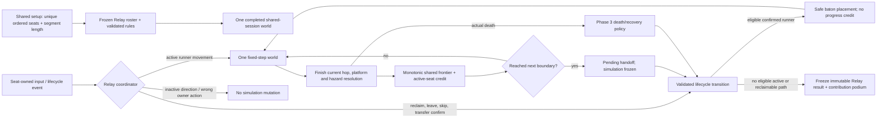

# Phase 4: Relay - Research

**Researched:** 2026-10-14  
**Domain:** deterministic local turn relay on a shared game simulation  
**Confidence:** MEDIUM

<user_constraints>
## User Constraints (from CONTEXT.md)

### Locked Decisions

- Configure unique characters, runner order, and validated segment length before
  starting. Reuse shared controller/keyboard binding and setup surfaces.
- Relay is a composable definition with lifecycle handlers. Input, rendering, and
  the world engine must not grow scattered checks for a Relay identifier.
- Exactly one eligible runner owns movement at a time; all controllers continue
  listening for valid menu/reclaim/lifecycle actions. Inactive directions cannot
  move the active character, buy items, or consume another player's action.
- A handoff occurs at each new segment boundary, safely and visibly. Preserve the
  same course, world clock, actor phases, pickup claims, seed/RNG future state,
  progress, and run-owned state. Never rebuild the course to hand off control.
- Backward travel and repeated boundary crossings cannot count a leg twice.
- The started roster is closed to new entrants until the run ends. Reclaiming an
  original slot after a controller reconnects is not a new join.
- Active loss, inactive loss, deliberate leave, reclaim, skip, and the last
  available runner have explicit Relay-owned outcomes. Do not leave an ambiguous
  no-controller run advancing indefinitely or apply a universal disconnect pause.
- Keep each player's identity, inventory, health, contribution record, and innate
  power separate. Death follows the established per-player spill/clear economy;
  disconnect does not become death. No handoff grants free purchases or duplicate
  pickups, healing, innate recharge, or personal-revival recharge.
- Preserve the separate personal revival mechanic (250 earned forward tiles)
  and existing character power (100); reuse validated recovery/item services when
  mode-eligible rather than implementing a second recovery system.
- Dedicated results include the shared outcome plus each character's legs,
  distance, time, coins, pickups, revives, skips, and other outcomes. Relay uses a
  contribution podium/breakdown appropriate to a shared run.
- Solo and the completed cooperative mode retain their committed behavior.

### the agent's Discretion

These are working implementation assumptions, not additional user answers:

- Retain four seats as the provisional shared-session capacity.
- Measure segment progress with a monotonic shared frontier and credit earned
  movement only to the active runner; repositioning at handoff is not progress.
- At a boundary, latch a pending handoff, finish the current hazard/landing
  resolution, and use a short explicit transfer board with the incoming runner's
  fresh confirmation. The board freezes simulation; its trigger cannot also hop.
- Transfer the baton position while keeping each runner's personal inventory and
  health. Resolve platform carry and safe placement through existing services;
  avoid resetting actor phases or teleporting to a newly generated course.
- Skip unavailable runners in the configured order. A disconnected original
  member remains reclaimable; deliberate departure is visibly different.
- Determine bounded no-runner/recovery handling and the exact leg-death policy
  during research. Defaults must become validated settings/handlers with real
  transition tests, not unresolved prose or user-approval gates.

### Deferred Ideas (OUT OF SCOPE)

None stated in CONTEXT.md.
</user_constraints>

<phase_requirements>
## Phase Requirements

| ID | Description | Research Support |
|----|-------------|------------------|
| RELAY-01 | Configure ordered unique-character roster and default-50 segment length. | Validated Relay definition, frozen roster snapshot, and setup-to-run transition. |
| RELAY-02 | Transfer exactly at each segment boundary without rebuilding the run. | Monotonic frontier, one-shot pending latch, post-landing settlement, and state-identity continuity tests. |
| RELAY-03 | Close roster after start while allowing original-seat reclaim. | Separate `joined`, `disconnected`, `departed`, and `reclaimed` transitions keyed by stable seat ID. |
| RELAY-04 | Make every loss, skip, reclaim, final departure, and no-controller case mode-owned. | Explicit relay state machine, frozen no-runner state, and deterministic terminal reasons. |
| RELAY-05 | Produce contribution results and podium. | Append-only leg ledger, immutable final snapshot, and shared contribution ranking. |
</phase_requirements>

## Summary

Relay should be a thin mode policy over the completed shared-session world: one world still owns course rows, actor phases, time, RNG, claims, and the shared frontier; each stable seat owns movement authority, health, inventory, innate/revival progress, and statistics. A handoff changes only which seat may author movement and which personal avatar is placed at the baton’s settled safe location. It must never create another `Game`, regenerate rows, or replay a seed. The current `Game` already exposes the important hazards: a successful `move('forward')` updates `maxY` before the following fixed updates settle collision, river support, or power rescue; its update loop advances time and hazards separately. [VERIFIED: `src/game.ts`; VERIFIED: `04-CONTEXT.md`]

The codebase currently contains the Phase 1 composable-definition seam, but no shipped `SharedSession`, multi-seat, consumable, recovery, or Relay module. Phase 2 and Phase 3 have reviewed plans/research and UI contracts, not completed summaries or source APIs. Therefore every implementation plan must start with an API reconciliation tracer against the completed Phase 1–3 summaries and source; the concepts below name responsibilities, not future exported identifiers. [VERIFIED: `src/game.ts`; VERIFIED: `src/mode-rules.ts`; VERIFIED: `.planning/phases/02-shared-local-session/02-PLANNING-REVIEW.md`; VERIFIED: `.planning/phases/03-survive-together-consumables/03-RESEARCH.md`]

**Primary recommendation:** Compose a validated Relay definition plus one Relay lifecycle coordinator that gates seat actions, records a monotonic-boundary leg ledger, and calls the completed Phase 2/3 session, recovery, item, and result services only after reconciling their actual APIs.

## Architectural Responsibility Map

| Capability | Primary Tier | Secondary Tier | Rationale |
|------------|-------------|----------------|-----------|
| Fixed-step terrain, actor clocks, seed/RNG, pickup-claim ledger, shared frontier | API / Backend (in-process simulation) | Browser / Client | These change once per simulation tick and must retain identity through every handoff. [VERIFIED: `src/game.ts`; VERIFIED: `04-CONTEXT.md`] |
| Seat lifecycle, active-turn authorization, segment accounting, recovery eligibility, result ledger | API / Backend (in-process simulation) | Browser / Client | UI and device input request transitions; validated mode state performs them atomically. [VERIFIED: `04-CONTEXT.md`; VERIFIED: `.planning/phases/03-survive-together-consumables/03-RESEARCH.md`] |
| Ordered setup, baton-transfer board, owner-labelled hand/market, HUD and podium | Browser / Client | API / Backend (in-process simulation) | The interface presents authoritative seat/mode state and emits commands; it never advances world state itself. [VERIFIED: `.planning/phases/02-shared-local-session/02-UI-SPEC.md`; VERIFIED: `04-CONTEXT.md`] |
| Controller snapshot transport and durable bindings | Frontend Server (runtime shell) | Browser / Client | The existing app uses an injected gamepad domain/authorized transport and SDK storage rather than native browser polling or browser durable storage. [VERIFIED: `src/gamepad.ts`; VERIFIED: `docs/boundaries.md`] |
| Theme and viewport placement | Browser / Client | — | Relay extends the one framed applet scene and its existing responsive tiers rather than adding a host surface. [VERIFIED: `AGENTS.md`; VERIFIED: `.planning/phases/02-shared-local-session/02-UI-SPEC.md`] |

## Project Constraints (from AGENTS.md)

- Keep implementation small, framework-light, and on the napplet side of the shell boundary; do not add shell implementation code. [VERIFIED: `AGENTS.md`]
- Do not access signer keys, relay pools, cookies, service workers, host DOM, `localStorage`, `sessionStorage`, direct `fetch`, `WebSocket`, or `EventSource`. Durable app state uses `@napplet/sdk` storage; read-only external bytes use `resource.bytes()`. [VERIFIED: `AGENTS.md`; VERIFIED: `docs/boundaries.md`]
- Do not import `@napplet/shim`; application calls use `@napplet/sdk`, and direct `window.napplet` access is only an optional-domain availability check. [VERIFIED: `AGENTS.md`; VERIFIED: `docs/package-surfaces.md`]
- Use OUTBOX for ordinary Nostr access and RELAY only for an explicit relay-local feature. Relay mode needs neither network access nor a new NAP/domain/wire format. [VERIFIED: `AGENTS.md`; VERIFIED: `docs/design-patterns.md`; VERIFIED: `docs/new-nap-proposals.md`]
- Render an applet working surface, not a web page: no app name, masthead, tagline, or footer; keep whole-surface runtime theming and responsive tiers at 200×160, 320×560, 900×600, and full screen in both themes. [VERIFIED: `AGENTS.md`; VERIFIED: `docs/design-patterns.md`]
- Preserve the existing 240×240 below-minimum notice, no-scroll behavior, and large game controls where the shared-screen UI needs them. [VERIFIED: `AGENTS.md`; VERIFIED: `.planning/phases/02-shared-local-session/02-UI-SPEC.md`]
- Before completion, run `pnpm type-check`, `pnpm build`, `pnpm test:guidance`, and `pnpm test:conformance`; built-browser evidence must use `--mute-audio`, preserve the audio graph, and prove optional-domain fallback. [VERIFIED: `AGENTS.md`; VERIFIED: `tests/runtime-smoke.mjs`; VERIFIED: `tests/gamepad-runtime.mjs`]

## Standard Stack

### Core

| Library / module | Version | Purpose | Why Standard |
|------------------|---------|---------|--------------|
| Existing TypeScript `Game` plus Phase 1 `ModeDefinition`/`ModeRules` | project source | Preserve the one course, simulation clock, seeded generation, mode configuration, and lifecycle seam. | It already supplies readonly composed rules and fixed-step simulation; Relay must adapt it, not fork it. [VERIFIED: `src/game.ts`; VERIFIED: `src/mode-rules.ts`] |
| Completed Phase 2 shared-session model | pending reconciliation | Own one world and durable seats/device bindings. | Its reviewed design assigns shared-world/single-tick and stable-seat ownership here, but this research cannot name an API until it is implemented. [VERIFIED: `.planning/phases/02-shared-local-session/02-RESEARCH.md`; ASSUMED: eventual module/API names] |
| Completed Phase 3 recovery, consumable, and result services | pending reconciliation | Reuse per-player death economy, personal revival, safe placement, eligibility, and result model. | Relay must not create another recovery or item implementation. [VERIFIED: `.planning/phases/03-survive-together-consumables/03-RESEARCH.md`; ASSUMED: eventual module/API names] |

### Supporting

| Module / tool | Purpose | When to Use |
|---------------|---------|-------------|
| `src/gamepad.ts` and completed Phase 2 seat router | Input transport and lifecycle events | The Relay coordinator authorizes only the active seat’s gameplay input; all seats remain eligible for menu/reclaim commands. [VERIFIED: `src/gamepad.ts`; VERIFIED: `04-CONTEXT.md`; ASSUMED: Phase 2 router API] |
| Existing `RunInventory` semantics as generalized by Phase 3 | Per-owner wallet/cards/powers/cosmetics and actual-death clearing | Retain ownership and clear only the actual dead runner’s assets; do not attach the current single-player object wholesale to Relay. [VERIFIED: `src/market/run.ts`; VERIFIED: `src/game.ts`; VERIFIED: `04-CONTEXT.md`] |
| Node test runner and existing Playwright fixtures | Production model and muted opaque-iframe proof | Extend the established `node --test` and built-artifact patterns; no new test framework. [VERIFIED: `package.json`; VERIFIED: `tests/gamepad-runtime.mjs`; VERIFIED: `tests/health-runtime.mjs`] |

### Alternatives Considered

| Instead of | Could Use | Tradeoff |
|------------|-----------|----------|
| One retained shared world | Construct a new game from the seed for each runner | A reconstruction loses actor phase, current pickup claims, future RNG position, market/run history, and in-flight platform position. [VERIFIED: `src/game.ts`; VERIFIED: `04-CONTEXT.md`] |
| Monotonic shared frontier plus active-seat credit | Current y-coordinate or net displacement | Backtracking and baton placement would create repeat credit and duplicate segment transfers. [VERIFIED: `04-CONTEXT.md`] |
| Explicit transfer board | Immediate automatic next-seat movement | A fresh input is required so the boundary hop cannot become the next runner’s hop, and the simulation must remain frozen for reviewable handoff state. [VERIFIED: `04-CONTEXT.md`] |
| Reuse Phase 3 recovery/item transactions | Relay-local revival/item logic | A duplicate implementation would diverge in safe placement, charge validation, death clearing, and result accounting. [VERIFIED: `04-CONTEXT.md`; VERIFIED: `.planning/phases/03-survive-together-consumables/03-RESEARCH.md`] |

**Installation:** None. This phase adds no dependency or package-manager change. [VERIFIED: `package.json`; VERIFIED: `04-CONTEXT.md`]

## Architecture Patterns

### System Architecture Diagram



### Mandatory API Reconciliation Gate

Before any Relay behavior is implemented, add a first task that reads the completed Phase 1–3 summaries and source, then records the actual types/functions that satisfy this table. Do not write adapters to plan-prose names such as `SharedWorld` or `SessionPlayer`. [VERIFIED: `.planning/phases/02-shared-local-session/02-PLANNING-REVIEW.md`; VERIFIED: `.planning/phases/03-survive-together-consumables/03-RESEARCH.md`]

| Required responsibility | Existing evidence | Execution rule |
|-------------------------|-------------------|----------------|
| One world snapshot/identity, fixed-step advance, rows/actors/time/RNG/pickup claims | `Game` currently has one world and deterministic update state; Phase 2 plans own the multi-seat wrapper. [VERIFIED: `src/game.ts`; VERIFIED: `.planning/phases/02-shared-local-session/02-01-PLAN.md`] | Locate the completed world/session owner and use its identity-preserving API; if it lacks one, extend that owner rather than copy `Game`. |
| Stable seat/character/device lifecycle with reclaim and input dispatch | Only single-controller `GamepadInput` exists in current source; Phase 2 plans own mixed-seat routing. [VERIFIED: `src/gamepad.ts`; VERIFIED: `.planning/phases/02-shared-local-session/02-03-PLAN.md`] | Enumerate actual seat ID, lifecycle event, and action-gate types before coding Relay. |
| Per-seat inventory, health, innate 100 progress, personal-revive 250 progress, safe recovery, item eligibility | Current `Game` has one `RunInventory` and its innate cooldown follows `maxY`; Phase 3 owns per-seat services. [VERIFIED: `src/game.ts`; VERIFIED: `src/market/run.ts`; VERIFIED: `.planning/phases/03-survive-together-consumables/03-RESEARCH.md`] | Reuse the delivered per-seat services. Do not calculate eligibility from shared `maxY`. |
| Owner-labelled hand/market and immutable results | Phase 2 owns the owner seam; Phase 3 proposes immutable mode-neutral results. [VERIFIED: `.planning/phases/02-shared-local-session/02-06-PLAN.md`; VERIFIED: `.planning/research/MODE-DESIGN.md`] | Confirm owner-switch invalidation and result-construction entry points before UI work. |

If any required responsibility did not land in its dependency phase, stop Relay implementation at the missing contract, add the smallest dependency-owned completion plan, and do not fabricate a substitute API. [ASSUMED: execution escalation procedure]

### Recommended Project Structure

Use actual Phase 1–3 module locations after the reconciliation tracer. These names are responsibility-level suggestions, not declared future APIs. [ASSUMED: final file names]

```text
src/
├── mode-rules.ts             # extend with validated Relay rules/definition
├── relay.ts                  # Relay lifecycle coordinator and pure transitions
├── relay-results.ts          # immutable Relay leg/result projection
├── session/…                 # completed Phase 2 world/seat APIs (actual path required)
├── recovery/…                # completed Phase 3 recovery APIs (actual path required)
└── session-ui/…              # completed owner/HUD surface plus Relay board/result UI
tests/
├── relay.test.mjs            # state machine and continuity traces
├── relay-runtime.mjs         # built opaque-iframe mixed-input proof
└── relay-layout.mjs          # viewports, themes, and screenshots
```

### Pattern 1: Validated Relay definition and frozen roster

Use a compile-time composed definition with a positive integer `segmentTiles` defaulting to `50`, the provisional capacity `4`, and explicit lifecycle policy values. Freeze the ordered roster at start as stable seat IDs plus selected-character IDs; a reconnect only attaches a device to one such record and cannot append a seat. `Game` already accepts a readonly composed mode definition, so Relay should extend that configuration boundary rather than add `if (mode === 'relay')` branches in core input or rendering. [VERIFIED: `src/game.ts`; VERIFIED: `src/mode-rules.ts`; VERIFIED: `04-CONTEXT.md`]

Chosen policies that must be represented as validated values and boundary-tested:

- **Boundary settlement: fatal hazard wins.** Crossing a boundary latches a pending handoff after accepted active-runner forward progress. The coordinator does not open the board until the current hop has finished, the runner is still alive, no rescue is in flight, and the landing/platform state is safe. An actual fatal death first runs the established spill/clear and recovery policy; it does not transfer the baton. A character power that prevents `end()` is not a death and may settle before the pending handoff. [VERIFIED: `src/game.ts`; VERIFIED: `04-CONTEXT.md`]
- **No automatic active-turn timeout or recovery.** A transfer/reclaim board never advances world time and never auto-skips its currently expected runner, auto-kills, or grants a recovery because a controller is absent. Ordinary rotation selects the next eligible connected runner, bypassing already-inactive unavailable seats; this differs from timing out an active turn. A connected eligible participant may explicitly skip the unavailable expected runner. A wholly disconnected roster enters a named frozen `waiting-for-reclaim` state; it cannot advance until an original slot is reclaimed or a later lifecycle event intentionally ends the run. [VERIFIED: `04-CONTEXT.md`; ASSUMED: state labels]
- **Actual death loses only the actual runner’s assets.** Apply the delivered per-player death transaction: spill that player’s wallet/cosmetics and clear that player’s run inventory before any personal revival return. Preserve all other seats, shared course state, pickup claims, and result records. Disconnect, skip, and deliberate leave do not emit a death transaction. [VERIFIED: `src/game.ts`; VERIFIED: `src/market/run.ts`; VERIFIED: `04-CONTEXT.md`]

### Pattern 2: Monotonic 50-tile handoff accounting

Capture `runStartFrontier` at Relay start and initialize `nextBoundary = runStartFrontier + segmentTiles`. On an accepted active runner’s genuine forward progress, update `sharedFrontier = max(sharedFrontier, worldForwardFrontier)` and credit only `max(0, sharedFrontier - priorSharedFrontier)` to the active leg and participant. When the settled state reaches `nextBoundary`, latch exactly one pending handoff keyed by that boundary. On a confirmed transfer, move `nextBoundary` to the smallest configured boundary strictly above the retained shared frontier; the normal one-row hop path therefore hands off every 50 new frontier tiles and a corrupted/debug jump cannot emit repeated empty legs. [VERIFIED: `src/game.ts`; VERIFIED: `04-CONTEXT.md`; ASSUMED: final shared-world frontier accessor]

Never evaluate boundary completion from a raw current y coordinate, a net leg displacement, or a newly teleported baton position. Backward travel cannot decrease the frontier or re-award distance. The handoff latch is consumed once, and the transfer confirmation does not call movement. [VERIFIED: `04-CONTEXT.md`]

### Pattern 3: Personal progress remains personal across baton placement

Store per-seat `earnedForwardFrontier` and an arrival `creditFloorY`. At baton placement, move the incoming runner to the settled safe baton location and set only its `creditFloorY` to that location; do not change `earnedForwardFrontier`, personal-revive charge, innate-power readiness, coins, health, inventory, or pickup ledger. Award the incoming runner only after a runner-authored forward movement settles above both their prior personal watermark and that credit floor. This gives no free 100-tile innate recharge or 250-tile personal-revival recharge from a 50-tile handoff teleport. [VERIFIED: `src/game.ts`; VERIFIED: `src/character-powers.ts`; VERIFIED: `04-CONTEXT.md`; ASSUMED: completed Phase 3 per-seat progress API]

The current single-player innate-power implementation derives readiness from global `maxY`, which is correct only for one player. The completed Phase 3/session contract must already expose a per-seat progress service; Relay must feed it real active-runner earned movement and must not reuse global `Game.maxY` for a participant’s 100/250 threshold. [VERIFIED: `src/game.ts`; VERIFIED: `src/character-powers.ts`; VERIFIED: `.planning/phases/03-survive-together-consumables/03-RESEARCH.md`]

### Pattern 4: Explicit roster and loss state machine

Use state transitions, not boolean combinations. `connected` means currently device-capable; `disconnected` is still reserved/reclaimable; `departed` has deliberately forfeited its slot; `dead` remains a participant outcome; and `active` identifies exactly one connected, alive runner. Reclaim checks the frozen seat ID and the router’s fresh neutral/action latch, never allocates a new character or converts a late controller into a join. [VERIFIED: `04-CONTEXT.md`; VERIFIED: `.planning/phases/02-shared-local-session/02-UI-SPEC.md`; ASSUMED: final lifecycle-token representation]

| Event | Chosen mode-owned outcome |
|-------|----------------------------|
| Inactive seat disconnects | Mark `disconnected-reclaimable`; leave the current runner/world unchanged; skip it on later rotation until reclaimed. [VERIFIED: `04-CONTEXT.md`] |
| Active seat disconnects | Freeze at the transfer board with that seat named; allow its fresh reclaim or explicit skip by another connected eligible seat. Do not convert it to death. [VERIFIED: `04-CONTEXT.md`] |
| Reclaim | Reattach only the frozen original seat, clear stale held input, and return to the pending board/its existing turn; it is never a join. [VERIFIED: `04-CONTEXT.md`; ASSUMED: Phase 2 input latch API] |
| Deliberate leave | Mark `departed`, close any current leg with `left`, retain immutable contribution data, release that seat permanently, and move to the next connected eligible runner. If only reclaimable disconnected members remain, enter `waiting-for-reclaim`; finalize `last-runner-departed` only when no eligible or reclaimable member remains. [VERIFIED: `04-CONTEXT.md`; ASSUMED: terminal reason spelling] |
| Skip | Record a zero-progress or partial current leg with `skipped`, advance in configured order to the next connected alive seat, and keep the disconnected slot reclaimable. [VERIFIED: `04-CONTEXT.md`; ASSUMED: exact partial-leg presentation] |
| Active actual death | Close the leg as `dead`, run Phase 3 personal-recovery eligibility before rotation, then rotate/skip only once recovery resolves. [VERIFIED: `04-CONTEXT.md`; VERIFIED: `.planning/phases/03-survive-together-consumables/03-RESEARCH.md`] |
| No connected runner but a reserved disconnected seat remains | Enter frozen `waiting-for-reclaim`; simulation and actor time are frozen, so the run is explicit rather than silently advancing. [VERIFIED: `04-CONTEXT.md`; ASSUMED: state label] |
| No eligible/reclaimable runner remains | Freeze one immutable result at current frontier with `no-eligible-runner`; ignore late input. [VERIFIED: `04-CONTEXT.md`; ASSUMED: terminal predicate] |

### Pattern 5: Mode eligibility and one owner-labelled hand

The Relay definition must pass its mode ID into completed Phase 3 catalog/drop/activation validation. Per the project’s mode design, initial Relay permits the active runner’s own personal revival only, has no Relay consumable world spawns, and rejects teammate Revival/Flare actions without spending a charge. If Phase 3 exposes other compatible items, validate them through the same mode eligibility function before rendering or activation; no UI may imply a disallowed item is usable. [VERIFIED: `.planning/research/MODE-DESIGN.md`; VERIFIED: `04-CONTEXT.md`; ASSUMED: final Phase 3 service interface]

Keep one persistent hand/market tree with an explicit owner. While Relay is playing, only the active runner may open, purchase, sell, target, or consume from that owner’s state; inactive direction/action input must not move the runner or execute a market/item command. On any owner/turn change, invalidate selected offer, draft, pending confirmation, target, and focus before rendering the next owner. [VERIFIED: `04-CONTEXT.md`; VERIFIED: `.planning/phases/02-shared-local-session/02-06-PLAN.md`; ASSUMED: final owner-surface API]

### Pattern 6: Append-only legs, immutable result, and contribution podium

Open a leg record only when an eligible runner confirms the transfer board. Record `{seatId, characterId, legNumber, startFrontier, startSimulationTime, startPosition}` and append a terminal event when it hands off, dies, is skipped, leaves, or the run ends. Derive that record’s `distance`, `duration`, coins, pickups, self-revives, and outcomes from events credited during that leg; never reconstruct it from the mutable final avatar or current selected owner. [VERIFIED: `04-CONTEXT.md`; VERIFIED: `.planning/research/MODE-DESIGN.md`; ASSUMED: final result type]

At one terminal transition, snapshot a mode-neutral common result and Relay detail: captured course descriptor, immutable roster/seat outcomes, final reason, shared frontier, elapsed simulation time, all closed legs, and participant aggregates. The contribution podium ranks descending **earned Relay distance**; equal distance shares rank and is never broken by roster array order, input timing, coins, or character ID. Show legs, time, coins, pickups, revives, deaths, skips, and departure state alongside the shared finish; this is a contribution presentation, not a new solo-style winner score. [VERIFIED: `04-CONTEXT.md`; VERIFIED: `.planning/research/MODE-DESIGN.md`; ASSUMED: exact UI record names]

## Don't Hand-Roll

| Problem | Don't Build | Use Instead | Why |
|---------|-------------|-------------|-----|
| Course continuity | One new `Game` per leg or a seed replay handoff | Completed shared-session world identity and its existing snapshot/placement services | Time-dependent actor phase, RNG position, current rows, claims, and market state must remain exact. [VERIFIED: `src/game.ts`; VERIFIED: `04-CONTEXT.md`] |
| Personal survival/recovery | Relay-specific healing, self-revival, or safe spawn logic | Completed Phase 3 recovery and personal-progress services | They already own safe placement, protection, threshold semantics, and actual-death consequences. [VERIFIED: `.planning/phases/03-survive-together-consumables/03-RESEARCH.md`; VERIFIED: `04-CONTEXT.md`] |
| Items and pickups | Relay-specific item inventory or duplicate claim resolver | Completed Phase 3 consumable eligibility/claim transaction | Validations must remain atomic and deterministic; a mode only supplies its eligibility policy. [VERIFIED: `.planning/phases/03-survive-together-consumables/03-RESEARCH.md`; VERIFIED: `04-CONTEXT.md`] |
| Device ownership | Browser gamepad polling or controller-ID-as-player identity | Completed Phase 2 router, stable seats, and authorized injected transport | Browser polling and host authority are prohibited; device index reuse must not steal a participant. [VERIFIED: `AGENTS.md`; VERIFIED: `src/gamepad.ts`; VERIFIED: `.planning/phases/02-shared-local-session/02-RESEARCH.md`] |
| Results/podium | Post-run inference from mutated session objects | Append-only relay event ledger and Phase 3 result model | Death, skip, leave, and cleared inventory remove evidence needed for fair results. [VERIFIED: `04-CONTEXT.md`; VERIFIED: `.planning/research/MODE-DESIGN.md`] |

**Key insight:** Relay is an ownership transition over one living simulation, not a sequence of solo games. [VERIFIED: `04-CONTEXT.md`]

## Common Pitfalls

### Pitfall 1: Transfer occurs as soon as `maxY` changes

**What goes wrong:** The outgoing runner crosses row 50 in `move`, then dies from an in-flight collision or loses platform support during the next fixed update; the app has already moved the baton.  
**Why it happens:** `Game.move` updates `maxY` before `Game.update` finishes hazards, river support, and rescue handling.  
**How to avoid:** Latch the boundary only; settle the hop, then require a live safe state before showing transfer. Actual death wins and uses recovery/rotation policy.  
**Warning signs:** A leg marked handed off while its runner is dead, a spill after the next runner is active, or a transfer board on a moving/falling rider. [VERIFIED: `src/game.ts`; VERIFIED: `04-CONTEXT.md`]

### Pitfall 2: Shared frontier leaks personal cooldown progress

**What goes wrong:** The incoming runner receives enough apparent distance from baton placement to recharge their 100-tile innate power or 250-tile revival.  
**Why it happens:** Their player coordinate is moved forward while global `maxY` is shared.  
**How to avoid:** Distinguish world/shared frontier from per-seat earned frontier and set a non-crediting handoff floor at placement.  
**Warning signs:** A runner arrives at tile 50 with a fresh charge, or a handoff immediately changes their cooldown meter. [VERIFIED: `src/game.ts`; VERIFIED: `src/character-powers.ts`; VERIFIED: `04-CONTEXT.md`]

### Pitfall 3: Device loss becomes a death or an implicit global pause

**What goes wrong:** A disconnected inactive player loses their inventory, or all modes inherit the solo disconnect pause.  
**Why it happens:** Device state and participant life are collapsed into one boolean.  
**How to avoid:** Keep independent connected/reclaimable/departed/dead state and let Relay freeze only its board at its defined active-loss transitions.  
**Warning signs:** A disconnect creates a death spill, releases a character for a new join, or changes an inactive player’s health/inventory. [VERIFIED: `04-CONTEXT.md`; VERIFIED: `.planning/phases/03-survive-together-consumables/03-CONTEXT.md`]

### Pitfall 4: Empty leg loop after an unusual progress jump

**What goes wrong:** A teleport/debug/recovery position beyond more than one boundary immediately emits multiple transfers.  
**Why it happens:** The next target is incremented mechanically without considering the retained monotonic frontier.  
**How to avoid:** Schedule only runner-authored settled forward progress; after confirmation select the smallest future boundary strictly greater than the retained frontier.  
**Warning signs:** Two handoff boards without any new accepted movement, or a zero-duration completed leg. [VERIFIED: `04-CONTEXT.md`; ASSUMED: recovery positioning can exceed one boundary]

### Pitfall 5: Owner switch leaks a market or item action

**What goes wrong:** A highlighted offer, pack draft, or consumable target belonging to an inactive seat executes for the new active runner.  
**Why it happens:** The DOM changes labels but retains a mutable action target.  
**How to avoid:** Switch one explicit owner identity and atomically clear action/focus state before rendering.  
**Warning signs:** An inactive controller can buy/sell/use an item, or a transferred runner confirms a predecessor’s draft. [VERIFIED: `04-CONTEXT.md`; VERIFIED: `.planning/phases/02-shared-local-session/02-06-PLAN.md`]

### Pitfall 6: Results inspect live state after death/leave

**What goes wrong:** Coins, cosmetics, inventory, or leg metrics disappear because the death transaction cleared them or a seat departed.  
**Why it happens:** Results are calculated only at the end from mutable player objects.  
**How to avoid:** Append credit/death/skip/leave events as they happen, then freeze one immutable result.  
**Warning signs:** A dead runner’s results read zero despite a prior collected coin, or a result changes after closing the board. [VERIFIED: `src/game.ts`; VERIFIED: `src/market/run.ts`; VERIFIED: `04-CONTEXT.md`]

## Code Examples

The following is a responsibility pattern, not an API claim. Replace the conceptual function/type names with Phase 1–3 APIs discovered by the mandatory reconciliation task. [ASSUMED: final API names]

### Settle before transfer

```ts
// Source: phase-4 policy derived from 04-CONTEXT.md and Game move/update ordering.
function afterFixedStep(relay: RelayState, session: CompletedSession): void {
  const runner = relay.activeSeatId;
  if (!relay.pendingBoundary || !runner) return;

  const player = session.player(runner);
  if (player.lifecycle === 'dead') {
    relay.resolveCurrentLeg('dead');
    return;
  }
  if (!player.isSettledSafe || player.recoveryInFlight) return;

  relay.freezeForHandoff({ boundary: relay.pendingBoundary, outgoingSeatId: runner });
}
```

### No-free-credit handoff

```ts
// Source: phase-4 policy derived from 04-CONTEXT.md.
function placeIncomingRunner(seat: RelaySeat, position: SafePosition): void {
  seat.placeAt(position);                // position changes, world stays intact
  seat.creditFloorY = position.y;        // prevents teleport distance credit
  // Do not mutate earnedForwardFrontier, innate/revival charges, inventory,
  // health, world time, world RNG, or pickup claims.
}
```

## State of the Art

| Old Approach | Current Approach | When Changed | Impact |
|--------------|------------------|--------------|--------|
| One `Game` owns one character, one `RunInventory`, and one gamepad action sink. | Phase 1 supplies composable rules; Phase 2/3 are planned to split shared world and seat-owned state. | Phase 1 source now exposes rules; Phase 2/3 are not yet implemented. | Relay implementation must reconcile completed dependency APIs rather than assume the planned abstraction exists. [VERIFIED: `src/game.ts`; VERIFIED: `src/mode-rules.ts`; VERIFIED: `.planning/phases/02-shared-local-session/02-PLANNING-REVIEW.md`] |
| Immediate solo death clears the only run inventory. | Multiplayer policy requires the exact death transaction to affect only the actual dead player. | Required by Phase 3 and Relay context. | Relay must call delivered per-seat death services, preserving other seats and world state. [VERIFIED: `src/game.ts`; VERIFIED: `.planning/phases/03-survive-together-consumables/03-CONTEXT.md`; VERIFIED: `04-CONTEXT.md`] |

**Deprecated/outdated:**

- Treating controller connection as a global pause is a solo-only behavior and must not be copied into Relay. [VERIFIED: `src/main.ts`; VERIFIED: `04-CONTEXT.md`]
- Measuring a character’s personal 100/250 charge from the one global `Game.maxY` is invalid after baton teleports. [VERIFIED: `src/game.ts`; VERIFIED: `04-CONTEXT.md`]

## Assumptions Log

| # | Claim | Section | Risk if Wrong |
|---|-------|---------|---------------|
| A1 | The completed Phase 2/3 public APIs and file paths differ from their planning concepts and must be discovered before Relay code. | Standard Stack; API Reconciliation | Writing against nonexistent APIs or duplicating dependency work. |
| A2 | `waiting-for-reclaim`, `no-eligible-runner`, `left`, and `skipped` are suitable labels; the final discriminants can differ. | Lifecycle state machine | Mismatched result/UI vocabulary, not product semantics. |
| A3 | Post-transfer `nextBoundary` should be the smallest configured boundary strictly above retained frontier to tolerate exceptional jumps without empty legs. | Monotonic handoff accounting | An unusual direct-position change may need a more specific completed-session invariant. |
| A4 | Relay result type/ledger and owner-surface APIs will be supplied by Phase 3/2 respectively. | Results; owner hand | A small dependency extension may be needed before Relay UI. |
| A5 | The conceptual code examples’ types/functions are not actual exports. | Code Examples | Copying examples literally would fail compilation. |

## Open Questions (RESOLVED)

None that require a user decision. The only execution dependency is factual: reconcile completed Phase 1–3 APIs before implementation. If a required shared-session, recovery, or result capability did not land, return it to its owning dependency instead of inventing an interface. [VERIFIED: `04-CONTEXT.md`; ASSUMED: dependency escalation workflow]

## Environment Availability

| Dependency | Required By | Available | Version | Fallback |
|------------|-------------|-----------|---------|----------|
| Node.js | TypeScript/test execution | ✓ | v26.7.0 | — [VERIFIED: local environment probe] |
| pnpm | Build, scripts, conformance | ✓ | 10.8.0 | — [VERIFIED: local environment probe] |
| Installed project dependencies | Build and Playwright fixtures | ✓ | `node_modules` present | — [VERIFIED: local environment probe] |
| Kehto | Optional live napplet preview | ✓ | installed on PATH | Built opaque-iframe fixtures remain the automated evidence path. [VERIFIED: local environment probe; VERIFIED: `package.json`] |
| Browser test harness | Production runtime/layout checks | ✓ | project Playwright dependency 1.61.0 | — [VERIFIED: `package.json`; VERIFIED: `tests/gamepad-runtime.mjs`] |

**Missing dependencies with no fallback:** None.  
**Missing dependencies with fallback:** None.

## Validation Architecture

### Test Framework

| Property | Value |
|----------|-------|
| Framework | Node built-in test runner plus Playwright 1.61.0 production fixtures. [VERIFIED: `package.json`] |
| Config file | none — direct `node --test` and executable `.mjs` fixtures. [VERIFIED: `package.json`] |
| Quick run command | `node --test tests/relay.test.mjs` (Wave 0). [ASSUMED: new file] |
| Full suite command | `pnpm test:phase1 && pnpm test:solo-parity && node --test tests/relay.test.mjs && pnpm build && node tests/relay-runtime.mjs && node tests/relay-layout.mjs && pnpm type-check && pnpm test:guidance && pnpm test:conformance && git diff --exit-code -- pnpm-lock.yaml` (Wave 0 script/paths to reconcile). [ASSUMED: new Relay commands] |

### Phase Requirements → Test Map

| Req ID | Behavior | Test Type | Automated Command | File Exists? |
|--------|----------|-----------|-------------------|-------------|
| RELAY-01 | Unique ordered roster; invalid 0/noninteger length rejected; default 50 accepted. | unit/state-machine | `node --test tests/relay.test.mjs` | ❌ Wave 0 |
| RELAY-02 | 49/50/51, several valid lengths, backward/repeated crossings, one-shot pending latch, precise continuity. | model/integration | `node --test tests/relay.test.mjs` | ❌ Wave 0 |
| RELAY-03 | Closed roster rejects new join; original disconnected seat reclaims with fresh input and no duplicate character. | model/integration | `node --test tests/relay.test.mjs` | ❌ Wave 0 |
| RELAY-04 | Active/inactive loss, skip, deliberate leave, recovery, final departure, and all-disconnected frozen state. | state-machine/runtime | `node --test tests/relay.test.mjs && node tests/relay-runtime.mjs` | ❌ Wave 0 |
| RELAY-05 | Immutable legs/aggregates/contribution ranks and ties. | unit/runtime | `node --test tests/relay.test.mjs && node tests/relay-runtime.mjs` | ❌ Wave 0 |
| ARCH-02 regression | Lifecycle events stay in the mode coordinator rather than core mode branches. | source + production behavior | `node --test tests/relay.test.mjs && pnpm test:phase1` | ❌ Wave 0 |
| UI-03 regression | Active owner only can operate one persistent hand/market tree; transfer clears stale action state. | opaque-iframe runtime | `node tests/relay-runtime.mjs` | ❌ Wave 0 |

### Required Continuity Oracle

At a settled boundary, deep-compare the retained shared-world identity/state before and after transfer: course descriptor/schema/seed, generated rows and lane actor phases, `time`, RNG state/future sequence, shared frontier, pickup claim IDs, claimed/unclaimed objects, common-world effects, and world-run metadata must be unchanged except for explicit relay coordinator fields. Compare outgoing/incoming per-seat states separately: the incoming avatar’s safe placement may change, while each player’s health, inventory, character, personal progress/charges, and statistics may not. This must exercise a river/platform handoff at a fractional position and a normal ground handoff. [VERIFIED: `src/game.ts`; VERIFIED: `04-CONTEXT.md`; ASSUMED: final snapshot accessors]

### Runtime and Visual Contract

Use a built self-contained artifact in an opaque `allow-scripts` iframe with injected authorized gamepad snapshots, the project’s existing fixture style, and `chromium.launch({ args: ['--mute-audio'] })`. Assert no page errors, no external requests, no native controller polling, and correct optional-domain fallback. Capture and inspect setup, 49/50 transfer, active disconnect, inactive disconnect, reclaim, skip, owner-labelled hand/market, terminal result, and podium in dark/light themes. [VERIFIED: `tests/gamepad-runtime.mjs`; VERIFIED: `tests/runtime-smoke.mjs`; VERIFIED: `04-CONTEXT.md`]

At 200×160 show only the existing minimum notice. At 240×240/320×560 use a one-page transfer/result layout with one primary action and 44px targets; at 900×600 use the scene plus seat HUD/transfer board; at 1000×280 preserve runner/status/primary action without scrollbars; at 2400×1200 expand the scene, not a second dashboard. Preserve marker + P-number + character-name identity in every tier and honor reduced motion. [VERIFIED: `.planning/phases/02-shared-local-session/02-UI-SPEC.md`; VERIFIED: `AGENTS.md`; VERIFIED: `04-CONTEXT.md`]

### Sampling Rate

- **Per task commit:** focused Relay model test plus the relevant completed Phase 2/3 regression tests. [ASSUMED: final script names]
- **Per wave merge:** `pnpm test:phase1`, `pnpm test:solo-parity`, focused Relay model/runtime/layout tests, and `pnpm type-check`. [VERIFIED: `package.json`; ASSUMED: Relay test paths]
- **Phase gate:** Full suite above, build/guidance/conformance, browser artifact inspection, and unchanged lockfile before `$gsd-verify-work`. [VERIFIED: `AGENTS.md`; VERIFIED: `package.json`]

### Wave 0 Gaps

- [ ] `tests/relay.test.mjs` — production-backed transition/continuity/ledger tests for RELAY-01 through RELAY-05.
- [ ] `tests/relay-runtime.mjs` — muted opaque-iframe mixed-seat lifecycle and owner-action proof.
- [ ] `tests/relay-layout.mjs` — required size/theme/reduced-motion screenshots and no-scroll/target assertions.
- [ ] First implementation task — reconcile actual Phase 1–3 APIs and replace all provisional test/file references before behavior work.
- [ ] Add Relay script aggregation only after the actual test files exist; no dependency installation is required.

## Security Domain

### Applicable ASVS Categories

| ASVS Category | Applies | Standard Control |
|---------------|---------|-----------------|
| V2 Authentication | No | Local seats are not authenticated identities; stable seat IDs are gameplay records, not credentials. [VERIFIED: `04-CONTEXT.md`] |
| V3 Session Management | No | No network/login session is introduced; lifecycle belongs to local mode state. [VERIFIED: `AGENTS.md`; VERIFIED: `docs/boundaries.md`] |
| V4 Access Control | Yes | Validate every movement/market/item/lifecycle command against stable seat ID, lifecycle generation, active-turn state, and mode eligibility. [VERIFIED: `04-CONTEXT.md`; ASSUMED: final Phase 2 token API] |
| V5 Input Validation | Yes | Reject invalid segment settings, unknown/rejoined seat IDs, stale/held transfer input, duplicate characters, invalid targets, and impossible state transitions before mutation. [VERIFIED: `04-CONTEXT.md`; VERIFIED: `src/gamepad.ts`] |
| V6 Cryptography | No | Relay adds no cryptographic operation and must not access signer keys. [VERIFIED: `AGENTS.md`] |

### Known Threat Patterns for Relay

| Pattern | STRIDE | Standard Mitigation |
|---------|--------|---------------------|
| Inactive/stale controller action moves, buys, or consumes for the current runner | Spoofing / Tampering | Mode gate resolves active seat and lifecycle generation before dispatch; transfer/reclaim requires a fresh input edge. [VERIFIED: `04-CONTEXT.md`; VERIFIED: `src/gamepad.ts`] |
| Handoff/reconnect reconstructs or changes deterministic shared state | Tampering | Preserve one shared-world object and deep continuity traces including next RNG results/claims. [VERIFIED: `04-CONTEXT.md`; VERIFIED: `src/game.ts`] |
| Device loss silently advances an unattended game | Denial of Service / Integrity | Freeze named transfer or waiting-for-reclaim state; no timeout/auto-run; require explicit lifecycle event. [VERIFIED: `04-CONTEXT.md`] |
| Results omit cleared/departed participant data | Repudiation | Append immutable leg and contribution events before mutable state changes. [VERIFIED: `04-CONTEXT.md`] |
| Direct browser authority/network/storage is introduced for local coordination | Elevation / Information Disclosure | Stay within injected SDK/runtime boundary; no native polling, direct network, or browser durable storage. [VERIFIED: `AGENTS.md`; VERIFIED: `docs/boundaries.md`] |

## Sources

### Primary (HIGH confidence)

- `04-CONTEXT.md` — locked Relay behavior, implementation defaults, and evidence requirements.
- `REQUIREMENTS.md` — RELAY-01 through RELAY-05 ownership and acceptance scope.
- `src/game.ts` — move/update/death/seed/world/clock/pickup ordering and composable rules boundary.
- `src/character-powers.ts` and `src/market/run.ts` — innate 100-tile power and single-run inventory/death semantics.
- `AGENTS.md`, `docs/boundaries.md`, `docs/design-patterns.md`, and `docs/package-surfaces.md` — napplet authority, UI, and verification constraints.

### Secondary (MEDIUM confidence)

- `MODE-DESIGN.md` — Relay item/recovery/terminal defaults and result shape.
- Phase 2 reviewed plans/UI contract — intended shared-session, ownership, controller, and visual seams; not implementation evidence.
- Phase 3 context/research/UI contract — intended per-seat recovery/item/result seams; not implementation evidence.

### Tertiary (LOW confidence)

- Conceptual Phase 2/3 API names, final Relay file names, lifecycle discriminant spellings, and new test script paths, all explicitly marked `[ASSUMED]`.

## Metadata

**Confidence breakdown:**

- Standard stack: MEDIUM — existing core and constraints are verified, while Phase 2/3 delivered APIs do not yet exist in source. [VERIFIED: `src/game.ts`; VERIFIED: `src/mode-rules.ts`; ASSUMED: Phase 2/3 exported API]
- Architecture: HIGH — one-world continuity, handoff ordering, roster closure, ownership, and exact Relay behavior are locked. [VERIFIED: `04-CONTEXT.md`; VERIFIED: `src/game.ts`]
- Pitfalls: HIGH — each follows from verified move/update/death order or locked mode rules. [VERIFIED: `src/game.ts`; VERIFIED: `04-CONTEXT.md`]

**Research date:** 2026-10-14  
**Valid until:** Phase 1–3 completion or 30 days, whichever occurs first. [ASSUMED: planning freshness policy]
