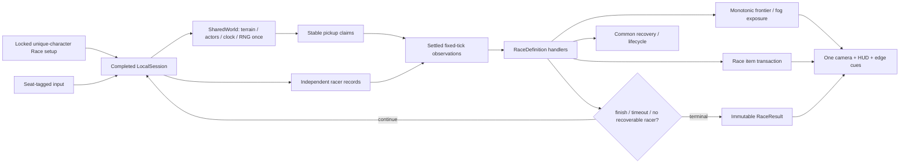

# Phase 5: Race — Research

**Researched:** 2026-10-14  
**Domain:** deterministic local competitive racing, leader-relative fog, contextual consumables, and immutable ranked results  
**Confidence:** MEDIUM

<user_constraints>
## User Constraints (from CONTEXT.md)

### Locked Decisions

- Configure and lock a unique-character roster before starting. Reuse existing controller/shared-keyboard setup and binding surfaces, with unchanged solo entry.
- Represent Race as validated settings plus lifecycle/result handlers, not mode-ID branches scattered through input, renderer, or the shared world engine.
- One shared course, actor clock, seed/RNG stream ownership, and deterministic pickup arbitration; every racer retains independent movement, health, inventory, powers, revival state, and stats.
- The advancing leader determines the fog boundary. It must not retreat when the leader backs up, dies, disconnects, or finishes. Exposure drains feathers at a configured cadence; the character does not instantly die on entering fog.
- Camera, world fog, edge cues, warnings, health feedback, and HUD keep leaders and trailers understandable in one scene without split-screen.
- Race clock and progress survive interruption/reclaim without resets or duplicate progress. Distinguish per-player disconnect/dropout/death from global safety suspension and explicit shared menus.
- Resolve ties, same-step finishes, timeout, deaths, last-survivor cases, no-controller cases, and terminal recovery deterministically from fixed simulation state.
- Supply at least one usable offensive and one defensive contextual consumable. Eligibility, targets, charges, timing, effects, and stats use the common item system. Invalid use, departed/ineligible targets, and changed world state spend nothing and cannot partially mutate the race. No effect leaks into unrelated modes.
- Keep personal revival (250 earned forward tiles) separate from innate character powers (100). Death retains the established spill/clear economy; disconnect does not. Forced repositioning cannot grant recharge or trigger fake finishes.
- Results use immutable records for every participant: podium rank including true ties, distance, elapsed/finish time, finish/death/departure status, fog damage, and relevant item/interaction statistics.
- Contextual fog, item, revival, flare, and transfer feedback honors mute and reduced motion. Automated browser execution must mute device output.
- Earlier solo/co-op/Relay behavior remains covered; all mode handlers and a tested authoring example must satisfy ARCH-02 without editing core input or renderer for each new definition.

### the agent's Discretion

These defaults were communicated as assumptions and are not additional user answers: four seats; a 500-tile finish; a 180-second active-play limit. Keep them editable through validated settings rather than hiding them as engine constants. Initial fog tuning from research is a 12-tile buffer and one feather per second of continuous exposure. Playtest against baseline hop speed and revise if necessary, with boundary tests and an explicit rationale.

Research must choose concrete fair policies for finish versus timeout ordering, true ties, disconnected grace/reclaim, last-survivor continuation, personal-revive windows, fog damage/protection interaction, and the initial offensive/defensive items. Keep choices simple, visible, configurable, and tested. Default shared card effects to baseline unless a declared Race mechanic deliberately changes a specific player; no implicit global card stacking.

### Deferred Ideas (OUT OF SCOPE)

None stated in CONTEXT.md.
</user_constraints>

<phase_requirements>
## Phase Requirements

| ID | Description | Research support |
|---|---|---|
| ARCH-02 | Modes compose reusable mechanics and explicit lifecycle handlers. | A `RaceDefinition` selects settings, item eligibility, lifecycle policy, fog policy, and result policy through the shared mode/session seams. |
| ITEM-06 | Usable offensive and defensive Race consumables cannot corrupt state. | Validate-then-commit item plans, Race-only eligibility, stable targets, and a separate keyed item stream. |
| RACE-01 | Configurable shared course, finish distance, and clock. | Strict settings with default 4 seats / 500 tiles / 180 active seconds and one shared-world clock. |
| RACE-02 | Leader-relative, non-instant deadly fog. | Monotonic leader frontier, strict boundary, per-seat continuous exposure and standard one-feather damage. |
| RACE-03 | Camera and feedback make race state legible. | One leader-biased camera plus scene fog, off-screen edge markers, racer HUD, warnings, health response, and reduced-motion/mute paths. |
| RACE-04 | Deterministic dropout/reclaim, ties, timeout, death, and last-survivor outcome. | Fixed-tick terminal precedence, seat-stable lifecycle state machine, immutable records, and competition ranking. |
| RACE-05 | Composable Race-only offensive/defensive items. | Typed item descriptor and effect ledger with all-or-nothing activation. |
| RACE-06 | Ranked podium and complete per-character statistics. | Freeze a mode-specific result snapshot at one terminal transition; display tied rank tiers rather than arbitrary order. |
| UI-06 | Fog/item/recovery feedback respects mute and reduced motion. | Existing game audio preference and motion preference gate supplementary events; built browser runs use `--mute-audio`. |
</phase_requirements>

## Summary

Race should be a configuration and lifecycle package over the completed Phase 2 shared-session and Phase 3 consumables/recovery seams. The current production tree is still in Phase 1 policy extraction: it has a single-player `Game`, one-player `Renderer.draw`, and one `RunInventory`; it does not yet expose `LocalSession`, racer lifecycle records, consumables, or a result model. Phase 5 implementation must therefore start with an API preflight against completed Phase 1–3 summaries and live exports, then use those actual contracts rather than copying the provisional names in this research. [VERIFIED: `src/game.ts`; VERIFIED: `src/render.ts`; VERIFIED: `.planning/phases/02-shared-local-session/02-01-PLAN.md`; VERIFIED: `.planning/phases/03-survive-together-consumables/03-RESEARCH.md`]

Use one common course and one world tick. The race policy reads a completed fixed tick after all racer movement, hazards, recovery decisions, pickup claims, and progress events have settled. It then records finishes, advances the monotonic fog frontier, applies timer precedence, and either continues or freezes a single immutable result. This ordering prevents player-array order, render timing, or a late controller event from deciding a fog hit, a tie, or a podium. [VERIFIED: `src/game.ts`; VERIFIED: `05-CONTEXT.md`; ASSUMED: final Phase 2/3 event names]

**Primary recommendation:** Build `RaceDefinition` as a validated mode handler that consumes the completed shared-session observations. Keep its fog, item, recovery, lifecycle, camera observation, and ranking policies in dedicated modules; core input dispatch and the common world/renderer only consume generic session views.

## Architectural Responsibility Map

| Capability | Primary tier | Secondary tier | Rationale |
|---|---|---|---|
| Fixed tick, course, actors, seeded pickup identity, and claim resolution | In-process simulation | Browser client | Shared state must advance once regardless of racer count. [VERIFIED: `ARCH-03`; VERIFIED: `02-01-PLAN.md`] |
| Racer position, health, inventory, personal frontier, power/revival readiness, lifecycle, and stats | In-process simulation | Browser client | It belongs to a durable seat and must not be derived from a global course frontier. [VERIFIED: `05-CONTEXT.md`; VERIFIED: `04-RESEARCH.md`] |
| Fog boundary, exposure accounting, terminal ordering, and race ranks | In-process simulation | Browser client | These rules must be fixed-step deterministic and independent of paint order. [VERIFIED: `05-CONTEXT.md`] |
| Setup, HUD, scene overlays, target selection, feedback, and podium | Browser client | In-process simulation | The UI renders and requests; authoritative mode handlers validate and commit. [VERIFIED: `AGENTS.md`; VERIFIED: `04-UI-SPEC.md`] |
| Controller snapshots, shared keyboard bindings, durable preferences | Runtime shell via SDK / browser client | In-process simulation | The napplet consumes the approved injected transport and SDK storage, never native polling or host APIs. [VERIFIED: `AGENTS.md`; VERIFIED: `docs/boundaries.md`] |

## Project Constraints (from AGENTS.md)

- Use codebase-memory MCP discovery before grep for code symbols and call paths; grep is appropriate for configuration, strings, or insufficient graph data. [VERIFIED: `AGENTS.md`]
- Keep the napplet framework-light and within the shell boundary. Do not add shell code or access signer keys, relay pools, cookies, service workers, host DOM, `localStorage`, `sessionStorage`, direct `fetch`, `WebSocket`, or `EventSource`. [VERIFIED: `AGENTS.md`; VERIFIED: `docs/boundaries.md`]
- Use `@napplet/sdk` helpers for authorized capability calls; do not import `@napplet/shim`, invent a NAP or wire format, or use native controller polling. [VERIFIED: `AGENTS.md`; VERIFIED: `docs/package-surfaces.md`; VERIFIED: `docs/gamepad.md`]
- Preserve the any-size applet, runtime theme, no-masthead/footer, no-scrollbar, and four-frame behaviour; visual work uses the established game aesthetic. [VERIFIED: `AGENTS.md`; VERIFIED: `docs/design-patterns.md`]
- Run `pnpm type-check`, `pnpm build`, `pnpm test:guidance`, and `pnpm test:conformance` before phase completion. Browser proof must use a built opaque `allow-scripts` iframe and mute device audio. [VERIFIED: `AGENTS.md`; VERIFIED: `package.json`]

## Standard Stack

### Core

| Library / module | Version | Purpose | Why standard |
|---|---:|---|---|
| Project TypeScript shared-session seam | completed Phase 2 required | One world plus independently-owned seat state | It is the approved ownership boundary and prevents `Game`-per-racer clocks/RNG. [VERIFIED: `02-01-PLAN.md`; ASSUMED: final export names] |
| Project composable mode rules | Phase 1 in progress | Validate Race settings and attach lifecycle policies | `composeModeDefinition` already rejects unsafe/unknown policy fields and freezes authored rules. [VERIFIED: `src/mode-rules.ts`] |
| Phase 3 common consumables/recovery system | planned dependency | Charges, activation transactions, safe returns, 250-tile personal revival | Race must reuse it rather than introduce a second item or recovery model. [VERIFIED: `03-RESEARCH.md`; ASSUMED: final export names] |
| Existing seed schemas and pure keyed samplers | project source | Stable terrain/coin generation and future item stream isolation | Level schemas explicitly prohibit altering released RNG/draw order. [VERIFIED: `docs/seeds.md`] |
| Node test runner + Playwright fixtures | Node / Playwright 1.61.0 | Model, fixed-step, built-iframe, and visual evidence | Existing tests use Node’s test runner and muted Chromium fixtures. [VERIFIED: `package.json`; VERIFIED: `tests/gamepad-runtime.mjs`] |

### Supporting

| Module | Purpose | When to use |
|---|---|---|
| `src/market/run.ts` / market catalog | Per-seat card, power, cosmetic, wallet and market primitives | Reuse per-player inventory only; Race policies must not make a card mutate the shared world. [VERIFIED: `src/market/run.ts`; VERIFIED: `05-CONTEXT.md`] |
| `src/character-powers.ts` | Existing innate 100-tile character save contract | Preserve it separately from personal 250-tile revival and item effects. [VERIFIED: `src/character-powers.ts`; VERIFIED: `05-CONTEXT.md`] |
| existing voxel renderer/audio services | Scene, materials, feedback and mute-aware audio graph | Add generic race render views/events, not a second renderer or direct speaker output. [VERIFIED: `src/render.ts`; VERIFIED: `src/audio.ts`; VERIFIED: `05-CONTEXT.md`] |

### Alternatives considered

| Instead of | Could use | Tradeoff |
|---|---|---|
| Monotonic leader frontier | Current leader’s current y | A retreat, death, or disconnect would pull fog back and reward non-progress. [VERIFIED: `05-CONTEXT.md`] |
| Fixed-tick result snapshot | Render-time/array-order result calculation | Rendering and roster order are not fair timing authorities. [VERIFIED: `05-CONTEXT.md`] |
| Generic session render view + race presentation policy | Race branches inside `Renderer.draw` or core input | This fails ARCH-02 and makes future mode composition expensive. [VERIFIED: `ARCH-02`; VERIFIED: `05-CONTEXT.md`] |
| Separate keyed Race item sampler | Terrain, coin, market, or mob RNG draws | It would alter released course output or make course data depend on update order. [VERIFIED: `docs/seeds.md`; VERIFIED: `03-RESEARCH.md`] |

**Installation:** None. This phase must add no external package or manifest capability. [VERIFIED: `package.json`; VERIFIED: `AGENTS.md`]

## Package Legitimacy Audit

No package installation is proposed; the legitimacy gate is not applicable. [VERIFIED: `package.json`]

## Architecture Patterns

### System architecture



### Required integration preflight

Before writing production Race code, read Phase 1–3 committed summaries and live exports, then record this table in the first Race plan summary. Do not implement against a plan-only API. [VERIFIED: `05-CONTEXT.md`; VERIFIED: `02-01-PLAN.md`; VERIFIED: `03-01-PLAN.md`]

| Required seam | Current inspected fact | Required completed API / reconciliation question |
|---|---|---|
| mode definition | `Game` accepts a frozen `definition` and exposes `rules`; current groups only cover solo policy. | Where validated mode settings and lifecycle/result handler attachment live after Phase 1–3; Race must add its settings there rather than duplicating parsing. [VERIFIED: `src/game.ts`; VERIFIED: `src/mode-rules.ts`] |
| shared world / seat player | Current `Game` still contains both world and player state. | Actual `LocalSession`, world update entry, player record/view, and stable seat ordering from Phase 2. [VERIFIED: `src/game.ts`; VERIFIED: `02-01-PLAN.md`] |
| recovery/personal progress | Current innate readiness is tied to one Game’s `maxY`. | Per-seat earned-forward watermark, 250-charge, protection and recovery transaction from Phase 3. [VERIFIED: `src/game.ts`; VERIFIED: `04-RESEARCH.md`; VERIFIED: `03-RESEARCH.md`] |
| item catalogue / pickup ledger | Current catalog has card/power/cosmetic/pack only. | Consumable type, mode eligibility, owner inventory, deterministic sampler, pickup arbitration and all-or-nothing activation from Phase 3. [VERIFIED: `src/market/types.ts`; VERIFIED: `03-RESEARCH.md`] |
| rendering and camera | Current `Renderer.draw(game, character, dt)` paints a single traveler and follows `game.maxY`. | Generic session view/render path and camera-policy extension from Phase 2, without Race-only core renderer branches. [VERIFIED: `src/render.ts`; VERIFIED: `02-01-PLAN.md`] |
| results / owner hand | Current terminal callback is a one-player `onEnd`; current market is one `RunInventory`. | Immutable result record and owner-labelled one-tree UI from Phases 2–3. [VERIFIED: `src/game.ts`; VERIFIED: `03-RESEARCH.md`] |

### Pattern 1: Validated Race definition and handler bundle

Define Race as a local, code-authored descriptor that separately validates settings and supplies generic lifecycle hooks. Do not use `if (mode === 'race')` through shared update, input, or rendering code. The precise types must use the completed Phase 1–3 contracts. [VERIFIED: `ARCH-02`; VERIFIED: `src/mode-rules.ts`; ASSUMED: final handler interfaces]

```ts
type RaceSettings = Readonly<{
  maxSeats: number;          // default 4; integer 2..4
  finishTiles: number;       // default 500; integer 25..10_000
  activeLimitSeconds: number;// default 180; finite 30..3_600
  fogBufferTiles: number;    // default 12; finite 1..64
  fogDamageSeconds: number;  // default 1; finite .25..10
  reconnectGraceSeconds: number; // default 12 active seconds; 0..120
}>;

const raceDefinition = defineMode({
  id: 'race',
  settings: validateRaceSettings(input),
  lifecycle: raceLifecycle,
  presentation: racePresentation,
  result: raceResultPolicy,
  items: raceItemEligibility,
});
```

Reject unknown keys, non-finite values, fractional/inverted integers, duplicate characters, more than four seats, or a roster under two players before the run allocates mutable state. Snapshot the accepted settings into the course/run descriptor and result record. [VERIFIED: `src/mode-rules.ts`; VERIFIED: `05-CONTEXT.md`; ASSUMED: final descriptor extension]

### Pattern 2: One post-settlement terminal ordering

For each fixed simulation tick, advance the world once and each active racer in stable seat-ID order. Gather observations; do not terminally rank a racer midway through the player loop. Then execute this ordered policy. [VERIFIED: `src/game.ts`; VERIFIED: `02-01-PLAN.md`; ASSUMED: completed session observation API]

1. Capture every genuine, accepted movement-earned frontier observed during this completed tick in an immutable tick ledger **before** lifecycle exclusion. A leader who advances and then dies or disconnects in the same tick still contributes that earned frontier once; a teleport/recovery/forced placement does not.
2. Commit valid deaths, recoveries, disconnect transitions, picks, and item effects using their own transactions.
3. Mark every racer still living after hazard settlement whose settled **earned** forward distance is at least `finishTiles` as finished with the same `simulationTick` and `elapsedActiveMs`; their finish occurs before timeout on that tick. A fatal same-tick hazard wins over finish.
4. Update `leaderFrontier = max(previousLeaderFrontier, tickLedger.earnedFrontiers, every active-or-finished racer’s earned forward distance)`, then update the fog boundary from it.
5. Apply exactly the accumulated fog exposure interval to still-active, unprotected racers using their settled visible ground position; normal damage/invulnerability rules resolve one feather loss at a time.
6. If elapsed active time reached the limit, first close every pending recovery offer as `race-timeout`, then freeze the timeout result after the finish records from this tick are committed. Otherwise, freeze only when all roster participants are finished, eliminated, departed, or non-reclaimably forfeited and no valid Phase 3 recovery decision is pending.

This makes a same-tick finish at the clock boundary a finish, makes same-tick finishers true ties, preserves a movement-earned leader advance despite same-tick death/disconnect, gives fatal hazards precedence over finishing, and ensures timeout distance uses the exact settled tick. A rejected move, a forced safe placement, a recovery relocation, or a reconnect return cannot enter the earned-progress feed and thus cannot finish or recharge anything. [VERIFIED: `05-CONTEXT.md`; VERIFIED: `04-RESEARCH.md`; ASSUMED: completed movement provenance API]

### Pattern 3: Monotonic leader-relative fog

Keep a Race-owned `leaderFrontier` and `fogBoundary` rather than reusing the solo wave. Let `earned(p)` be a racer’s personal earned/course high-water and `groundY(p)` be the racer’s actual settled, visible ground position. Boundary/accounting use `earned`; exposure and target range use `groundY`. On each settled tick:

```ts
leaderFrontier = Math.max(leaderFrontier, ...tickLedger.earnedFrontiers, ...activeOrFinished.map(earned));
fogBoundary = Math.max(fogBoundary, leaderFrontier - settings.fogBufferTiles);
inFog = active && !protected && groundY(player) < fogBoundary;
```

The strict `<` boundary means a racer exactly on the line is safe. Maintain `fogExposureSeconds` only while continuously `inFog`; reset it immediately when the racer exits fog or starts genuine recovery protection. A racer whose earned high-water remains ahead but who walks or drifts backward across the boundary enters fog and takes damage normally. For each complete configured interval, dispatch one named `fog` damage event through the existing per-player health pipeline, respecting its invulnerability/recovery state; record attempted/landed fog hits separately so the result can report actual feathers lost. Fog never calls terminal death directly. Finished, ghosted/disconnected, departed, and eliminated racers are excluded from future exposure and cannot change the monotonic frontier. [VERIFIED: `05-CONTEXT.md`; VERIFIED: `src/game.ts`; ASSUMED: Phase 2 per-player health interface]

**Initial protection rule:** a successful personal revival grants two active seconds of protection. It freezes/resets the fog exposure counter, blocks fog and ordinary immediate-hazard damage, permits movement, but blocks pickup claims and offensive activation during the protection window. Reclaim is not a recovery: it never creates, extends, resets, or restores a protection deadline. [VERIFIED: `03-RESEARCH.md`; ASSUMED: Race-specific pickup/offense lock]

### Pattern 4: Race lifecycle and recovery policy

Use explicit states, not disconnected boolean flags. `active`, `finished`, `eliminated`, `recovery-offered`, `disconnected-grace`, `forfeited`, and `departed` are mutually exclusive racer states. A state transition creates an append-only event with tick, active-clock time, actor seat, and reason. [VERIFIED: `05-CONTEXT.md`; VERIFIED: `04-RESEARCH.md`; ASSUMED: final enum spelling]

| Event | Chosen policy |
|---|---|
| One racer dies, another remains active | Apply the delivered death transaction only to the dead racer (spill wallet/cosmetics, clear their run cards/powers/cosmetics/items); open that racer’s normal personal-revival offer when eligible. Other racers continue and the active clock continues. [VERIFIED: `src/game.ts`; VERIFIED: `05-CONTEXT.md`] |
| Personal revival | Reuse Phase 3’s one charge, 250 personally earned new tiles, and bounded eight-active-second explicit offer. It returns the same seat/character safely at or behind its last valid course position, with the protection policy above; it restores no spilled inventory. [VERIFIED: `03-RESEARCH.md`; VERIFIED: `05-CONTEXT.md`; ASSUMED: exact Phase 3 offer API] |
| All racers are dead with pending personal recovery | Keep the existing fixed active-session clock and Race clock running while the normal bounded Phase 3 recovery offer is pending; the shared world also continues its ordinary fixed ticks. Only an explicit pause/menu/focus/all-controller safety suspension freezes these clocks. A valid accept uses normal safe placement; decline/expiry finalizes once no other valid recovery exists. Reaching Race timeout closes pending offers as `race-timeout` and freezes the timeout result. [VERIFIED: `05-CONTEXT.md`; VERIFIED: `03-RESEARCH.md`; ASSUMED: exact completed recovery API] |
| One or more racers active; others dead/forfeited | Continue. A last living racer can finish or time out normally; no co-op team-game-over shortcut applies. [VERIFIED: `05-CONTEXT.md`] |
| Controller loss | Mark the racer `disconnected-grace`, retain character/seat/items/stats, make its avatar a non-colliding non-claiming ghost, and continue the world/clock whenever any racer remains active. It is not a death and produces no spill. [VERIFIED: `05-CONTEXT.md`; VERIFIED: `03-RESEARCH.md`] |
| Reclaim before grace expires | The validated router may bind a replacement device/generation to the reserved original seat after a fresh neutral input; it must not allocate a character or admit a new participant. Reattach at an authoritative safe location no farther ahead than its preserved earned distance and clear held input. Reclaim preserves health, items, personal charge, earned frontier, fog exposure accumulator, clock, cooldowns, and any existing protection deadline exactly; it mints no fresh protection. Reclaim does not change leader frontier, recharge, or finish record. [VERIFIED: `05-CONTEXT.md`; VERIFIED: `03-RESEARCH.md`; ASSUMED: final replacement-device router API] |
| Grace expiration / deliberate leave | At the default 12 active seconds, or immediately on confirmed leave, mark `forfeited`/`departed` DNF. Preserve inventory on disconnect/leave as required by the current economy policy, but exclude the racer from fog, claims, finish, and terminal recovery. A later input cannot create a new race entrant. [VERIFIED: `05-CONTEXT.md`; ASSUMED: leave economy is explicitly preserved by completed lifecycle layer] |
| All controllers unavailable | Enter named `waiting-for-reclaim`; freeze world and active race clock. A validated replacement-device reclaim of a reserved seat resumes; finalization occurs only after every grace/eligible recovery has deterministically resolved. [VERIFIED: `05-CONTEXT.md`; ASSUMED: global suspension owner API] |

The default 12-second reconnect grace is intentionally measured in **active race seconds**, so opening a shared menu or all-controller suspension cannot secretly expire a player. It is a tuning setting and test fixture parameter, not a global constant. [ASSUMED: selected fair default]

### Pattern 5: Contextual Race consumables

Reuse the Phase 3 discriminated consumable model and transaction design. Initial Race eligibility is deliberately limited to personal revival plus the two Race-only definitions below. Common `Revival` and `Flare` have `raceEligible: false`: they do not appear in Race world sampling, capacity, shop stock, hand UI, target UI, or activation validation. This avoids an underspecified common-Revival acquisition/capacity contract and avoids Flare’s mass-teleport effect in a competition. [VERIFIED: `03-RESEARCH.md`; VERIFIED: `05-CONTEXT.md`; ASSUMED: selected initial Race eligibility]

| Item | Class | Target / effect | Default acquisition | Validation / feedback |
|---|---|---|---|---|
| **Mud Splash** | Offensive | Select one active, unprotected opponent within 16 actual visible-ground tiles ahead or behind. For 2 active seconds their hop cooldown is multiplied by 1.35; it neither moves them nor changes health, position, score, fog boundary, or earned progress. | Race shop price 30; pure Race-only pickup sampler bucket 0 of 1,250. | Revalidate target state/range/protection at commit. Render a brown voxel splash and target nameplate; play a muted-aware short effect cue. [ASSUMED: tuning/pricing] |
| **Fog Lantern** | Defensive | Self only. For 3 active seconds it prevents fog damage and pauses/resets exposure; it does not prevent traffic, water, mobs, or items. | Race shop price 30; pure Race-only pickup sampler bucket 1 of 1,250. | Reject if owner is not active, is protected, or already lantern-lit. Render a warm lantern halo/edge cue; play a muted-aware short effect cue. [ASSUMED: tuning/pricing] |

Both item drops use a separate `race-item-schema-1` keyed stream based on captured run identity plus pickup anchor and mode descriptor. The stream is mutually exclusive with itself and never consumes terrain, coin-denomination, market, mob, death-spill, or audio randomness. Its version is recorded in the Race descriptor/result; do not modify released `ph1`–`ph3` level schemas. If Phase 3 has already established one extensible item sampler/version registry, register the Race sampler there instead of inventing parallel hashing. [VERIFIED: `docs/seeds.md`; VERIFIED: `src/death-spill.ts`; VERIFIED: `03-RESEARCH.md`; ASSUMED: final sampler registry]

Activation is a two-stage transaction: create a side-effect-free plan from immutable inputs `(owner state, item charge, target identity+generation, mode eligibility, world tick, range, protection)`; immediately before commit revalidate every condition, debit exactly one charge and append the effect event atomically. Any failure makes no debit, target change, audio success event, or result-stat update. [VERIFIED: `ITEM-06`; VERIFIED: `03-RESEARCH.md`]

### Pattern 5a: Explicit launch card policy

Race starts with empty card/power/pack hands and a deny-by-default metadata policy: every existing `CardDefinition`, `PowerDefinition`, and `PackDefinition` has `raceEligible: false`; cosmetics remain appearance-only and may be worn but never change race simulation. Existing cards modify shared lane/actor/economy hooks such as traffic speed, platform length, mob timing, wave settings, coin pulls, or hand capacity, so none is safe to silently admit to a competitive shared world. [VERIFIED: `src/market/items/*.ts`; VERIFIED: `src/market/types.ts`; VERIFIED: `05-CONTEXT.md`]

The catalogue extension must encode a typed mode eligibility set rather than maintain an undocumented ID list. Initial allowed values are `solo`, `survive-together`, `relay`, and `race`; legacy definitions preserve their released solo semantics, while Race filters card/power/pack offers by `raceEligible`. A future Race card must explicitly declare `raceEligible: true`, affect only its owner’s documented racer state, and carry a parameterized reversed-roster proof that it does not mutate shared terrain, actor time, fog, another racer, or pickup arbitration. Until that proof exists, it cannot enter Race shop stock, a pack, a world pickup, a starting hand, or the result ledger as a usable card. [VERIFIED: `05-CONTEXT.md`; VERIFIED: `src/market/types.ts`; ASSUMED: final metadata field spelling]

### Pattern 6: Ranking and immutable results

Create the result once from a copy of the terminal seat records and append-only event ledger. It contains `modeId`, captured course and Race settings, terminal reason, simulation ticks/elapsed active milliseconds, monotonic leader frontier/fog boundary, and one `RaceParticipantResult` per locked roster seat. The result view is read-only; old input, item targets, reconnects, viewport changes, or opening a board must not mutate it. [VERIFIED: `05-CONTEXT.md`; VERIFIED: `03-RESEARCH.md`; VERIFIED: `04-UI-SPEC.md`]

Ranking policy:

1. Finishers sort by `finishSimulationTick`; same tick shares a rank regardless of seat order, character, device, or exact input ordering.
2. On timeout, unfinished active racers sort after finishers by settled earned distance descending. Equal distance shares a rank.
3. Eliminated, forfeited, and departed racers are DNF after finishers/timeout racers; DNF is grouped by equal lifecycle/status rather than falsely assigning a race placement. The display may retain stable seat order only as a visual order inside an explicitly shared rank/DNF group.
4. Use competition ranks: `=1, =1, 3`, never `1, 2` for a true tie.

Each participant record includes marker, seat, character, lifecycle/finish/death/departure status, rank or DNF, earned distance, finish/terminal active time, deaths, personal revives used, innate powers used, fog attempted/landed damage, each item collected/used/received, and pickup/market interactions. Preserve pre-death item/coin counters in the ledger even though death clears the live inventory. [VERIFIED: `05-CONTEXT.md`; VERIFIED: `src/game.ts`; VERIFIED: `04-UI-SPEC.md`; ASSUMED: final result field names]

### Pattern 7: One camera, legible race state

Keep one shared camera. Its focus follows a leader-biased course anchor (current monotonic leader frontier, with normal smoothing) rather than a per-racer camera or split screen. A racer outside the viewport receives a persistent edge marker containing marker/P-number, character, signed distance to leader/fog boundary, health feathers, lifecycle, and an arrow pointing forward/back. A fog ribbon at the actual boundary and the leader marker make pressure visible in the scene; the HUD makes trail state legible when the racer itself is outside the camera. [VERIFIED: `05-CONTEXT.md`; VERIFIED: `src/render.ts`; ASSUMED: exact session-camera view API]

Use the established voxel/material surfaces: game canvas remains focal, boards use paper/wood/ink/gold materials, controls are at least 44px, and the persistent hand/market tree retains a clear `Viewing Pn · character` owner. Race setup and podium use mode boards rather than website panels. On 240–319px show one named board page, at 320×560 show one roster/result page plus large navigation, at 900×600 use scene plus edge HUD and two-column board, and at 1000×280 retain only current state plus one primary action. Never introduce a scrollbar. [VERIFIED: `04-UI-SPEC.md`; VERIFIED: `AGENTS.md`; ASSUMED: Race uses the completed shared board primitives]

Reduced motion uses a static fog band, fixed warning ring and static lantern/splash indicators; it removes camera shake, splash travel, board entrance and pulsing. Audio events are supplementary, emitted through the existing game audio service, and are suppressed by the app mute preference; all automated browser launches include `--mute-audio` while still exercising the audio graph. [VERIFIED: `AGENTS.md`; VERIFIED: `package.json`; VERIFIED: `tests/gamepad-runtime.mjs`; ASSUMED: final session audio event router]

## Don’t Hand-Roll

| Problem | Don’t build | Use instead | Why |
|---|---|---|---|
| Controller polling / device discovery | `navigator.getGamepads`, browser global listeners, or a bespoke parent protocol | Existing injected/draft gamepad transport and Phase 2 router | Native authority is explicitly forbidden; current adapter owns device lifecycle. [VERIFIED: `AGENTS.md`; VERIFIED: `docs/gamepad.md`] |
| Persistent storage | Browser storage for race state/bindings | SDK storage through existing preference/binding services | Browser storage violates the napplet boundary. [VERIFIED: `AGENTS.md`; VERIFIED: `docs/boundaries.md`] |
| A second world/seed replay per racer | One `Game` instance per seat or seed reconstruction at Race start/reclaim | Completed `LocalSession` and one live `SharedWorld` | It duplicates actor time/RNG and loses live continuity. [VERIFIED: `02-01-PLAN.md`; VERIFIED: `05-CONTEXT.md`] |
| Result reconstruction from final avatars | Read mutable inventory/position after end | Append-only event ledger plus frozen `RaceResult` | Death and departure erase live state needed for accurate results. [VERIFIED: `05-CONTEXT.md`; VERIFIED: `04-RESEARCH.md`] |
| Per-item partial UI edits | Deduct then search/move target | Shared validate/revalidate/commit activation transaction | Targets can die, leave, or become protected in the same tick. [VERIFIED: `ITEM-06`; VERIFIED: `03-RESEARCH.md`] |

## Common Pitfalls

### Fog uses the current leader position

**What goes wrong:** Fog retreats when the leader backs up, dies, or disconnects.  
**Avoidance:** Advance only the Race-owned maximum earned leader frontier and monotonic fog boundary; test retreat/death/reclaim/finish cases. [VERIFIED: `05-CONTEXT.md`]

### Finish/timeout occurs in player iteration order

**What goes wrong:** The first player in an array receives first place even when two racers cross in one simulation tick.  
**Avoidance:** Collect settled observations, mark all same-tick finishes together, and rank only after the tick. Reverse roster order in the test. [VERIFIED: `05-CONTEXT.md`]

### Fog damage bypasses normal health semantics

**What goes wrong:** Fog instantly kills or repeatedly damages through invulnerability/protection.  
**Avoidance:** Send named, cadence-gated fog damage through the existing per-player health pipeline and ledger actual losses. [VERIFIED: `05-CONTEXT.md`; VERIFIED: `src/game.ts`]

### Reclaim grants a strategic reset

**What goes wrong:** A disconnect/reconnect gets free distance, a charge, a finish, healing, or a movable fog boundary.  
**Avoidance:** Restore only the original seat at safe no-ahead placement; preserve the earned watermark and clock, clear held input, and test every meter before/after. [VERIFIED: `05-CONTEXT.md`; VERIFIED: `04-RESEARCH.md`]

### Race items leak into solo, co-op, or Relay

**What goes wrong:** A catalog item appears/picks up/activates outside its intended mode.  
**Avoidance:** Apply eligibility at catalogue, world sampling, pickup claim, shop, UI, and activation validation; parameterize negative mode tests. [VERIFIED: `ITEM-06`; VERIFIED: `03-RESEARCH.md`]

### A menu or missing controller advances time

**What goes wrong:** A player loses grace, fog health, protection, or the whole race during an explicit shared menu/suspension.  
**Avoidance:** Define active-race clock ownership once; freeze it and world updates during named global suspension and test input/reclaim boundaries. [VERIFIED: `05-CONTEXT.md`; ASSUMED: completed session pause API]

## Assumptions Log

| # | Claim | Section | Risk if wrong |
|---|---|---|---|
| A1 | Completed Phase 2 exposes a single shared session/world plus stable seat observations; final names remain unknown. | Integration preflight | Implementing to plan-only names would require rework. |
| A2 | Phase 3 recovery offers can continue under the ordinary fixed active session clock when all racers are dead, and Race can close them at timeout. | Lifecycle | Requires exact API reconciliation before implementation. |
| A3 | Race starts with 12 active seconds reconnect grace; reclaim preserves rather than creates protection. | Lifecycle | Balance/fairness tuning may change after playtest. |
| A4 | Mud Splash and Fog Lantern, their 30-coin prices, duration/range, and 1/1250 each sampler rates are suitable launch defaults. | Race items | Balance may require changes, but must retain versioned isolated sampling. |
| A5 | Existing shared-session renderer exposes a generic camera/view policy extension. | Camera/presentation | Might require a Phase 2/4-compatible adapter rather than a new interface. |

## Chosen Defaults and Execution Dependency

The following are resolved launch defaults, not open design questions: personal revival plus Mud Splash/Fog Lantern are Race’s entire consumable set; common Revival/Flare are Race-ineligible; legacy cards/powers/packs are Race-ineligible; cosmetics are appearance-only; reconnect grace is 12 active seconds; reclaim safely rebinds the reserved seat and preserves every resource/timer/protection deadline; all-dead recovery offers run on the ordinary active clock and Race timeout closes them; and item rates/prices are `1/1250` each and 30 coins each. All numeric settings remain validated/configurable and their sampler version remains captured for deterministic replay. [ASSUMED: selected launch defaults; VERIFIED: `05-CONTEXT.md`; VERIFIED: `docs/seeds.md`]

The sole implementation dependency is an actual-API preflight after Phase 3 completes: reconcile the shipped session, recovery, item, result, renderer, and router exports; map the choices above to those exports; and stop before product edits if a required shared seam is missing. This is reconciliation, not permission to reopen the policy defaults. A focused Race playtest validates the 500-tile economy, fog buffer/cadence, reconnect grace, item prices, rates, durations, and range; tuning changes require a new captured Race configuration/sampler version and matching fixed-step evidence. [VERIFIED: `05-CONTEXT.md`; VERIFIED: `docs/seeds.md`; ASSUMED: final API names]

## Environment Availability

| Dependency | Required by | Available | Version | Fallback |
|---|---|---:|---|---|
| Node | TypeScript/tests/build | ✓ | v26.7.0 | — |
| pnpm | repository scripts | ✓ | 10.8.0 | — |
| Playwright package | built iframe visual/runtime tests | ✓ | project dependency | project test fixture |
| Chromium executable on PATH | direct runtime probe | ✗ | — | Playwright-managed browser used by current tests |
| Napplet conformance CLI | phase gate | ✓ | project dependency | — |

No missing external dependency blocks the phase. [VERIFIED: local environment probe; VERIFIED: `package.json`]

## Validation Architecture

### Test framework

| Property | Value |
|---|---|
| Framework | Node built-in test runner plus Playwright-backed built-artifact fixtures. [VERIFIED: `package.json`] |
| Config | None; scripts live in `package.json`. [VERIFIED: `package.json`] |
| Quick command | `node --test tests/race.test.mjs tests/race-items.test.mjs tests/race-results.test.mjs` |
| Full phase gate | `pnpm type-check && pnpm build && pnpm test:guidance && pnpm test:conformance` |

### Phase requirements → test map

| Requirement | Behaviour | Automated evidence | File exists? |
|---|---|---|---|
| ARCH-02 | A custom Race descriptor adds policies without core mode branches; malformed settings fail closed. | `node --test tests/race-definition.test.mjs` | ❌ Wave 0 |
| ITEM-06 / RACE-05 | Race-only item eligibility, target revalidation, no-spend invalid use, stream isolation. | `node --test tests/race-items.test.mjs` | ❌ Wave 0 |
| RACE-01 | Locked setup, defaults, one world tick and active clock. | `node --test tests/race.test.mjs` | ❌ Wave 0 |
| RACE-02 | Frontier/boundary monotonicity, exact threshold, cadence, protection. | `node --test tests/race-fog.test.mjs` | ❌ Wave 0 |
| RACE-03 / UI-06 | Scene/HUD/edge feedback, mute/reduced motion, all frames/themes. | `pnpm build && node tests/race-runtime.mjs && node tests/race-layout.mjs` | ❌ Wave 0 |
| RACE-04 | Same-tick finish/timeout, DNF, all-dead recovery, disconnect/reclaim, last survivor. | `node --test tests/race.test.mjs tests/race-results.test.mjs` | ❌ Wave 0 |
| RACE-06 | Immutable result/podium and true ties. | `node --test tests/race-results.test.mjs` | ❌ Wave 0 |

### Mandatory scenarios

- Run the same scenario with reversed seat-array construction and delivery order. Assert one world tick, identical pickup claimant, same fog state, same finish records, and same rank groups. [VERIFIED: `05-CONTEXT.md`]
- Pin fog at equality, just inside, just outside, partial cadence, exact cadence, two cadence intervals, leave/re-enter, active protection, leader retreat, leader death, disconnect, and finish. Include a racer whose earned high-water remains ahead of the boundary but whose actual ground position backtracks/drifts behind it; assert that they accrue fog exposure and damage. [VERIFIED: `05-CONTEXT.md`]
- In one completed tick, make the leader earn a new forward frontier and then die or disconnect. Assert that the tick ledger advances the monotonic fog boundary exactly once, but a fatal racer receives no finish even when that frontier crosses the target. [VERIFIED: `05-CONTEXT.md`; ASSUMED: final event API]
- Make two racers settle across 500 on one tick at exactly 180 seconds. Both must finish and share rank; then repeat an equal-distance timeout and DNF case. [VERIFIED: `05-CONTEXT.md`]
- Exercise active survivor continuation, all-dead offer accept/decline/expiry, no-controller suspension/reclaim, replacement-device seat rebind, grace expiry, deliberate leave, and late input after result freeze. Assert no reset/duplicate progress/free recharge and that reclaim preserves health/items/charge/earned frontier/fog exposure/cooldown/protection deadline rather than minting protection. [VERIFIED: `05-CONTEXT.md`]
- For both Race items, test invalid mode, inactive owner, stale/invalid target, target state change between plan and commit, range/protection violation, full inventory/charge failure, and a valid effect. Invalid paths must be byte/semantic no-ops. [VERIFIED: `ITEM-06`; VERIFIED: `03-RESEARCH.md`]
- Verify Race item sampler values at `-1, 0, 1, 2, 1249, 1250`, and compare terrain/coin vectors with sampling on/off and rows generated in different orders. [VERIFIED: `docs/seeds.md`; ASSUMED: bucket mapping selected above]
- Use a muted built opaque iframe at 240×240, 320×560, 900×600, 1000×280, and 2400×1200 in dark/light/reduced-motion variants. Inspect setup, multiple racers, fog, items, recovery, reclaim, market owner, timeout, and tied podium; assert no horizontal/vertical scrollbars and 44px interactive targets. [VERIFIED: `AGENTS.md`; VERIFIED: `04-UI-SPEC.md`]
- Re-run all earlier Phase 1 solo parity, Phase 2 session, Phase 3 co-op/items, and Phase 4 relay gates; do not accept source-search assertions as behavioural proof. [VERIFIED: `05-CONTEXT.md`]

### Sampling rate

- **Per task commit:** focused model tests and `pnpm type-check`.
- **Per plan/wave:** mode plus upstream focused suites and `pnpm build`.
- **Phase gate:** full commands above, all earlier mode gates, muted built-runtime evidence, and visually inspected image artifacts.

## Security Domain

### Applicable ASVS categories

| ASVS category | Applies | Control |
|---|---|---|
| V2 Authentication | No | Local seats are gameplay identities, not authenticated accounts. |
| V3 Session management | Yes | Stable seat/device generations, fresh neutral reclaim and terminal result freeze. [VERIFIED: `02-03-PLAN.md`; VERIFIED: `05-CONTEXT.md`] |
| V4 Access control | Yes | Mode handler validates owner, lifecycle, target, and Race eligibility before every mutation. [VERIFIED: `ITEM-06`; VERIFIED: `03-RESEARCH.md`] |
| V5 Input validation | Yes | Strict numeric Race settings, bounded controller transport, unique roster validation, and fail-closed item plans. [VERIFIED: `src/mode-rules.ts`; VERIFIED: `02-03-PLAN.md`] |
| V6 Cryptography | No | This phase adds no cryptographic operation or secret handling. [VERIFIED: `AGENTS.md`] |

| Threat | STRIDE | Mitigation |
|---|---|---|
| Forged/stale seat action or target | Spoofing / Tampering | Resolve current seat/device generation and revalidate lifecycle/target state immediately before commit. [VERIFIED: `03-RESEARCH.md`] |
| Shared world advances per racer | Tampering / DoS | One session tick, once-only world ownership, and 1/2/4 player comparison tests. [VERIFIED: `02-02-PLAN.md`] |
| Malformed settings/items cause non-determinism | Tampering | Strict validated descriptor, unknown-key rejection, and isolated seeded sampler. [VERIFIED: `src/mode-rules.ts`; VERIFIED: `docs/seeds.md`] |
| Direct device or storage access | Elevation of privilege | Use existing SDK/injected transport only; guidance tests reject forbidden native/shell APIs. [VERIFIED: `AGENTS.md`] |
| Late action changes published outcome | Repudiation / Tampering | Single immutable result snapshot; terminal actions return no-op/error without changing ledgers. [VERIFIED: `05-CONTEXT.md`] |

## Sources

### Primary

- [`.planning/phases/05-race/05-CONTEXT.md`](05-CONTEXT.md) — locked Race behaviour and evidence requirements.
- [`.planning/REQUIREMENTS.md`](../../REQUIREMENTS.md) — ARCH-02, ITEM-06, RACE-01..06, UI-06.
- [`src/game.ts`](../../../src/game.ts), [`src/mode-rules.ts`](../../../src/mode-rules.ts), [`src/render.ts`](../../../src/render.ts) — current production boundaries and fixed-step facts.
- [`docs/seeds.md`](../../../docs/seeds.md), [`docs/market.md`](../../../docs/market.md) — schema/RNG and run economy contracts.
- [Phase 2 plans](../02-shared-local-session/02-01-PLAN.md), [Phase 3 research](../03-survive-together-consumables/03-RESEARCH.md), [Phase 4 research](../04-relay/04-RESEARCH.md) — approved/planned seams; labelled as provisional where not yet shipped.

### Secondary

- [`AGENTS.md`](../../../AGENTS.md), [`docs/boundaries.md`](../../../docs/boundaries.md), [`docs/design-patterns.md`](../../../docs/design-patterns.md), [`docs/package-surfaces.md`](../../../docs/package-surfaces.md) — napplet and UI authority constraints.

## Metadata

**Confidence breakdown:**

- Standard stack: HIGH for existing project dependencies and boundaries; MEDIUM for Phase 2/3 integration names because those phases are not yet shipped.
- Architecture: MEDIUM — locked outcomes and current engine were inspected, while final shared-session interfaces require mandatory reconciliation.
- Policies and balance: LOW/MEDIUM — result/fog invariants are locked; reconnect, recovery suspension, item tuning, and camera constants are explicitly labelled launch assumptions.

**Research date:** 2026-10-14  
**Valid until:** implementation preflight after Phase 3 completion; then recheck assumptions before the first Race task.
