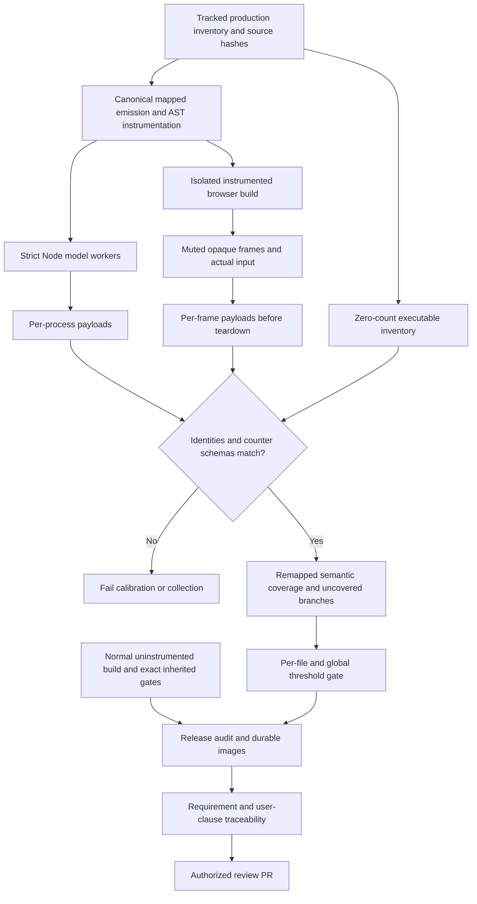

# Phase 07: Release Evidence & PR — Research

**Researched:** 2026-10-16  
**Execution:** Generic-agent fallback applying the full local gsd-phase-researcher role; not typed-agent execution.  
**Entry:** 679e7cb; production b9bc44f.  
**Confidence:** MEDIUM for planning recommendations; local observations below have explicit provenance. No release coverage or phase completion claimed.

<user_constraints>
## User Constraints (from CONTEXT.md)

The complete context is reproduced verbatim because it uses evidence/delivery sections rather than separate discretion headings.

<!-- DATA_K7M4Q9V2_START -->
# Phase 7: Release Evidence and PR — Context

**Mode:** Complete the authorized multiplayer milestone and open its review PR.
**Dependencies:** Verified Phases 1-6; all mechanics and interfaces implemented.

## Stop condition

All requested modes and behavior are implemented, broad meaningful coverage is
green, required checks pass, visual proofs are inspected and included, requirement
traceability is current, and a reviewable PR against `main` is open. Do not mark
the goal complete while any required behavior or evidence remains missing.

## Required evidence

- Reconcile every requirement in REQUIREMENTS.md and every clause in the verbatim
  USER-REQUEST.md against current production behavior, tests and visual evidence.
  Plans, names, source scans, mocked UI transitions, and documentation alone are
  not proof of implementation.
- Preserve the immutable original solo oracle
  `a310a81ed6c76df4b265c9012c23b8c83f4802e5`. Later checkpoints may supplement it
  but must never replace or silently repin that source.
- Measure production coverage for rules, shared simulation, ownership, controller
  and keyboard state machines, all three modes, personal revival, consumables,
  lifecycle and results. Set and enforce explicit high thresholds, review every
  meaningful uncovered branch, and include adversarial boundary/ordering cases.
  Do not raise percentages with tests that merely repeat implementation details.
  Read `../../research/COVERAGE-PROBE.md`: the current temporary/data-URL loaders
  can yield empty or harness-only 100% reports. Preserve correct source maps
  through glob expansion, inventory expected production modules, calibrate the
  executable-line denominator, and fail on missing source coverage.
  Also read `../../research/COVERAGE-CALIBRATION.md`: a measured TypeScript
  before-transformer preserves eager-glob source identities, but native LCOV
  and default V8-to-Istanbul conversion do not establish semantic branch or
  executable-line denominators. Calibrate the final reporting approach with
  known exercised and unexecuted sources before setting thresholds.
- Run the exact canonical gates from each verified phase. Required final gates
  include type-check, production build, guidance and conformance; model/legacy
  and deterministic course regressions; original solo differential and pixel
  comparisons; per-mode tests; and built opaque-iframe user flows.
- Record conformance evidence skips explicitly. Unresolved manifest, unmeasured
  teardown or missing wire evidence is not a passing check. Provide fixture
  evidence where feasible and distinguish any physical-controller limitations
  from injected runtime/controller proof without fabricating either.
  Read `../../research/CONFORMANCE-EVIDENCE.md`: the installed HTML-only CLI
  cannot accept manifest/lifecycle facts; its engine checks manifest structure,
  not signatures or built-byte integrity, and predates the authorized controller
  draft. Supplemental evidence must measure those facts and preserve these scopes.
- Inspect saved visual proofs for setup, all-character HUD, shared hand/market,
  consumable selection/use, co-op recovery, Relay transfer/loss/wait/reclaim,
  Race fog/offense/defense, and every mode's results and podium.
- Use supported compact, regular, short and wide frames, both runtime themes,
  reduced motion and optional-domain absence. All automated browser playback
  remains muted. No production-only test hooks or forbidden native APIs.

## Delivery

Work remains on the existing feature branch, `feat/local-multiplayer`; do not
reset or replace the user's repository history. Keep coherent atomic commits
and committed GSD plans, summaries, reviews, verification and final traceability.
Reconcile concurrent edits rather than discarding another agent's work.

Open the requested PR against `main` once the result is concrete and verified;
the user already authorized this action. Its title and description must explain
the final product behavior, compatibility, test evidence and any material limits
for a reviewer without conversation context. Include usable visual proofs in
the PR or durable linked artifacts: local ignored `artifacts/` paths alone are
not sufficient for a remote reviewer. Do not merge, deploy, publish a napplet,
or send external messages beyond the authorized PR as part of this task.

Repository credentials and local `.napplet/config.json` stay ignored. Do not
print their values or include them in logs, screenshots, commits or PR content.

<!-- DATA_K7M4Q9V2_END -->
</user_constraints>

## Summary

The release audit needs a trustworthy coverage pipeline and durable, current evidence, not another implementation of the multiplayer modes. Phase05 has 40/40 technical truths and Phase06 has 47/47, both explicitly human_needed. Their pending appearance/clarity/play-feel acceptance must remain pending until actual human evidence exists. The context's “Verified Phases 1-6” dependency is a target, not evidence that this acceptance has occurred. [VERIFIED: 05-VERIFICATION.md; 06-VERIFICATION.md]

The earlier Node calibration established useful AST counter and eager-glob mapping behavior in an erased experimental fixture using an adapted Babel dependency. It did not validate a normal installed Istanbul tree, browser instrumentation, reporter APIs, or production thresholds. The current project has none of the five proposed Istanbul packages, c8, v8-to-istanbul, or Babel standalone available through root resolution or its pnpm package directory. Node is now26.11.1 rather than the experiment's26.7.0. Repeating native coverage percentages would not close those gaps. [VERIFIED: research/COVERAGE-CALIBRATION.md; current environment audit]

**Primary recommendation:** Plan a standalone, declared test-tool package with its own dependency manifest/lockfile, preserving the immutable root lockfile and all exact inherited gates. Validate normal dependency resolution and commit small Node/browser calibration tests before measuring production coverage. This is an implementation recommendation, not a research-time installation or a new user approval checkpoint. If dependency resolution remains unavailable, report that concrete tooling blocker; do not substitute fabricated semantic metrics.

## Architectural Responsibility Map

| Capability | Primary owner | Secondary owner | Reason |
|---|---|---|---|
| Source inventory, instrumentation, counter merge and thresholds | Node test tooling | Isolated browser build | Coverage is evidence infrastructure, never product mechanics |
| Browser realm counters and actual-input assertions | Muted opaque-iframe fixture | Node evidence writer | Counters must come from the frame that executes the app |
| Uninstrumented release/parity gates | Existing phase runner | Existing fixtures | Instrumentation cannot prove unchanged release bytes |
| Protocol evidence | Test host and installed validator | Living protocol authority | Shell permissions and transport remain outside the napplet |
| Requirement traceability, inspected proofs, PR body | Committed documentation | GitHub PR | Remote reviewers cannot access local ignored artifacts |

This allocation follows the current loader, browser fixture, boundary documents and canonical runner. [VERIFIED: tests/source-loader.mjs; tests/market-game-fixture.mjs; tests/phase6-gate.mjs; docs/boundaries.md]

<phase_requirements>
## Phase Requirements

| ID | Required behavior | Research support |
|---|---|---|
| TEST-02 | Broad production model/state-machine/integration coverage for modes, shared simulation, input/lifecycle, revival, odds/range/ownership and results | Calibrated source inventory, semantic counters, critical-file floors and uncovered-branch ledger |
| TEST-03 | Complete built opaque-iframe keyboard and injected-controller flows; no runtime errors/native access/product hooks | Existing actual-input fixtures plus explicit browser collection and provenance classification |
| TEST-04 | Capture and inspect mode/setup/HUD/items/revival/market/disconnect/podium proofs across frames/themes | Durable selected image set, capture manifest and final inspection index |
| TEST-05 | Required gates, legacy/per-mode coverage, explicit thresholds and meaningful uncovered-branch review | Exact inherited gate plus additive calibration/coverage/conformance evidence commands |
| SHIP-01 | Existing feature branch, coherent GSD evidence/traceability, open PR to main with tests/visual proofs | Committed audit and images, reproducible commands and concrete PR handoff |

Scope comes from REQUIREMENTS.md; all original user clauses must also be mapped, including those spanning several IDs. [VERIFIED: .planning/REQUIREMENTS.md; .planning/USER-REQUEST.md]
</phase_requirements>

## Project Constraints (from AGENTS.md)

- Discover source via MCP graph first; fall back for literals/configuration/non-code or insufficient graph results. This research used graph discovery for compileSources/loadSources/createMarketGameFixture and LocalSession before reading their implementations.
- Keep the app framework-light and napplet-side. No shell implementation, signer/relay access, host DOM, cookies/service workers, browser durable storage, direct fetch/WebSocket/EventSource, or app imports of @napplet/shim. SDK storage/resource and optional-domain checks retain their documented boundaries.
- Use OUTBOX for ordinary Nostr operations; no new NAP/domain/envelope. Living NIP-5D authority is required for changed protocol assumptions. The existing controller bridge is explicitly authorized and pinned separately.
- Respect runtime theming, live resize, minimum notice, compact/regular/wide/short layouts and established game-specific written control/type exceptions. This phase needs documentation, not a new evidence-index product UI.
- Before completion run type-check, build, guidance and conformance; read skips. Preserve user-triggered SDK and absent-domain behavior in real shell/iframe evidence.
- No skills install during this research: the explicit no-install assignment overrides the template bootstrap instruction. Existing project-local skill directories are absent and agent-skills query returns no configured research skills.
- Current assignment additionally forbids source/dependency/lockfile/state edits, commits, publication, preview5175 changes and credential reads; all browser runs must be muted. Only this research document is owned here.

[VERIFIED: AGENTS.md; docs/context-map.md; docs/boundaries.md; docs/design-patterns.md; docs/package-surfaces.md; research assignment; filesystem/agent-skills query]

## Standard Stack and Environment Availability

These are installed versions, not claims that they are latest releases. No registry installation or package download was performed. [VERIFIED: package resolution and command probes]

| Tool | Observed version/availability | Intended use |
|---|---|---|
| Node |26.11.1 | Native test runner, child orchestration, hashes and JSON |
| pnpm |10.8.0 | Existing root commands; isolated tool package if implemented |
| TypeScript |5.9.3 | Existing transpileModule and source-aware before transformer |
| Vite |6.4.3 | Existing production build; separate coverage build |
| Playwright |1.61.0; Chromium executable exists | Existing muted browser fixtures |
| @napplet/conformance-cli |0.2.15 | Preserve current CLI evidence |
| @napplet/conformance |0.13.0 in earlier inspected CLI dependency | Supplemental engine API, with documented scope limits |
| GitHub CLI |2.83.2 | Later authorized PR creation; authentication/write access not tested here |
| Context7 MCP / ctx7 CLI |Neither available | Official web documentation fallback |
| Istanbul five-package stack / c8 / v8-to-istanbul / Babel standalone |Not root-resolvable; none in project .pnpm directory | Missing normal AST instrumentation/reporting dependency |
| source-map-js |1.2.1 present in .pnpm directory | Mapping utility alone is not a semantic instrumenter |

The repository remote is sandwichfarm/down-to-duck and the feature work remains on its existing history. No remote write or authentication probe was needed for research. [VERIFIED: git remote -v; entry status]

### Dependency decision and lockfile compatibility

There are two distinct constraints: **no installs during this research**, and **the inherited root pnpm-lock.yaml must remain byte-identical to the solo oracle**. The first does not imply that every future test-only dependency is permanently forbidden. The second is executable today in package.json Phase2/3 and both blocks of tests/phase6-gate.mjs; its comparison passed during this research. The old research suggestion to add root devDependencies would fail it. [VERIFIED: package.json; tests/phase6-gate.mjs; root lockfile comparison; COVERAGE-CALIBRATION.md]

Recommended implementation boundary: a standalone directory such as tools/release-coverage with a private package.json and its own pnpm-lock.yaml; resolve Istanbul from that directory, not undeclared global packages or hardcoded .pnpm internals. Keep it outside a shared root workspace lock. pnpm10.8's local help confirms --ignore-workspace, --ignore-scripts and --frozen-lockfile; the official install documentation describes standalone scope and frozen enforcement. Commit the isolated package's lock and prove both reproducible tool installation and an unchanged root lockfile. Do not use --no-lockfile, hidden tarball extraction or a Babel compatibility shim as the release dependency strategy. [VERIFIED: pnpm help install; CITED: https://pnpm.io/cli/install]

Candidate versions from the prior experiment are instrument6.0.3, coverage3.2.2, source-maps5.0.6, report3.0.1 and reports3.2.0. These are **candidates to resolve and audit**, not validated installed dependencies. Normal resolution is a first execution task. No automatic approval request is introduced; ordinary tooling work stays within the authorized task, and a real unresolved network/package issue is reported as such. [VERIFIED: COVERAGE-CALIBRATION.md; assignment]

### Package legitimacy audit status

All five candidate names are associated with the official IstanbulJS monorepo. The research seam returned SUS for each solely with null existence/age/download/repository signals, not a positive malicious-package finding. A direct npm metadata request for instrument6.0.3 failed EBADF before returning metadata. No package is marked registry-verified, no postinstall claim is made, and no package was installed. The planner must make successful official-source/registry metadata, exact-version, dependency and script inspection part of the dependency task; preserve the failure if the environment still cannot resolve them. This is an evidence gap to resolve, not grounds to invent a user approval gate contrary to the standing assignment. [VERIFIED: package-legitimacy query; npm view exit1; CITED: https://github.com/istanbuljs/istanbuljs]

| Candidate | Current disposition |
|---|---|
| istanbul-lib-instrument | WARNING: seam SUS from unavailable metadata; official API cited; normal install unverified |
| istanbul-lib-coverage | WARNING: seam SUS from unavailable metadata; normal install unverified |
| istanbul-lib-source-maps | WARNING: seam SUS from unavailable metadata; normal install unverified |
| istanbul-lib-report | WARNING: seam SUS from unavailable metadata; reporter execution unverified |
| istanbul-reports | WARNING: seam SUS from unavailable metadata; reporter execution unverified |

## Architecture Patterns

### Evidence data flow



This is a proposed tooling design. It deliberately keeps instrumented evidence separate from uninstrumented release/parity proof.

### Existing API seams and recommended ownership

| Existing seam | Actual behavior / limitation | Planned integration |
|---|---|---|
| tests/source-loader.mjs compileSources(entries, options) | Transpiles TS, then regex-expands eager default globs and prepends imports; returns Map of emitted modules | Optional explicit coverage mode with source-level glob transform, canonical identity/maps and instrumented output |
| loadSources(entries, sourceDirectory) | Writes temporary JS tree, imports modules, removes it on dispose | Retain manifest/maps independently of deleted temp files; identify immutable baseline root separately |
| tests/strict-node-tests.mjs | Rejects dash-prefixed arguments and checks exactly one nonempty all-pass TAP totals block | Add an explicit controlled collector channel or coverage runner; preserve strict outcomes, never pass arbitrary flags as file names |
| createMarketGameFixture(evidence, options) | Reads dist/index.html, creates allow-scripts opaque iframe, installs authorized host fixtures, supports real keyboard/pad controls | Explicit test-only artifact input for isolated coverage output; collect in each frame before close; default remains normal dist |
| compileSources render/component fixtures | Some production code executes inside browser realms despite Node test files | Collect those realms too; classify by execution realm, not filename suffix |
| tests/phase6-gate.mjs | Sequential exact Relay6, Race7 and health/cross-mode suffix | Reuse unchanged as final uninstrumented acceptance block |
| Existing provenance JSON and layout reports | Current source/build hashes coexist with older composite sheets/indexes | Build one final manifest from actual current files, never relabel stale sheets |

[VERIFIED: source-loader.mjs; strict-node-tests.mjs; market-game-fixture.mjs; render.test.mjs; session-board-controls.test.mjs; phase6-gate.mjs; 06-VERIFICATION.md]

### Canonical source inventory

Current tracked src inventory is176 files:159 TypeScript paths including env.d.ts,14 CSS files,3 font/documentation assets;88 paths are market item definitions. This is an inventory fact, not159 executable modules. Classify every source using emitted AST sites: declaration-only modules remain documented with zero executable sites, while an executable but never-imported module must supply full zero counters. CSS/assets receive visual/asset evidence rather than invented JavaScript coverage. Dev-only sources must have an explicit build-scope disposition and separate dev tests; do not silently remove difficult files. [VERIFIED: git ls-files inventory; src/env.d.ts; source-loader.mjs]

Generate the expected inventory independently of runtime imports. Retain source content hash, canonical repository-relative path, original realpath, emitted identity, map hash, instrumenter/options version, scope and zero-counter schema. Reject missing/duplicate canonical identities, unknown generated paths, empty payload sets and mismatching content/counter schemas. Preserve src/market/items subdirectories and declaration erasure; catalog import execution cannot count as exercising every modifier callback.

Do not collapse the immutable baseline copy into current src paths. loadSources accepts another source root for parity; baseline instrumentation must be disabled or recorded in a separately named scope excluded from current coverage. Similarly, the deliberately modified alternate sampler in consumable-drops.test.mjs and examples extracted by mode-authoring.test.mjs are variants/examples, not additional hits for unchanged production code. Legacy gamepad.test.mjs uses a data URL and sound.test.mjs has its own transpiler; route genuine production loads through the coverage-capable path without merging altered variants. [VERIFIED: tests/solo-parity-snapshot.mjs; render.test.mjs; consumable-drops.test.mjs:151; mode-authoring.test.mjs; gamepad.test.mjs:7; sound.test.mjs:17]

### Node and browser calibration contract

Persist the earlier fixture and expected totals: choose(1) yields lines1/4, branches1/4, functions1/3, statements2/5; choose(-1) yields2/4,1/4,1/3,2/5; both yield2/4,2/4,1/3,3/5. Retain the never-imported module and its unexecuted function/ternary outcomes. Add declaration-only, eager catalog with real default imports, same-module multiple temp instances, child-worker collection and missing/empty/mismatched-map negative cases. The prior values are exploratory expectations to validate against the normal dependency tree, not current passing tests. [VERIFIED: COVERAGE-CALIBRATION.md]

Browser calibration must execute the same known branches in an actual muted allow-scripts opaque iframe, collect that frame's global coverage map before teardown, and retain the never-loaded source denominator. Repeat positive/negative/both cases and compare canonical identity and semantic locations. Add two frames or reloads to prove collection does not lose one realm, and a missing-frame-payload failure. A Node preload cannot observe the browser's globalThis. Playwright frame.evaluate supplies the realm evaluation seam; its existence does not itself prove this project's collector works. [CITED: https://playwright.dev/docs/api/class-frame#frame-evaluate; proposed acceptance contract]

Prefer one canonical TypeScript emission/instrumentation stage shared by Node and the coverage build. Instrument before bundling with preserved source maps; Vite's plugin transform can return code/maps and be scoped to build. A coverage-only configuration should write a separate artifact directory, retain production mode semantics, keep ordinary dist untouched and expose no product test hook. Validate import.meta.env, CSS/assets, eager globs and SDK imports in that path. Vite/esbuild and TypeScript can produce different counter layouts: never merge independently assigned counter IDs solely because paths match. Fail mismatching schemas; either unify emission or report independently calibrated realm coverage until a justified merge exists. [CITED: https://v6.vite.dev/guide/api-plugin; proposed integration]

Keep the standard uninstrumented build as the authority for pixel parity, prohibited API scanning, visual captures and final browser acceptance. Instrumentation can alter bundling, tree shaking and timing; “same sources” is not “same shipped bytes.” Require matching behavioral assertions in both paths, plus independent final production gates. [Recommendation based on separate current build/fixture architecture]

### Thresholds and meaningful gaps

Proposed initial policy, to be ratified in the Phase07 plan and enforced only after exact calibration: global production lines90%, functions90%, branches85%; each critical multiplayer authority file lines95%, functions95%, branches90%. These are recommended acceptance targets, **not measured achieved percentages**. Keep statements visible alongside the three thresholded metrics. No global average may hide a poorly covered coordinator, recovery or input module.

Critical scope includes mode-rules, game/shared simulation, session, session-input, keyboard-input, gamepad, session-recovery/recovery, survive-together/results, relay/results, race/items/results, consumables/drops, co-op-market, shared-world-effects and market/run. Main/UI/render integration needs its own reported browser strata and per-file floor, not exclusion because Node cannot import DOM code. List every file in the committed policy rather than relying on ambiguous name globs. [VERIFIED: source inventory and phase requirement ownership; thresholds are proposed policy]

For every uncovered meaningful branch, record canonical path/location, condition, user requirement, consequence, existing evidence, new behavioral test or justified unreachable/build-scope disposition. Test boundary values and rejected transitions:249/250/251 earned progress versus innate100; exact rare buckets and gravity; stale/replaced/wrong owners; fatal/finish/timeout ordering; late terminal input; reentrant receiver isolation; missing optional domains; result archives and true ties. Do not lower thresholds or suppress counters to erase a discovered gap. Valid impossible guards still require a reason and proof; percentages alone do not establish specification coverage. [VERIFIED: requirements and prior verification matrices; recommended uncovered-branch workflow]

## Don't Hand-Roll

| Problem | Use | Avoid |
|---|---|---|
| Semantic statement/function/branch sites | Normal Istanbul AST instrumenter after calibration | Regex line counting or treating raw V8 ranges as semantic branches |
| Source-map transformation | Standard TypeScript emission/maps and Istanbul remapper | Editing emitted JS while retaining stale maps |
| Unloaded modules | Instrumented zero-count source inventory | Enumerating only modules seen in payloads |
| Counter aggregation | Schema-checked standard coverage-map merge | Adding Node/browser numeric IDs with different layouts |
| Browser interaction | Existing actual controls and authorized host snapshots | Product hooks, forced clicks, private writes represented as public input |
| Remote evidence | Committed selected images and Markdown index | Local ignored artifacts or ephemeral /tmp links as the only PR proof |

Istanbul's official API accepts inputSourceMap in instrumentSync and exposes lastFileCoverage/lastSourceMap; these are the intended interfaces. [CITED: https://github.com/istanbuljs/istanbuljs/blob/main/packages/istanbul-lib-instrument/api.md]

## Code Examples

Proposed implementation skeleton using the documented instrumenter API; not executed in this research:

```js
const instrumenter = createInstrumenter({
  esModules: true, compact: false, produceSourceMap: true,
});
const code = instrumenter.instrumentSync(emitted.code, emitted.path, emitted.inputMap);
const zero = structuredClone(instrumenter.lastFileCoverage());
// Persist the schema/map and its canonical source/hash before another file.
```

[Source: official Istanbul API above; the zero-record integration is a proposed pattern.]

Collector seam in a test fixture, before closing each known frame:

```js
const payload = await frame.evaluate(() => globalThis.__coverage__ ?? null);
assert.ok(payload && Object.keys(payload).length, 'missing frame coverage');
await persistPayload({ realmId, sourceManifestHash, payload });
```

This is test-host collection, not app-to-host DOM access. Implement persistPayload in tooling, capture final counters once per realm or use deltas to avoid repeated cumulative additions, and fail incomplete teardown collection. [CITED: https://playwright.dev/docs/api/class-frame#frame-evaluate; proposed collector]

## Conformance and Protocol Boundary

Preserve the installed CLI's actual result5pass/0fail/5unmeasured: three manifest checks, wire evidence and lifecycle evidence. Its HTML-only parser cannot receive all supplemental facts. The prior isolated engine probe found that a syntactically valid hash with deliberately invalid signature/id/pubkey passed manifest structure, gamepad.subscribe was unknown-domain, and makeContext supplied default passing boot booleans. These limitations are not repaired by rerunning the same CLI. [VERIFIED: CONFORMANCE-EVIDENCE.md; 06-VERIFICATION.md]

Plan a supplemental evidence runner that derives boot/fallback, real emitted wire traffic and teardown facts from the built opaque frame. Preserve direction/source/validator verdicts and actual subscribe/unsubscribe/listener counts, double pagehide and ignored late events. No successful default booleans, synthetic passing envelopes or draft-domain allowlist bypasses. Installed validator results and separately scoped authorized controller-draft checks must remain separate.

Before any new manifest-format claim, resolve and record the current NIP-5D PR head and relevant NAP authority, compare them with the installed engine/plugin's legacy path schema, and state the exact versions supported. This research opened the living PR but does not assert a current normative format from its discussion page. No migration, signature, publication or built-byte integrity claim follows from the old structural validator. A local candidate, if needed, must use public configuration and an actual built digest without reading ignored .napplet/config.json or signer material; missing real signing evidence stays unmeasured. [VERIFIED: docs/nip-5d.md; docs/gamepad.md; CONFORMANCE-EVIDENCE.md; CITED: https://github.com/nostr-protocol/nips/pull/2303]

Physical controllers, actual screen-reader speech and target-shell behavior must remain distinct from deterministic injected snapshots, DOM mutation assertions and fixture SDK operations. Existing fixture evidence can substantiate its own scope; it cannot fabricate hardware or user acceptance. [VERIFIED: 05/06-VERIFICATION.md]

## Durable Visual Evidence and Traceability

Use a committed docs/release-evidence/ directory with a Markdown index, a bounded representative PNG/JPEG set and machine-readable manifest. Existing docs/images demonstrates that tracked images are an established repository surface; artifacts/ and coverage/ are ignored. Do not force-add the entire generated tree or expose logs/configuration wholesale. [VERIFIED: .gitignore; git ls-files docs/images]

The manifest should bind capture name, mode/base mode, size, theme/motion, scenario/seed/input provenance, source/test/tool hashes, built HTML digest, command/result and inspection finding. Include full-size representative frames as well as sheets: setup, four actual simultaneous travelers, single Relay runner, compact owner hand/market/paid pack, co-op recovery/departure, Relay handoff/wait/reclaim, Race fog/offense/defense, every podium and archived participants. Include200×160 notice,240×240,320×560,900×600,1000×280 and2400×1200 across the established matrix; preserve all43 Phase06 probe dispositions and the8px full-body/nameplate separation proof. [VERIFIED: 06-EVIDENCE.md; 06-VERIFICATION.md; proposed release selection]

Do not reuse a stale sheet merely because the latest individual captures exist. Phase06 explicitly separates historical contact/index provenance from current repaired-source captures. Regenerate the release contact sheets from the exact selected file manifest, inspect them and critical full-size states, and commit those selected bytes. Prior Relay252/Race420 and cross-mode counts are historical run facts, not automatically final-head counts. [VERIFIED: 06-VERIFICATION.md]

Create a requirement matrix with one row per requirement clause and original user clause, linking production authority, real assertions, command/terminal result, source/build hash, visual file where relevant and remaining limit. Distinguish model-arranged, component-arranged, public-input and read-only observation. Existing paid-pack/five-participant fixtures deliberately arrange production state; Relay public seed49/50/51 and G actual-mode journeys have different provenance. A test name, summary count, source scan or image alone is insufficient evidence for gameplay. [VERIFIED: 06-EVIDENCE.md; original request]

At final delivery, use the existing feature branch and a concrete PR to main. The PR should explain all three modes, exact solo compatibility, controls, evidence and material limits; link committed images and traceability using repository paths/permalinks. gh pr create supports --base, --head and --body-file. Verify the returned PR URL/base/head and open state after creation; do not merge/deploy/publish. This action is authorized in the original goal but is not performed during research. [CITED: https://cli.github.com/manual/gh_pr_create; VERIFIED: 07-CONTEXT.md]

## Validation Architecture

### Test framework and commands

Existing framework is Node26.11.1 node:test plus Playwright1.61.0; no framework replacement is needed. tests/strict-node-tests.mjs enforces nonempty complete results. [VERIFIED: package.json; strict runner; installed version audit]

| Layer | Command / contract | Status |
|---|---|---|
| Fast unchanged production smoke | node tests/strict-node-tests.mjs tests/consumables.test.mjs tests/session-input.test.mjs | Exists; no new timing claim |
| Calibration | node --test tools/release-coverage/calibration.test.mjs | Proposed; must include Node and muted iframe variants |
| Coverage | node tools/release-coverage/run.mjs | Proposed explicit runner; do not advertise before implemented |
| Supplemental conformance | node tests/release-conformance.mjs | Proposed; measured facts and negative controls |
| Exact inherited acceptance | node tests/phase6-gate.mjs | Exists; retains both complete canonical blocks and suffix |
| Evidence/traceability self-check | node tests/release-evidence.test.mjs | Proposed missing-file/hash/clause/URL checks |

Fast calibration should be a targeted iteration gate, aiming for under30seconds where feasible; browser matrices and exact inherited gates are deliberately long. Do not invent a measured duration for proposed commands.

### Requirement-to-test map

| Requirement | Automated evidence | Remaining work |
|---|---|---|
| TEST-02 | Existing production model/state-machine suites under calibrated collection | Source inventory, new coverage tests, per-file thresholds, uncovered review |
| TEST-03 | Existing actual-input local/Survive/Relay/Race runtime suites | Browser counter calibration and explicit complete-flow evidence index |
| TEST-04 | Existing layout/cross-mode suites and saved measurements | Current release manifest, regenerated selected sheets, direct inspection |
| TEST-05 | Exact phase6 runner, additive calibration/coverage and supplemental conformance | One final frozen-source gate with durable results and limits |
| SHIP-01 | Evidence-link/schema checks; later gh PR readback | Committed traceability/assets, coherent commits and open PR |

### Exact final gate policy

After implementation and focused gap repairs, run the existing tests/phase6-gate.mjs unchanged: Relay Gate6 → Race Gate7 → health-runtime once → strict cross-mode suite → diff check. Each Relay/Race block intentionally contains its own complete Phase3/2/1 chain and required suffix. Do not duplicate that again with gratuitous extra standalone phase gates, and do not optimize away its canonical nested repetition. Add the new calibrated coverage/conformance/evidence gates as explicit separate stages. Rebuild the normal production artifact for final visual/parity acceptance; instrumented output stays separate. Record every command's actual terminal exit, source/tree/tool/lock hashes and final byte digest. [VERIFIED: tests/phase6-gate.mjs; package.json; 06-VALIDATION/verification evidence]

The latest complete inherited run21972 preceded repairb9bc44f;92241 is the current affected31/104 repair gate, and52826 independently rechecked the two repaired behaviors. These are legitimate entry evidence but not one final exact all-gate run on the eventual Phase07 head. Schedule that final run once after source/test freeze. No baseline was rerun for this research. [VERIFIED: 06-REVIEW-REPAIR.md; 06-VERIFICATION.md]

### Sampling and Wave0 gaps

- Per tooling task: exact calibration and deliberate failure cases, then its affected strict suites.
- Per behavioral gap repair: retained failing production behavior first, focused green and relevant integration.
- Per release wave: coverage policy/report and evidence-integrity checks.
- Final: one exact inherited runner plus additive new gates and direct visual inspection; never claim pending human acceptance resolved by automation.

Missing deliverables: standalone normal tooling resolution; committed Node/browser calibration; canonical mapped inventory; worker/realm collector and schema-safe merge; threshold policy and uncovered-branch ledger; supplemental measured conformance; durable selected assets; complete clause traceability; final release runner/report. These are the concrete Phase07 tasks, not reasons to rewrite mechanics.

## Security Domain

This is a test/evidence boundary, not a new network service. Existing config enables security review at ASVS level1; no ASVS certification is claimed. Do not transplant category numbering from a different ASVS edition. [VERIFIED: .planning/config.json; task scope]

| Applicable control area | Scope and standard mitigation |
|---|---|
| Authentication / secrets | No new app auth. Never read/print ignored credentials or add them to captures/PR; PR CLI uses existing auth only when delivery runs |
| Session / access control | Preserve seat/device epoch, ownership, modal context and stale-event rejection; instrumenters cannot bypass those checks |
| Input validation | Fail malformed coverage payloads, unknown source IDs, mismatched hashes/schemas and invalid traffic; retain production parser tests |
| Cryptography | SHA256 via node:crypto for evidence bytes; no hand-rolled signatures and no signing claim from structural manifest validation |
| Supply chain | Official provenance, exact standalone tool lock, dependency/scripts inspection and reproducible resolution; root lock unchanged |

Threats include false coverage through omitted modules, counter identity collision, stale screenshots presented as current, and secret leakage through broad artifact publication. Mitigate with independent inventory/negative calibration, schema/hash checks, precise provenance and a small explicitly selected committed evidence set. This table is a scoped engineering threat model, not a new compliance requirement.

## Common Pitfalls

1. **Empty100%:** src-only filters hide temporary/data-URL modules. Fail missing identity and empty executable denominators before percentages. [VERIFIED: COVERAGE-PROBE.md]
2. **Erased TS counted as missed code:** native mapped lines include comments/declarations; raw V8 ranges are not stable semantic branch outcomes. Retain AST calibration. [VERIFIED: COVERAGE-CALIBRATION.md]
3. **Coverage from the wrong copy:** oracle, altered sampler and runtime variants must never add hits to current-source identity. [VERIFIED: inspected loader callers]
4. **Browser filename assumptions:** render/component tests can execute production only inside a frame. Node payload success does not imply frame collection. [VERIFIED: render.test.mjs; session-board-controls.test.mjs]
5. **Instrumented release confusion:** final normal dist, pixel comparisons and remote screenshots must have the recorded release digest, not the coverage build's digest.
6. **Averaging hides weak modes:** report/gate critical files and each mode stratum; review uncovered decisions, not just aggregate percentages.
7. **Conformance scope inflation:** keep5unmeasured explicit and distinguish controller draft transport from released validator support. [VERIFIED: CONFORMANCE-EVIDENCE.md]
8. **Premature completion:** Phase05/06 human acceptance stays pending; remote reviewable PR and full release evidence remain required. [VERIFIED: prior verifications; original request]

## Assumptions and Open Questions

| ID | Unproven integration / proposed decision | Resolution |
|---|---|---|
| A07-01 | Standalone normal Istanbul dependency tree can resolve in the execution environment | First bounded tooling task; current npm metadata request failed EBADF. No hidden download bypass |
| A07-02 | One canonical instrumented emission works through this Vite single-file plugin and opaque fixture | Commit Node/browser exact calibration and compare counter schemas/maps before production collection |
| A07-03 | Proposed90/90/85 global and95/95/90 critical floors are achievable with meaningful tests | Measure after calibration; add requirement-driven missing cases and review every meaningful uncovered branch |
| A07-04 | Final optional-domain/wire/teardown observations can close some installed CLI skips supplementally | Measure actual production facts; preserve validator-format boundaries and unresolved evidence |
| A07-05 | Existing CLI authentication permits PR creation | Check only at delivery; tool presence is not auth/write proof |

These are explicit implementation questions, not inferred user decisions or automatic approval gates. There is no current proof that an existing-dependencies-only semantic coverage implementation satisfies the contract. Existing Node V8 collection is useful raw diagnostic evidence; a custom TypeScript AST instrumenter would need a substantially larger semantics calibration and is not the recommended shortcut. If the standalone tooling route remains blocked, surface that concrete limitation rather than claiming coverage is complete.

## Sources and Metadata

Primary local evidence: AGENTS and boundary docs; USER-REQUEST/REQUIREMENTS/ROADMAP;07-CONTEXT;06 summaries/evidence/repair/verification;05 verification; COVERAGE-PROBE/COVERAGE-CALIBRATION/CONFORMANCE-EVIDENCE; package.json/vite.config/ignore rules; graph-discovered loader/fixture/session APIs and callers; current installed-tool inventory. [VERIFIED: reads and queries in this research]

Official references consulted:
- [Istanbul instrumenter API](https://github.com/istanbuljs/istanbuljs/blob/main/packages/istanbul-lib-instrument/api.md) — map and counter APIs.
- [Vite6 plugin API](https://v6.vite.dev/guide/api-plugin) — version-matched build/transform integration.
- [Playwright Frame API](https://playwright.dev/docs/api/class-frame#frame-evaluate) — browser realm collection.
- [Node test coverage](https://nodejs.org/api/test.html#collecting-code-coverage) — raw/native coverage context; fetched latest docs describe26.12, not the installed26.11.1.
- [pnpm install](https://pnpm.io/cli/install) — standalone/frozen semantics, cross-checked against installed10.8 help; newer-only flags are not recommended.
- [Living NIP-5D PR](https://github.com/nostr-protocol/nips/pull/2303) — protocol authority entry, not a claim that discussion equals the current normative file.
- [GitHub CLI PR creation](https://cli.github.com/manual/gh_pr_create) — delivery interface.

Research-plan seam selected Context7, unavailable here; official web fallback was used. classify-confidence returned MEDIUM for verified websearch, LOW for its generic local/webfetch provider labels. Therefore this report claims MEDIUM planning confidence and explicit local observations rather than inventing HIGH provider provenance. The source-map package page fetch failed; its integration remains supported by the prior measured experiment and requires execution validation. Research cache writes were omitted to honor ownership of only this repository document.

No browser/test calibration, full gate, installation, source edit, lockfile change, commit, PR, deployment or publication occurred. Only read-only environment/lockfile probes and this document were produced. Existing previews and pending human acceptance remain untouched.

**Valid until:** Any source/loader/build/toolchain change invalidates its measured environment/API assumptions; recheck installed dependencies and living protocol authority during execution.

## Read-only delivery preflight — 2026-10-16 23:17 UTC

During full collection11460, root confirmed the intended remote is `sandwichfarm/down-to-duck`. `gh repo view --json nameWithOwner,url,defaultBranchRef,viewerPermission` exited0 and reported default branch `main` and current viewer permission `ADMIN`. `git ls-remote origin refs/heads/main refs/heads/feat/local-multiplayer` exited0: remote main is the immutable solo oracle `a310a81ed6c76df4b265c9012c23b8c83f4802e5`; no remote feature branch was returned. `gh pr list --base main --head feat/local-multiplayer --state all --json number,url,state,baseRefName,headRefName` exited0 with `[]`.

This establishes current read access, the intended destination and absence of a matching PR. It does not prove a future push will succeed and does not satisfy delivery. No branch push, PR creation/edit, merge or publication occurred.07-06 must recheck live base/head/PR state after the final technical gate, then perform the already authorized non-force push and PR creation. Source/tests/tooling and the running collection were unchanged by this preflight.

## Read-only mode reachability follow-up — current collection11460

Before07-03 interprets the complete report, retain a concrete scope check: `policy.json`'s solo Arcade/Flow strata include the complete executable `src/session.ts`, `co-op-market.ts`, `consumables.ts` and `consumable-drops.ts` modules. Graph discovery and source reads confirm `Game` imports runtime `SharedWorld` and `SessionPlayer` from `session.ts`; that same module also defines `LocalSession`/`LocalSessionStage` and imports the multiplayer market/item implementations. Thus module inclusion alone does not prove every contained branch is reachable while the asserted mode remains solo.

This observation is not a measured shortfall, unreachable-branch verdict or policy correction. After07-12 produces the complete source-bound report,07-03 must distinguish missing real solo paths from mixed-module paths requiring a different mode, with exact branch/schema identity and concrete call/state evidence. Do not manufacture solo hits by executing unrelated multiplayer objects in a solo-labelled interval, copy mixed-mode totals, silently remove paths, lower floors or change the frozen live run. Any necessary reconciliation must preserve the full original requirement, all-source accounting and honest attributed counters. Existing global/per-file/mode thresholds remain unchanged; the full initial report remains the mandatory entry gate.

## Original-clause inventory preparation

`07-CLAUSE-PREPARATION.json` is a documentation-only input for07-05, not its completed evidence manifest. It classifies every33 nonempty line of the original request, records51 verbatim clause spans (including separate item probabilities, collection/gravity rules and every stop-condition sentence), and retains all47 requirement IDs/texts. Stable IDs use original line plus clause ordinal; candidate requirement links do not assert delivery. Original-request SHA256 is `abf7219607ecd3e3933cd7b31d681c2ef937990fd126337dc065e57a288dac75`; the observed requirements snapshot is `c05ae02cd64e7f16846e51c64cc57844c80c44ed34eeb287881cdce83fabfa1a`.

All entries remain `pending-current-evidence`, including rows whose source checkbox is checked.07-05 must inspect each compound clause's sub-obligations, bind actual named assertions/terminal/source/build/visual identities, mechanically validate the completed inventory and keep SHIP pending until live PR readback. Refresh a changed requirements snapshot explicitly; never infer current proof from this preparatory document or omit clauses because a broad requirement label appears complete. No production/test/tool source, execution order or acceptance status changed during preparation.

## Evidence digest encoding clarification

During the completed `suffix-12` diagnostic run `a01e16c4-09bf-4bd5-aa6f-68162f72bede`, root checked the complete12-job ordered ledger (all exit0) and24-payload manifest. `tools/release-coverage/instrument.mjs` defines `hash(value)` as SHA256 of a string directly, or `JSON.stringify(value)` for nonstrings. Consequently, the runner's `normalArtifactHash` and build hashes, when computed from `readFile()` Buffers, are **SHA256 of the Buffer's JSON representation**, not conventional raw-file SHA256. The runner compares this representation consistently.

For the unchanged normal `dist/index.html`, root independently reproduced both values: runner encoding `37aadac57cbcddc25a08799ab07003f6f9d5ea91831209588521186a37a205a4`; raw-file SHA256 `bc1bcc8f07aae95e7308f3c659157ee5f2cf31dd98dce77d393d2b070373f2fb`. Their difference is not evidence of a changed build.07-05 must label digest encoding explicitly and verify the corresponding bytes with that encoding; do not equate the two fields or silently relabel a runner hash as raw-file SHA256. No hash schema or running collection change is authorized by this observation. The focused suffix report does not evaluate coverage floors or replace the complete initial collection.
## Frozen-build equivalence during collection68162

Root compared the actual initial inventories and both built iframe artifacts from prior full run `ed12cf45-d4d2-4fb1-a77a-89ede7a9ea78` and current full run `6802bfd4-2d88-4d8e-a091-9733e4423b91`. All158 inventory records have identical source/map hashes, and the entire inventory JSON is byte-identical (raw SHA256 `cd2869fae16b79b0068a3f60ca23eed8055bf54901d7c035f4717d59c5f93d47`). These are inventory records, not a count of executable files, tests or passed jobs. The production instrumented `build/production/index.html` bytes also match (raw SHA256 `95697faa04f42bffb7ac230bd720c9a608ef78f03fd0f6201aa71b74af2c041f`), as do the development instrumented bytes (`c8db2f2a98a210a9e2504617f85b46dbec687062d96b1b5d9de845e2b0094610`).

This establishes source/build equivalence across the recovery test-only repair, not test-suite equivalence or release acceptance. The recovery test and artifact-preservation manifest changed; its original cancellation remains a failure. Later visual evidence may use this identity comparison when assessing archived bytes, but must still bind each selected image to its actual acquisition, named test, terminal result and image digest. Historical Phase06 manifests do not become current merely because a later directory contains them. The current complete collection, coverage-floor evaluation and07-05 packaging remain pending.

## Visual report build identity during coverage acquisition

Root inspected the completed `local-session-owner-layout` job in current run `6802bfd4-2d88-4d8e-a091-9733e4423b91`. Its archived report (raw SHA256 `9900064d58c1f85aa7316e073fe33acc716d2919eb4dbd4134b3fdb0ba3d538e`) contains53 frames, no deficiencies/errors/external requests, and `artifactSha256: bc1bcc8f07aae95e7308f3c659157ee5f2cf31dd98dce77d393d2b070373f2fb`. That field hashes normal `dist/index.html` explicitly at `tests/local-session-owner-layout.mjs:32`; it is a normal-build integrity check, not the identity of the instrumented iframe used in this acquisition.

`tests/market-game-fixture.mjs:10` loads through `artifactForCoverage`, whose active config selects the isolated instrumented production artifact. The actual collected realm `browser-ab292d3d6f1e33480592734d741735a8c1868ffa69b2ae1f0159b78a85f99073.json` records the same run/job, production build scope and runner-encoded artifact hash `e177bc75b7ead5c3245c44b488d68fe0766936473adaf1ccb567fcd57dbe2fe0`. The selected HTML's raw SHA256 is `95697faa04f42bffb7ac230bd720c9a608ef78f03fd0f6201aa71b74af2c041f`, independently checked. The fixture also injects its documented shell harness into that HTML; the build hash identifies the input artifact rather than the complete final srcdoc string.

07-05 must label the normal build, instrumented input artifact, fixture and acquisition separately. Do not copy this nested visual report's normal `artifactSha256` into a claim that these instrumented captures came from the final normal release. This verified example is not a repository-wide audit of every report field. It does not invalidate the current source-bound coverage payload or justify restarting the live collection. Final normal-release visual claims require corresponding normal-build acquisitions or an explicitly limited comparison; preserve instrumented evidence as such. No source, test, collector or acceptance-policy change was made.
