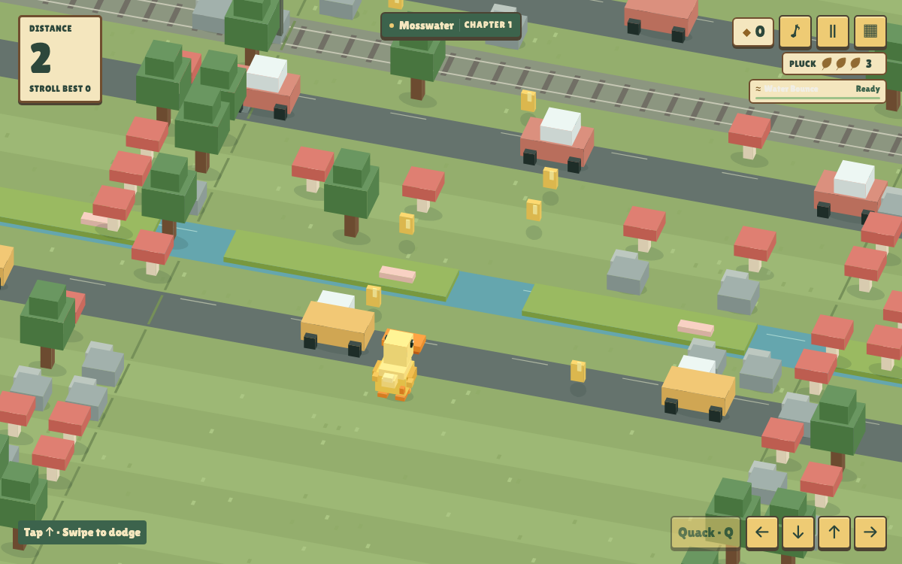
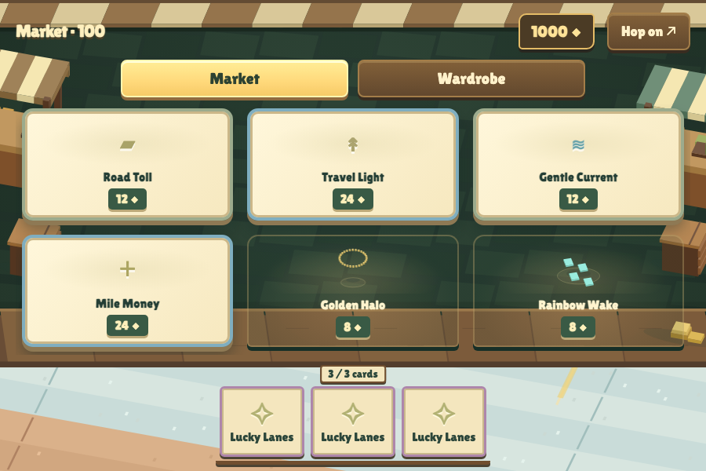
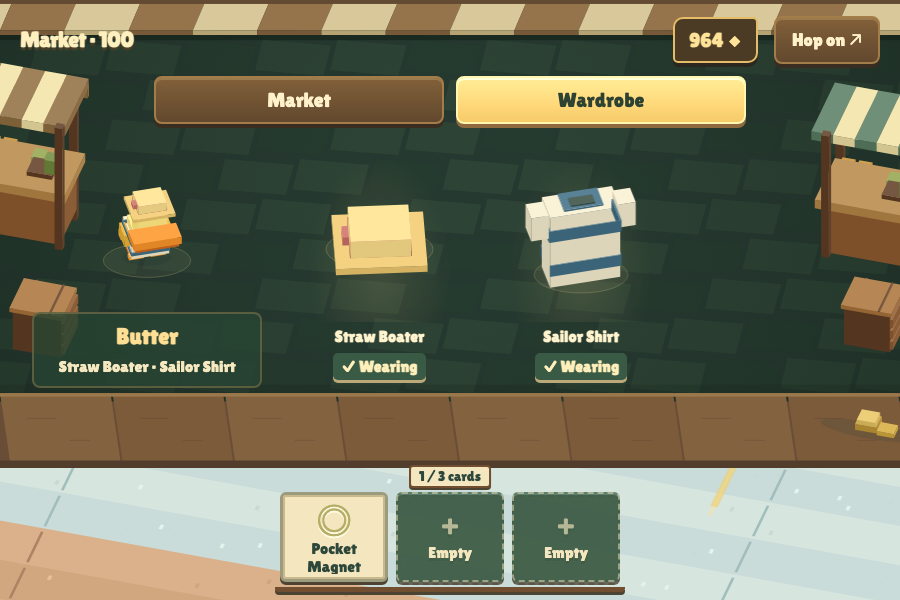

<div align="center">

# Down to Duck

A little duck. A very big adventure.

[](LICENSE)
[](package.json)
[](package.json)

</div>

Down to Duck is a voxel crossing game for solo play or two to four local players, built as a **napplet**: a self-contained game that runs inside a Nostr application's sandbox. Start as Butter the duck, dodge traffic, ride river platforms, and build a three-card hand while hopping through six changing worlds. Play together in Survive Together, take turns in Relay, or compete in Race.



## Quick start

Use **Node.js 22+**, **pnpm 10.8.0**, and the [Paja runtime (`kehto` CLI)](https://napplet.run/docs/guide/getting-started.html). From the project directory:

```sh
pnpm install --frozen-lockfile
pnpm dev
```

`pnpm dev` starts Vite and Paja on dynamically assigned available ports, then opens the printed **Paja Runtime URL** in your browser. Paja receives Vite's actual bound address, so other running projects and previews are left alone. Source changes retain Vite's development reload behavior. Stop both servers with Ctrl+C.

For the bare Vite server without the runtime, use `pnpm dev:app`. Saved progress, registered keyboard shortcuts, shared sound packs, and intents depend on the runtime.

To preview the self-contained development build instead:

```sh
pnpm build:dev
napplet paja -- pnpm preview:dev
```

Open the printed **Paja URL**. Rebuild after source changes, then reload the frame. No account or signer is needed to play.

## Play

| Action | Touch / mouse | Default shell shortcut |
| --- | --- | --- |
| Move | Tap to hop forward; swipe or use direction buttons | Arrows / WASD |
| Start, resume, or confirm | Primary action button | Enter |
| Pause | Pause button | P |
| Make your traveler call | Quack / call button | Q |
| Visit an available market | Market button | M |
| Back / close a menu | Back button | Escape |

The solo shortcuts above use the shell's optional **NAP-KEYS** support. Local Play also reads its keyboard profiles directly inside the focused game frame. Controllers use the shell's **NAP-GAMEPAD** adapter: stick/D-pad to move, A to confirm, X to call, Start to pause, Y for the collection, and LB for the market. See [controller support](docs/gamepad.md).

- **Arcade or Stroll.** Outrun a visible wave and progressively tougher pursuers, or explore with slower hazards and no chase. Each mode tracks its own best distance.
- **Pluck and traveler powers.** Start with three feathers. Rear car bumps cost one; side hits cost two. Recover half a feather every 100 new points. Automatic powers can avert matching hazards, then recharge over 100 new blocks.
- **Changing crossings.** Traffic gains mixed sizes, slow trucks, and accelerating sports cars. River platforms gain varied lengths and spacing as you progress.
- **A run-sized economy.** Shop every 100 points. Cards alter abilities, income, and hand capacity; hats and shirts dress the traveler. A small default coin pull keeps pickups reachable after river drift without snapping your hop grid. Higher-value bars and sacks reward careful collecting. Your wallet and market inventory last one run; lifetime records and traveler unlocks remain.
- **Reproducible courses.** Copy the seed after a run. It pins the generation version, starting world, mode, and gentle opening. Older seed versions remain supported; your timing and choices still affect play.
- **Interchangeable sound.** Pond and Pocket Arcade are bundled packs. Scene-aware engines, water, horns, character calls, and death sounds share separate music, ambience, and effects controls. Shared packs use the game's [NIP-51/NIP-94 profile](docs/sound-packs.md).

The game supports panes of **240×240 or larger**, with compact menu pages and a Less motion setting. Losing focus or shrinking the pane pauses play.

## Local multiplayer

Open **Local Play**, assign two to four players, and choose a different traveler for each. Mix supported controllers with keyboard profiles, or share one keyboard: Keyboard A defaults to **WASD / Q** and Keyboard B to **arrow keys / .** for movement and calls. The setup's keyboard editor checks for conflicting bindings. An idle connected controller does not join; an unassigned controller requests a place when used.

| Mode | How it plays |
| --- | --- |
| **Survive Together** | Share the course in Arcade or Flow (Stroll). Players can join or leave during the run, with personal health, wallets, and inventories. Revival items and flares help teammates return. |
| **Relay** | One active runner at a time, with a configurable leg length of **50 tiles** by default. The incoming runner confirms the handoff. Players can leave or reclaim their existing place; the roster closes when the run starts. |
| **Race** | Race to **500 tiles** within **180 active seconds** by default, with configurable settings. The leader drives the trailing fog, which plucks feathers from racers caught behind. Mud and Lantern consumables provide offensive and defensive options. The roster closes at the start. |

Each player has a personal revival that recharges after **250 new tiles**, separate from their traveler's automatic **100-block** power. The HUD identifies each traveler and their state; the Controls drawer keeps actions compact. Markets and hands show whose inventory is selected, and each mode ends with its own results. Controller loss follows the mode's recovery rules; losing frame focus remains a separate pause condition.

## Market and wardrobe

The catalog includes **55 cards and 28 cosmetics**. The Market fits six offers on one board: three cards across the top, a possible rare item or pack below left, and two cosmetics below right. Wardrobe gives your traveler and owned looks their own space. The persistent hand stays available across gameplay and menus, including selling cards during pack selection.

<table>
<tr>
<td></td>
<td></td>
</tr>
</table>

Packs can open with a full hand. Choose what to keep and replace, sell a card to make room, or skip the pack. The default limit is three cards; some cards change that capacity. [Market rules](docs/market.md) explain prices, pack choices, and inventory lifetime.

## Development and verification

The development **Dev** inspector can load a copied seed, jump to a score, add run coins, heal, and inspect live state. Mutated runs do not earn lifetime records. Production builds exclude both controls and diagnostic text. See [development tools](docs/development.md).

```sh
pnpm verify                         # Guidance checks, TypeScript, production build
pnpm exec playwright install chromium
pnpm test:conformance                # Built game in an opaque sandbox
```

Conformance reports skipped checks when manifest, wire, or lifecycle evidence is unavailable. Feature suites provide additional coverage:

| Command | Coverage |
| --- | --- |
| `pnpm test:game` | Movement, hazards, pickups, progress |
| `pnpm test:seeds` | Versioned generation and replay compatibility |
| `pnpm test:market` | Inventory, effects, capacity, cosmetics |
| `pnpm test:intents` | Built-game intent delivery, validation, lifecycle |
| `pnpm test:devtools-runtime` | Inspector behavior and production exclusion |
| `pnpm test:solo-parity` | Solo behavior compared with the immutable pre-multiplayer baseline |
| `pnpm test:local-session-model` | Shared world, player state, lifecycle, and keyboard/controller routing |
| `pnpm build && pnpm test:local-session-ui` | Built-game setup, input, ownership, audio, and responsive layouts |
| `pnpm test:survive-recovery` | Revival behavior and recharge boundaries |

More suites are listed in [package.json](package.json); [verification notes](docs/verification.md) record scenarios and limitations. Browser suites require Playwright's corresponding browser. Tests write generated evidence to `artifacts/`.

`pnpm build` produces a single **`dist/index.html`** with bundled scripts, styles, models, fonts, and default audio. Deployment metadata lives in `.napplet/config.json`; use `napplet deploy --dry-run` to inspect a deployment. Publish the production artifact only; `dist-dev` contains the inspector.

The local napplet config is ignored because it can contain signing credentials.
On a fresh checkout, copy [the public configuration example](.napplet/config.example.json)
to `.napplet/config.json`, then configure your signer locally through the Napplet CLI.
The example preserves the app metadata without any signing settings.

## Napplet integration

All shell capabilities are optional. Storage persists lifetime progress and preferences; theme and keys integrate the game with its host. Shared sound packs use outbox, resource, and common. The game works signed out, delegates network and durable storage to the shell, and publishes no events during play.

The display name is **Down to Duck**. The deployment identity remains `puddlehop` (Zapstore: `farm.sandwich.puddlehop`), and existing storage keys, shortcut IDs, and `puddlehop:*` sound-pack tags stay unchanged to preserve compatibility.

The **game** archetype advertises `napplet:game/open` with optional `seed` and `mode` parameters. A valid launch prepares a course without starting play or replacing an active run. This is the game's local payload contract; see [intent integration](docs/intents.md) for caller examples and validation rules.

## Project structure

```text
.
├── docs/                 # Gameplay rules, integration, and verification
├── src/
│   ├── fonts/            # Bundled lettering and font licenses
│   ├── levels/           # Versioned deterministic course generators
│   ├── market/           # Item definitions, inventory, and effects
│   ├── audio.ts          # Semantic cues and Web Audio mixer
│   ├── content.ts        # Travelers, world models, and palettes
│   ├── game.ts           # Simulation, movement, hazards, and scoring
│   ├── main.ts           # Run flow, controls, UI, and SDK integration
│   ├── mode-rules.ts     # Validated composable mode definitions
│   ├── race.ts           # Race clock, finish, fog, and lifecycle policy
│   ├── relay.ts          # Turn order, handoffs, and lifecycle policy
│   ├── render.ts         # Isometric voxel renderer
│   └── session.ts        # Shared world and individual local players
├── tests/                # Model tests and built-game browser scenarios
├── index.html            # Game surface
├── package.json          # Dependencies and commands
└── vite.config.ts        # Single-file build and napplet metadata
```

## Documentation

| Guide | Details |
| --- | --- |
| [Content authoring](docs/content-guide.md) | Add travelers and worlds |
| [Cards](docs/cards.md) · [Cosmetics](docs/cosmetics.md) | Expanded item catalog and effects |
| [Market](docs/market.md) · [Persistent hand](docs/persistent-hand.md) | Trading, packs, wardrobe, and sales |
| [Health](docs/health.md) · [Traveler powers](docs/character-powers.md) | Damage, recovery, and automatic rescues |
| [Actors](docs/actors.md) · [Mobs](docs/mobs.md) | Traffic, platforms, pursuit, and progression |
| [Seeds](docs/seeds.md) · [Intents](docs/intents.md) | Reproducible courses and external launch requests |
| [Sound packs](docs/sound-packs.md) · [Soundscape](docs/soundscape.md) | Asset mapping, scene audio, and mixing |
| [Development tools](docs/development.md) | Score jumps, state inspection, and sandbox isolation |
| [Mode authoring](docs/mode-rules.md) · [Controller support](docs/gamepad.md) | Composable policies, input transport, and device lifecycle |
| [Architecture boundaries](docs/boundaries.md) · [Context map](docs/context-map.md) | App/runtime responsibilities and contributor orientation |

## Contributing

Start with the relevant guide above and run the checks for the behavior you change. Preserve released seed generators when changing course generation, and keep debugging controls out of production. For agent-assisted work, read [AGENTS.md](AGENTS.md) and install the maintained workflow with `npx skills add napplet/napplet`.

## License and credits

Code is licensed under [MIT](LICENSE). Butter's recorded quack has separate attribution and licensing in [audio credits](docs/audio-credits.md); bundled fonts include their license files in [src/fonts/](src/fonts/). The crossing loop is inspired by Crossy Road.
