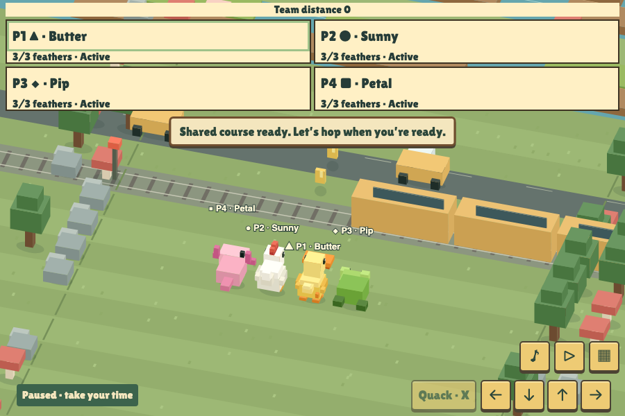

# Multiplayer release evidence

Release verification is in progress. This index contains completed conformance
and the first actual visual tracer; it does not claim the full visual matrix,
complete clause audit, final gate or open PR.

## Opaque-frame conformance

[Measured report](conformance.json): real official storage shim requests and
per-invocation response correlation; missing, mismatched, wrong-source and
duplicate response controls; scoped repeated teardown. The unsigned public
manifest field subset and exact normal artifact digest pass independently.
Installed legacy CLI:5 passed/5 unmeasured; supplement:6 passed/4 unmeasured.
No signature, publication or physical-device claim.

## Actual four-player tracer

[Source/build/image/geometry manifest](tracer.json) · [Terminal acquisition receipt](visual-tracer-20261018030008866.json)

The normal production HTML runs in an opaque iframe. Public seed intent,
Play/Pause/Local Play/Start controls and authorized controller snapshots reach
four distinct travelers on Flow rules. Read-only debugger observations measure
the actual rendered voxel bodies and packed nameplate/status envelopes against
visible DOM footprints, including material edges: inclusive8CSSpx clearance
passes. No world, actor or camera state is injected. The legitimate Pause action
holds the reached state. Storage/theme/keys are test-host fixtures; these images
do not claim physical controllers or target-shell persistence.

Full-size900×600 dark/reduced-motion image inspected2026-10-18:four distinct
models and identifying labels are visible; the team/seat status band, course,
notice and controls remain readable; no observed HUD concealment of characters.
This inspection is a technical review, separate from the user's already received
play-feel approval. It covers this one image only.

Run `node tools/release-coverage/evidence.mjs --check-tracer` to verify current
source hashes, normal artifact, exact image dimensions/digest, durable acquisition
receipt/output and recorded geometry. The complete `--check` contract still
requires all specified frames/themes/states; the tracer cannot satisfy it.

## Remaining proof

The six-frame/two-theme matrix, reduced-motion representatives, recovery/market/
items, Relay handoff/disconnect, Race fog/ties/DNF, mode-specific results, contact
sheets and complete51-original-clause/47-requirement audit remain to be acquired
or assembled. Final canonical verification and actual PR follow these checks.
